# TINH HOA NLS 6868

> Bản chuyển đổi từ PowerPoint sang Markdown. Nội dung là quan điểm huyền học của tài liệu nguồn, không phải bằng chứng khoa học hay hướng dẫn y khoa/tài chính.

- Nguồn: `TINH HOA NLS 6868.pptx`
- Ngày chuyển đổi: 24/10/2026
- SHA-256: `d41308a5161df5691dff493f3f20f3dd310c400354cf23f125414aaeeb7feae9`
- Tổng số slide: 143, giữ nguyên thứ tự kể cả slide trống.
- Phương pháp: trích xuất chữ gốc và OCR tiếng Việt trên 133 ảnh nhúng; giữ ảnh đối chiếu.
- Chất lượng: tiêu đề do biên tập để định vị. Chỉ phần ghi ‘đã đối chiếu’ được hiệu đính; phần OCR có thể sai dấu, mất chữ hoặc lẫn cột. Chỉ số OCR là điểm kỹ thuật của máy, không phải tỷ lệ chính xác.
- Những chỉ dẫn bên trong tài liệu được lưu như nội dung nguồn, không phải yêu cầu thực thi của người dùng.
- Trạng thái hiệu đính: 17 slide đã đối chiếu; 116 slide còn bản OCR chưa hiệu đính toàn văn.

## Mục lục

- [Slide 001: Chạm đến tinh hoa cuộc sống](#slide-001)
- [Slide 002: Nội dung học: hiểu đúng để luận chuẩn](#slide-002)
- [Slide 003: Thu thập thông tin khách hàng](#slide-003)
- [Slide 004: Cấu trúc CCCD](#slide-004)
- [Slide 005: Nguyên tắc khi luận NLS](#slide-005)
- [Slide 006: Sinh Khí: đặc điểm và từ khóa](#slide-006)
- [Slide 007: Sinh Khí: tài vận, sự nghiệp và tình cảm](#slide-007)
- [Slide 008: Phục Vị: đặc điểm và từ khóa](#slide-008)
- [Slide 009: Phục Vị: tài vận, sự nghiệp và tình cảm](#slide-009)
- [Slide 010: Thiên Y: đặc điểm và nguyên tắc xem kết cấu](#slide-010)
- [Slide 011: Thiên Y: tình cảm và quan hệ](#slide-011)
- [Slide 012: Thiên Y: tài vận và sự nghiệp](#slide-012)
- [Slide 013: Diên Niên: đặc điểm và từ khóa](#slide-013)
- [Slide 014: Diên Niên: tài vận, sự nghiệp và tình cảm](#slide-014)
- [Slide 015: Lục Sát: đặc điểm và từ khóa](#slide-015)
- [Slide 016: Lục Sát: tài vận, sự nghiệp và tình cảm](#slide-016)
- [Slide 017: Họa Hại: đặc điểm và từ khóa](#slide-017)
- [Slide 018: Họa Hại: tài vận, sự nghiệp và tình cảm](#slide-018)
- [Slide 019: Tuyệt Mệnh: đặc điểm và từ khóa](#slide-019)
- [Slide 020: Tuyệt Mệnh: tài vận, sự nghiệp và tình cảm](#slide-020)
- [Slide 021: Ngũ Quỷ: đặc điểm và từ khóa](#slide-021)
- [Slide 022: Ngũ Quỷ: tình cảm và sức khỏe](#slide-022)
- [Slide 023: Ngũ Quỷ: công việc và tài chính](#slide-023)
- [Slide 024: Ngũ Quỷ: học tập và huyền học](#slide-024)
- [Slide 025: Mối liên kết các từ trường NLS](#slide-025)
- [Slide 026: Số 0 và tính chất đặc biệt](#slide-026)
- [Slide 027: Số 5 và đặc tính](#slide-027)
- [Slide 028: Lưu ý về số 0 và số 5](#slide-028)
- [Slide 029: Sinh Khí kết hợp số 0](#slide-029)
- [Slide 030: Lục Sát kết hợp số 0](#slide-030)
- [Slide 031: Diên Niên kết hợp số 0](#slide-031)
- [Slide 032: Ngũ Quỷ kết hợp số 0](#slide-032)
- [Slide 033: Họa Hại kết hợp số 0](#slide-033)
- [Slide 034: Tuyệt Mệnh kết hợp số 0](#slide-034)
- [Slide 035: Thiên Y kết hợp số 0](#slide-035)
- [Slide 036: Quy trình luận số](#slide-036)
- [Slide 037: Câu hỏi khai thác thông tin](#slide-037)
- [Slide 038: Câu hỏi đối chiếu theo kết hợp từ trường](#slide-038)
- [Slide 039: Cách kết hợp số](#slide-039)
- [Slide 040: Cách kết hợp số (lặp lại)](#slide-040)
- [Slide 041: Nguyên tắc thiết kế kết cấu số](#slide-041)
- [Slide 042: Quan điểm ứng dụng số trong tài liệu](#slide-042)
- [Slide 043: Lợi ích học tập theo tài liệu](#slide-043)
- [Slide 044: Công cụ kết nối và thấu hiểu khách hàng](#slide-044)
- [Slide 045: Lý do học theo tài liệu](#slide-045)
- [Slide 046: Lưu ý khi xem và lựa chọn SIM](#slide-046)
- [Slide 047: Slide trống](#slide-047)
- [Slide 048: Bảng liên kết các từ trường (nhắc lại)](#slide-048)
- [Slide 049: Sơ đồ chuyển hóa Thiên Y](#slide-049)
- [Slide 050: Thiên Y + Thiên Y](#slide-050)
- [Slide 051: Thiên Y + Thiên Y (tiếp)](#slide-051)
- [Slide 052: Thiên Y + Sinh Khí](#slide-052)
- [Slide 053: Thiên Y + Sinh Khí (tiếp)](#slide-053)
- [Slide 054: Thiên Y + Diên Niên](#slide-054)
- [Slide 055: Thiên Y + Phục Vị](#slide-055)
- [Slide 056: Thiên Y + Họa Hại](#slide-056)
- [Slide 057: Thiên Y + Họa Hại (tiếp)](#slide-057)
- [Slide 058: Thiên Y + Lục Sát](#slide-058)
- [Slide 059: Thiên Y + Tuyệt Mệnh](#slide-059)
- [Slide 060: Thiên Y + Tuyệt Mệnh (tiếp)](#slide-060)
- [Slide 061: Thiên Y + Ngũ Quỷ](#slide-061)
- [Slide 062: Sơ đồ chuyển hóa Lục Sát](#slide-062)
- [Slide 063: Lục Sát + Sinh Khí](#slide-063)
- [Slide 064: Lục Sát + Sinh Khí (tiếp)](#slide-064)
- [Slide 065: Lục Sát + Thiên Y](#slide-065)
- [Slide 066: Lục Sát + Thiên Y (tiếp)](#slide-066)
- [Slide 067: Lục Sát + Diên Niên](#slide-067)
- [Slide 068: Lục Sát + Diên Niên (tiếp)](#slide-068)
- [Slide 069: Lục Sát + Phục Vị](#slide-069)
- [Slide 070: Lục Sát + Phục Vị (tiếp)](#slide-070)
- [Slide 071: Lục Sát + Họa Hại](#slide-071)
- [Slide 072: Lục Sát + Họa Hại (tiếp)](#slide-072)
- [Slide 073: Lục Sát + Lục Sát](#slide-073)
- [Slide 074: Lục Sát + Tuyệt Mệnh](#slide-074)
- [Slide 075: Lục Sát + Tuyệt Mệnh (tiếp)](#slide-075)
- [Slide 076: Lục Sát + Ngũ Quỷ](#slide-076)
- [Slide 077: Lục Sát + Ngũ Quỷ (tiếp)](#slide-077)
- [Slide 078: Sơ đồ chuyển hóa Tuyệt Mệnh](#slide-078)
- [Slide 079: Tuyệt Mệnh + Thiên Y](#slide-079)
- [Slide 080: Tuyệt Mệnh + Thiên Y (tiếp)](#slide-080)
- [Slide 081: Tuyệt Mệnh + Diên Niên](#slide-081)
- [Slide 082: Tuyệt Mệnh + Sinh Khí](#slide-082)
- [Slide 083: Tuyệt Mệnh + Phục Vị](#slide-083)
- [Slide 084: Tuyệt Mệnh + Họa Hại](#slide-084)
- [Slide 085: Tuyệt Mệnh + Ngũ Quỷ](#slide-085)
- [Slide 086: Tuyệt Mệnh + Tuyệt Mệnh](#slide-086)
- [Slide 087: Tuyệt Mệnh + Lục Sát](#slide-087)
- [Slide 088: Sơ đồ chuyển hóa Diên Niên](#slide-088)
- [Slide 089: Diên Niên + Sinh Khí](#slide-089)
- [Slide 090: Diên Niên + Thiên Y](#slide-090)
- [Slide 091: Diên Niên + Diên Niên](#slide-091)
- [Slide 092: Diên Niên + Phục Vị](#slide-092)
- [Slide 093: Diên Niên + Họa Hại](#slide-093)
- [Slide 094: Diên Niên + Họa Hại (tiếp)](#slide-094)
- [Slide 095: Diên Niên + Lục Sát](#slide-095)
- [Slide 096: Diên Niên + Tuyệt Mệnh](#slide-096)
- [Slide 097: Diên Niên + Ngũ Quỷ](#slide-097)
- [Slide 098: Sơ đồ chuyển hóa Họa Hại](#slide-098)
- [Slide 099: Họa Hại + Thiên Y](#slide-099)
- [Slide 100: Họa Hại + Thiên Y (tiếp)](#slide-100)
- [Slide 101: Họa Hại + Sinh Khí](#slide-101)
- [Slide 102: Họa Hại + Sinh Khí (tiếp)](#slide-102)
- [Slide 103: Họa Hại + Diên Niên](#slide-103)
- [Slide 104: Họa Hại + Diên Niên (tiếp)](#slide-104)
- [Slide 105: Họa Hại + Diên Niên (tiếp)](#slide-105)
- [Slide 106: Họa Hại + Phục Vị](#slide-106)
- [Slide 107: Họa Hại + Phục Vị (tiếp)](#slide-107)
- [Slide 108: Họa Hại + Phục Vị (tiếp)](#slide-108)
- [Slide 109: Họa Hại + Họa Hại](#slide-109)
- [Slide 110: Họa Hại + Họa Hại (tiếp)](#slide-110)
- [Slide 111: Họa Hại + Lục Sát](#slide-111)
- [Slide 112: Họa Hại + Lục Sát (tiếp)](#slide-112)
- [Slide 113: Họa Hại + Tuyệt Mệnh](#slide-113)
- [Slide 114: Họa Hại + Tuyệt Mệnh (tiếp)](#slide-114)
- [Slide 115: Họa Hại + Ngũ Quỷ](#slide-115)
- [Slide 116: Họa Hại + Ngũ Quỷ (tiếp)](#slide-116)
- [Slide 117: Sơ đồ chuyển hóa Ngũ Quỷ (chữ gốc)](#slide-117)
- [Slide 118: Sơ đồ chuyển hóa Sinh Khí](#slide-118)
- [Slide 119: Sinh Khí + Thiên Y](#slide-119)
- [Slide 120: Sinh Khí + Thiên Y (tiếp)](#slide-120)
- [Slide 121: Sinh Khí + Sinh Khí](#slide-121)
- [Slide 122: Sinh Khí + Sinh Khí (tiếp)](#slide-122)
- [Slide 123: Sinh Khí + Diên Niên](#slide-123)
- [Slide 124: Sinh Khí + Diên Niên (tiếp)](#slide-124)
- [Slide 125: Sinh Khí + Phục Vị](#slide-125)
- [Slide 126: Sinh Khí + Phục Vị (tiếp)](#slide-126)
- [Slide 127: Sinh Khí + Họa Hại](#slide-127)
- [Slide 128: Sinh Khí + Họa Hại (tiếp)](#slide-128)
- [Slide 129: Sinh Khí + Lục Sát](#slide-129)
- [Slide 130: Sinh Khí + Lục Sát (tiếp)](#slide-130)
- [Slide 131: Sinh Khí + Tuyệt Mệnh](#slide-131)
- [Slide 132: Sinh Khí + Tuyệt Mệnh (tiếp)](#slide-132)
- [Slide 133: Sinh Khí + Ngũ Quỷ](#slide-133)
- [Slide 134: Sinh Khí + Ngũ Quỷ (tiếp)](#slide-134)
- [Slide 135: Sơ đồ chuyển hóa Ngũ Quỷ (nhắc lại)](#slide-135)
- [Slide 136: Slide trống](#slide-136)
- [Slide 137: Slide trống](#slide-137)
- [Slide 138: Slide trống](#slide-138)
- [Slide 139: Slide trống](#slide-139)
- [Slide 140: Slide trống](#slide-140)
- [Slide 141: Slide trống](#slide-141)
- [Slide 142: Slide trống](#slide-142)
- [Slide 143: Slide trống](#slide-143)

## Bản chuyển đổi theo slide

<a id="slide-001"></a>

### Slide 001: Chạm đến tinh hoa cuộc sống

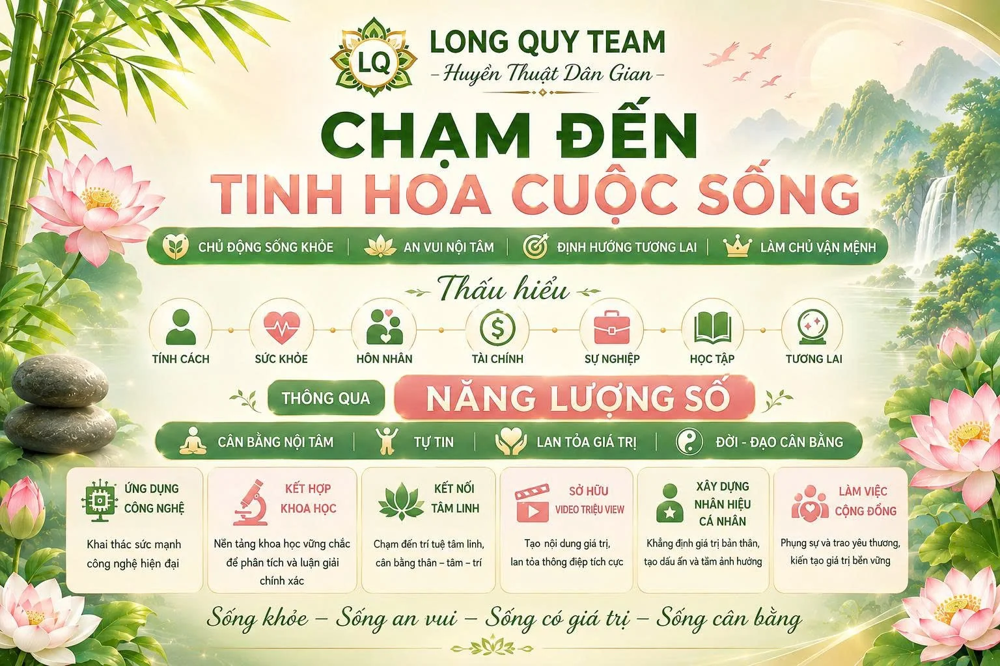

**Bản chép đã đối chiếu với ảnh nguồn:**

LONG QUY TEAM – Huyền Thuật Dân Gian

CHẠM ĐẾN TINH HOA CUỘC SỐNG

Chủ động sống khỏe. An vui nội tâm. Định hướng tương lai. Làm chủ vận mệnh.

Thấu hiểu tính cách, sức khỏe, hôn nhân, tài chính, sự nghiệp, học tập, tương lai thông qua Năng lượng số.

Cân bằng nội tâm. Tự tin. Lan tỏa giá trị. Đời – đạo cân bằng.

Ứng dụng công nghệ: khai thác sức mạnh công nghệ hiện đại.
Kết hợp khoa học: nền tảng khoa học vững chắc để phân tích và luận giải chính xác.
Kết nối tâm linh: chạm đến trí tuệ tâm linh, cân bằng thân – tâm – trí.
Sở hữu video triệu view: tạo nội dung giá trị, lan tỏa thông điệp tích cực.
Xây dựng nhân hiệu cá nhân: khẳng định giá trị bản thân, tạo dấu ấn và tầm ảnh hưởng.
Làm việc cộng đồng: phụng sự và trao yêu thương, kiến tạo giá trị bền vững.

Sống khỏe – Sống an vui – Sống có giá trị – Sống cân bằng.

<a id="slide-002"></a>

### Slide 002: Nội dung học: hiểu đúng để luận chuẩn

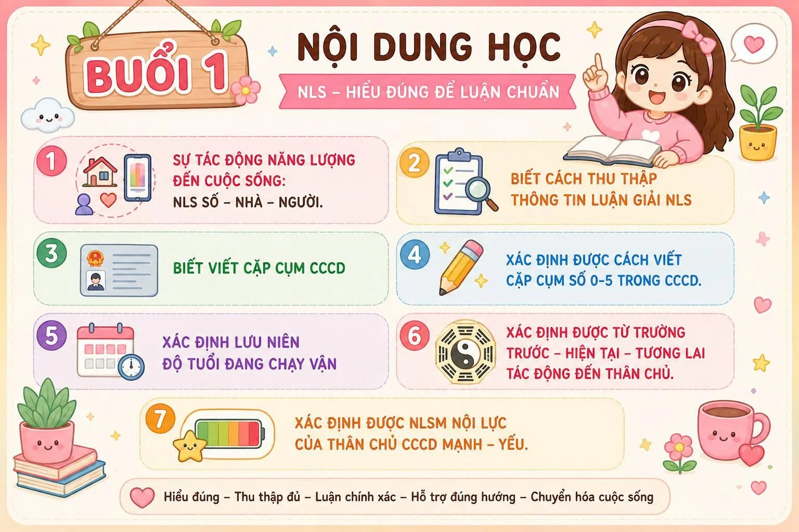

**Bản chép đã đối chiếu với ảnh nguồn:**

BUỔI 1 – NỘI DUNG HỌC

NLS – HIỂU ĐÚNG ĐỂ LUẬN CHUẨN

1. Sự tác động năng lượng đến cuộc sống: NLS SỐ – NHÀ – NGƯỜI.

2. Biết cách thu thập thông tin luận giải NLS.

3. Biết viết cặp cụm CCCD.

4. Xác định được cách viết cặp cụm số 0–5 trong CCCD.

5. Xác định lưu niên, độ tuổi đang chạy vận.

6. Xác định được từ trường trước – hiện tại – tương lai tác động đến thân chủ.

7. Xác định được NLSM nội lực của thân chủ CCCD mạnh – yếu.

Hiểu đúng – Thu thập đủ – Luận chính xác – Hỗ trợ đúng hướng – Chuyển hóa cuộc sống.

<a id="slide-003"></a>

### Slide 003: Thu thập thông tin khách hàng

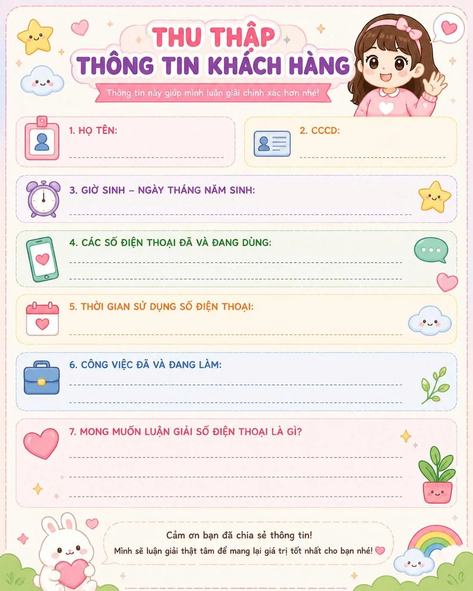

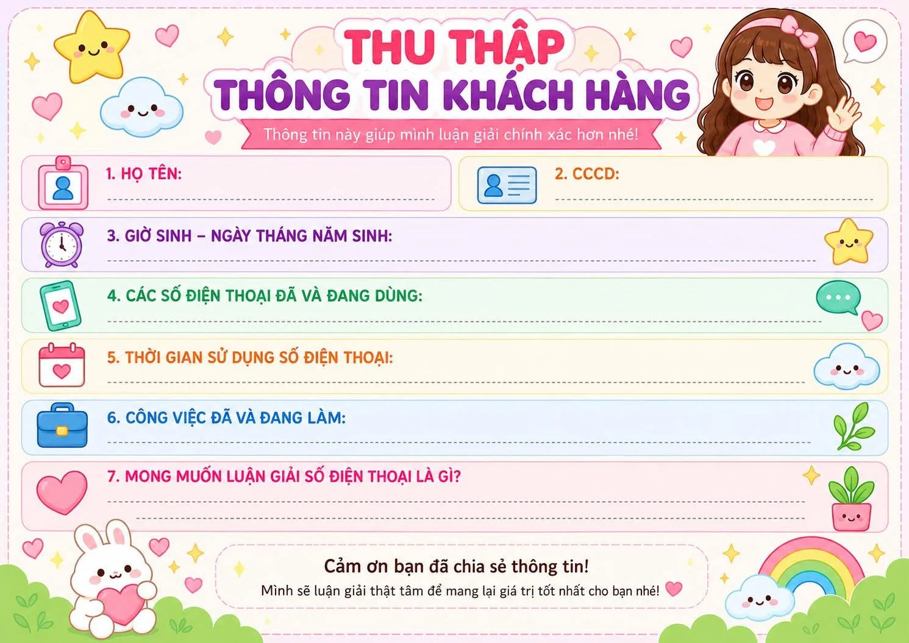

**Bản OCR chưa hiệu đính toàn văn** (điểm OCR: 65):

```text
S4) 3 “.THUTHẬP.' #SðÀ”
| á 7 VY |
| + ì ^ s - _m
| $ \ Ị
| 2 'THÔNG TIN KHÁCH HANG Ï
Ị °.° b- Ị
| 4.
|
| [3] 1. HỌ TÊN: 2. CCCD: |
[
Ï
3. GIỜ SINH - NGÀY THÁNG NĂM SINH: % |
\ |
J |
-_
[ @ 4. CÁC SỐ ĐIỆN THOẠI ĐÃ VÀ ĐANG DÙNG: -.] |
5. THỜI GIAN SỬ DỤNG SỐ ĐIỆN THOẠI: |
S “|
—— ĩ 8 W“"“é= HH]
&3 6. CÔNG VIỆC ĐÃ VÀ ĐANG LÀM: ìỊ
›⁄ -
c 7. MONG MUỐN LUẬN GIẢI SỐ ĐIỆN THOẠI LÀ GÌ? $ |
L TW n  A O  m m X 4 |
|
|
9 : :
$ Cảm ơn bạn đã chia sẻ thông tin!
°... Mình sẽ luận giải thật tâm để mang lại giá trị tốt nhất cho bạn nhé! ©?
. ng

| nơ] + +/⁄ + KHI (®)
. „““ THU THẬP ` s đ#È
| + í( .] # À = \ ( ‡
9 _> THONG TIN KHÁCH H NG. , |
ca 5 SA
Ị = —.
| 1. HỌ TÊN: Í (a=] 2. cCCD:
liry _ |
\ Í Ø5. GIỜ SINH - NGÀY THÁNG NĂM SINH: s«
E3 +sesxm-eymeeme -l>”  -T/ đụ
| @ 4. CÁC SỐ ĐIỆN THOẠI ĐÃ VÀ ĐANG DÙNG: @®
| (S) 5. THỜI GIAN SỬ DỤNG SỐ ĐIỆN THOẠI: “o
mm 6. CÔNG VIỆC ĐÃ VÀ ĐANG LÀM: mi ' . vớ
| c2 7. MONG MUỐN LUẬN GIẢI SỐ ĐIỆN THOẠI LÀ GÌ? + w
| 9
$, $ Cảm ơn bạn đã chia sẻ thông tin! bá †
.@e 9 Mình sẽ luận giải thật tâm để mang lại giá trị tốt nhất cho bạn nhé! ©? nu
⁄i s
. ÿ  .
```

<a id="slide-004"></a>

### Slide 004: Cấu trúc CCCD

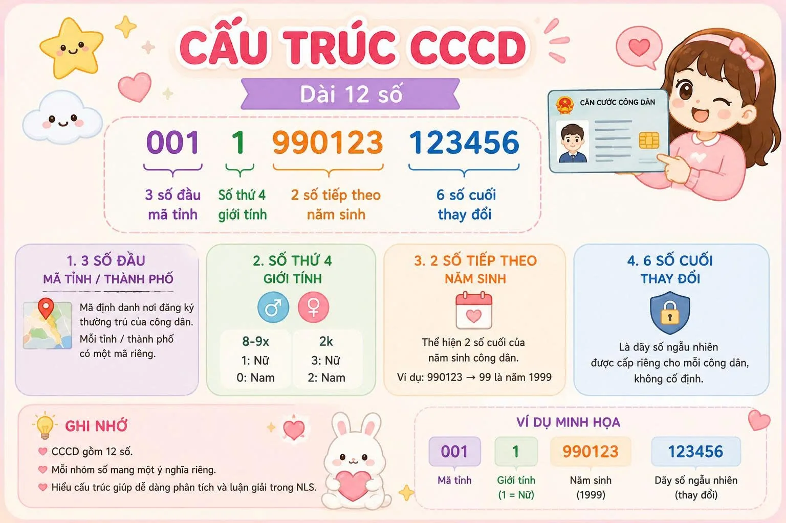

**Bản chép đã đối chiếu với ảnh nguồn:**

CẤU TRÚC CCCD

Dài 12 số

Ví dụ trên slide: 001 1 990123 123456 — 3 số đầu: mã tỉnh; số thứ 4: giới tính; 2 số tiếp theo: năm sinh; 6 số cuối: thay đổi.

#### 1. 3 số đầu – Mã tỉnh / thành phố

Mã định danh nơi đăng ký thường trú của công dân. Mỗi tỉnh / thành phố có một mã riêng.

#### 2. Số thứ 4 – Giới tính

8-9x: 1: Nữ; 0: Nam.

2k: 3: Nữ; 2: Nam.

#### 3. 2 số tiếp theo – Năm sinh

Thể hiện 2 số cuối của năm sinh công dân. Ví dụ: 990123 → 99 là năm 1999.

#### 4. 6 số cuối – Thay đổi

Là dãy số ngẫu nhiên được cấp riêng cho mỗi công dân, không cố định.

#### Ghi nhớ

- CCCD gồm 12 số.
- Mỗi nhóm số mang một ý nghĩa riêng.
- Hiểu cấu trúc giúp dễ dàng phân tích và luận giải trong NLS.

#### Ví dụ minh họa

001 (Mã tỉnh) – 1 (Giới tính, 1 = Nữ) – 990123 (Năm sinh, 1999) – 123456 (Dãy số ngẫu nhiên, thay đổi).

<a id="slide-005"></a>

### Slide 005: Nguyên tắc khi luận NLS

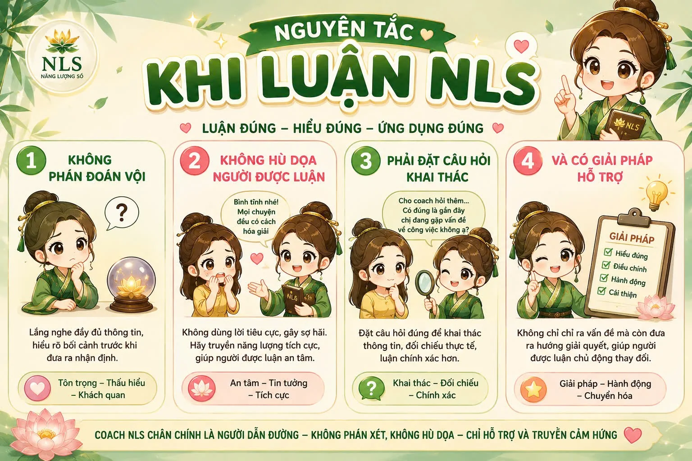

**Bản chép đã đối chiếu với ảnh nguồn:**

NGUYÊN TẮC KHI LUẬN NLS

LUẬN ĐÚNG – HIỂU ĐÚNG – ỨNG DỤNG ĐÚNG

#### 1. Không phán đoán vội

Lắng nghe đầy đủ thông tin, hiểu rõ bối cảnh trước khi đưa ra nhận định.

Tôn trọng – Thấu hiểu – Khách quan.

#### 2. Không hù dọa người được luận

Bình tĩnh nhé! Mọi chuyện đều có cách hóa giải.

Không dùng lời tiêu cực, gây sợ hãi. Hãy truyền năng lượng tích cực, giúp người được luận an tâm.

An tâm – Tin tưởng – Tích cực.

#### 3. Phải đặt câu hỏi khai thác

Cho coach hỏi thêm... Có đúng là gần đây chị đang gặp vấn đề về công việc không ạ?

Đặt câu hỏi đúng để khai thác thông tin, đối chiếu thực tế, luận chính xác hơn.

Khai thác – Đối chiếu – Chính xác.

#### 4. Và có giải pháp hỗ trợ

Giải pháp: Hiểu đúng. Điều chỉnh. Hành động. Cải thiện.

Không chỉ chỉ ra vấn đề mà còn đưa ra hướng giải quyết, giúp người được luận chủ động thay đổi.

Giải pháp – Hành động – Chuyển hóa.

COACH NLS CHÂN CHÍNH LÀ NGƯỜI DẪN ĐƯỜNG – KHÔNG PHÁN XÉT, KHÔNG HÙ DỌA – CHỈ HỖ TRỢ VÀ TRUYỀN CẢM HỨNG.

<a id="slide-006"></a>

### Slide 006: Sinh Khí: đặc điểm và từ khóa

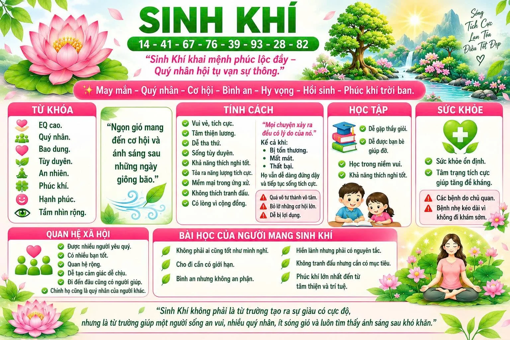

**Bản chép đã đối chiếu với ảnh nguồn:**

SINH KHÍ

14 – 41 – 67 – 76 – 39 – 93 – 28 – 82

Sinh Khí khai mệnh phúc lộc đầy – Quý nhân hội tụ vạn sự thông.

May mắn – Quý nhân – Cơ hội – Bình an – Hy vọng – Hồi sinh – Phúc khí trời ban.

#### Từ khóa

EQ cao. Quý nhân. Bao dung. Tùy duyên. An nhiên. Phúc khí. Hạnh phúc. Tầm nhìn rộng.

Ngọn gió mang đến cơ hội và ánh sáng sau những ngày giông bão.

#### Tính cách

Vui vẻ, tích cực. Tâm thiện lương. Dễ tha thứ. Sống tùy duyên. Khả năng thích nghi tốt. Tỏa ra năng lượng tích cực. Mềm mại trong ứng xử. Không thích tranh đấu. Có lòng vì cộng đồng.

Mọi chuyện xảy ra đều có lý do của nó. Kể cả khi bị tổn thương, mất mát, thất bại, họ vẫn dễ dàng đứng dậy và tiếp tục sống tích cực.

Lưu ý: Quá vô tư thành vô tâm. Bỏ lỡ những cơ hội lớn. Dễ bị lợi dụng.

#### Học tập

Dễ gặp thầy giỏi. Dễ được bạn bè giúp đỡ. Học trong niềm vui. Khả năng thích nghi tốt.

#### Sức khỏe (phát biểu của tài liệu nguồn)

Sức khỏe ổn định. Tâm trạng tích cực giúp tăng đề kháng. Các bệnh do chủ quan. Bệnh nhẹ kéo dài vì không đi khám sớm.

#### Quan hệ xã hội

Được nhiều người yêu quý. Có nhiều bạn tốt. Quan hệ rộng. Dễ tạo cảm giác dễ chịu. Đi đến đâu cũng có người giúp. Chính họ cũng là quý nhân của người khác.

#### Bài học của người mang Sinh Khí

Không phải ai cũng tốt như mình nghĩ. Cho đi cần có giới hạn. Bình an nhưng không an phận. Hiền lành nhưng phải có nguyên tắc. Không tranh đấu nhưng cần có mục tiêu. Phúc khí lớn nhất đến từ tâm thiện và trí tuệ.

Sinh Khí không phải là từ trường tạo ra sự giàu có cực độ, nhưng là từ trường giúp một người sống an vui, nhiều quý nhân, ít sóng gió và luôn tìm thấy ánh sáng sau khó khăn.

<a id="slide-007"></a>

### Slide 007: Sinh Khí: tài vận, sự nghiệp và tình cảm

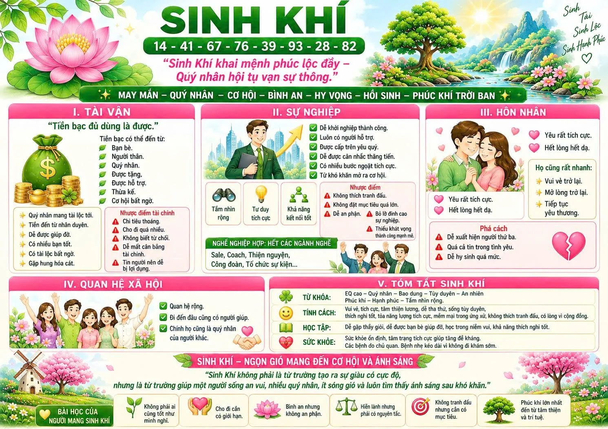

**Bản OCR chưa hiệu đính toàn văn** (điểm OCR: 63):

```text
& ch. Ah `.
4 j z ch c
L 09g. ` 12, ĐẦM .-. >
14-41-67-76-39-93-28-82 2.
ì S "| 1Ø S
À 64 uy) Ú Ưng
k « Rê-) A ` và ` -
(Ca =>] : NA  G mu Di A;
«#œ ỳ S14 Xa  NGG  se - ."<< ng ~c 4
—— r MAYMẮN - QUÝ NHÂN - CƠ HỘI - BÌNH AN - HY VỌNG - HỒI SINH - PHÚC KHÍ TRỜI BAN '‡; - PS Z SH)
“Tiền bạc đủ dùng là được.” @Œ Dễ khởi nghiệp thành công. —
<# Tiên bạc có thể đến từ: T, 3 (Ê3 Luôn có người hỗ trợ. . Yêu rất tích cực.
_ Ø Bạnbè. FA L| À, goenseenyeeb xà Hết lòng hốt dạ,
4Áñ4\ Ø Người thân. ‡ 71 Ểề Dễ được cân nhấc thăng tiến. SỐ XvÁ

Ễ \ #Ø Quý nhân. km Có nhiều bước ngoặt tích cực. j Y. Họ cũng rất nhanh:

Í Ø Được tặng, Từ khó khăn mở ra cơ hội. iu L “  n
=.. è = Ø Được hỗ trợ. —a Ầ 4 sà Vui vẻ trở lại.
_. qun, . Nhược điểm ú x x, _ -.
= G Ø Thùa kế... @ sẽ Không thích tranh đấu. ãế/KEtIh Mở lòng trở lại.
SN 22/2952 Ø Cơhội bất ngờ. ưng Ti x= Không đặt mục tiêu quá lớn. l nà m sn Tiếp tục

Quý nhân mang tài lộc tới. Nhược điểm tài chính Tế và . s Dễ an phận. .A, Bỏ lở đính cao letlòng hốt dại yêu thương.
Hê En can N Chỉ tiêu thoáng. Ễ ng mai sự nghiệp.
Tiền đến từ nhân duyên. Ễ n Phá các
Š : Cho đi quá nhiều. Thiếu khát vọng ... Phá cách
Dễ được giúp đỡ. Không biết từ chối. => HH s thình công nghhnê, .A. Dễ xuất hiện người thứ ba.
Có nhiều bạn tốt. Dễ mất cân bằng =” œ% Quá cả tin trong tình yêu.
0ó tài lộc bất ngờ. ti chim Sale, Coach, Thiện nguyện, CA .A. Dễ hy sinh quá mức.
Gặp hung hóa cát. Trngmisin di Công đoàn, Tổ chức sự kiện... vở =- 2¬
ù „..... EQ cao - Quý nhân - Bao dung ~ Tùy duyên - An nhiên
T^ | œ TỪ KHÓA: phúc khí - Hạnh phúc - Tẩm nhìn rộng.
^ La Bì SG Quan hệ rộng. ¬ n ÁCH. Vui về, tích cực, tâm thiện lương, dễ tha thứ, sống tùy duyên,
Ni và BA ⁄ ( Đi đến đâu cũng có người giúp. %2 TÍNH CÁCH: ` ích nghị tốt, tỏa năng lượng tich cực, mềm mại trong ứng xử, không thích tranh đầu, có lòng vì cộng đồng.

. Ầ N § ý Chính họ cũng là quý nhân (43] HỌC TẬP: Dễ gặp thầy giỏi, dễ được bạn bè giúp đỡ, học trong niềm vui, khả năng thích nghỉ tốt.

NI: ¿ 0 ng: ni - 7 :

kè xen ả của người khác. lề " „. Sức khỏe ổn định, tâm trạng tích cực giúp tăng để kháng.
S bị la ÂU 1 25 SỨC KHỎE: Các bệnh do chủ quan. Bệnh nhẹ kéo dài vì không đi khám sớm.
/ s Na . “Sinh Khí không phải là từ trường tạo ra sự giàu có cực độ, N,

SN & về. è nhưng là từ trường giúp một người sống an vui, nhiều quý nhân, ít sóng gió và luôn tìm thấy ánh sáng sau khó khăn.”

na. - hưng là từ trườn, t người h hân, ít luôn tìm thấy ánh khó kh Nền Ma G]
mè. 8 ba nà ^“:2 2G
Ga <ex un  nI N N J : cm 224 Không tranh dấu 5 Phúc khí lớn nhất sự

¬ ñ h Không phải ai "„ . Bình an nhưng Hiền lành nhưng C) ewc vi nh ¬

Ù BÀI HỌC CỦA So: ` 1 ù không an hà ác ÁN) nhưng cân có đếntừtâmthiện
ˆ ¿ hh bông an phận. phẩcónguyentác Z Š HH

N2 9e MANG SINH KHÍ mình nghĩ. ghe, | GQNBSP mục tiêu và trí tuệ.
```

<a id="slide-008"></a>

### Slide 008: Phục Vị: đặc điểm và từ khóa

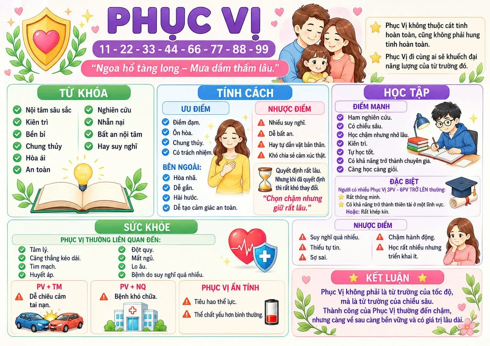

**Bản chép đã đối chiếu với ảnh nguồn:**

PHỤC VỊ

11 – 22 – 33 – 44 – 66 – 77 – 88 – 99

Ngọa hổ tàng long – Mưa dầm thấm lâu.

Phục Vị không thuộc cát tinh hoàn toàn, cũng không phải hung tinh hoàn toàn. Phục Vị đi cùng ai sẽ khuếch đại năng lượng của từ trường đó.

#### Từ khóa

Nội tâm sâu sắc. Kiên trì. Bền bỉ. Chung thủy. Hòa ái. An toàn. Nghiên cứu. Nhẫn nại. Bất an nội tâm. Hay suy nghĩ.

#### Tính cách

Ưu điểm: Điềm đạm. Ôn hòa. Chung thủy. Có trách nhiệm. Bên ngoài hòa nhã, dễ gần, hài hước, dễ tạo cảm giác an toàn.

Nhược điểm: Nhiều suy nghĩ. Dễ bất an. Hay tự dằn vặt bản thân. Khó chia sẻ cảm xúc thật. Quyết định rất lâu nhưng khi đã quyết định thì rất khó thay đổi. Chọn chậm nhưng giữ rất lâu.

#### Học tập

Điểm mạnh: Ham nghiên cứu. Có chiều sâu. Học chậm nhưng nhớ lâu. Kiên trì. Tự học tốt. Có khả năng trở thành chuyên gia. Càng học càng giỏi.

Đặc biệt: Người có nhiều Phục Vị 3PV–6PV trở lên thường rất thông minh, có khả năng trở thành thiên tài ở một lĩnh vực, hoặc rất khép kín.

Nhược điểm: Suy nghĩ quá nhiều. Thiếu tự tin. Sợ sai. Chậm hành động. Học rất nhiều nhưng triển khai ít.

#### Sức khỏe (phát biểu của tài liệu nguồn)

Phục Vị thường liên quan đến: Tâm lý. Căng thẳng kéo dài. Tim mạch. Huyết áp. Đột quỵ. Mất ngủ. Lo âu. Bệnh do suy nghĩ quá nhiều.

PV + TM: Dễ chiêu cảm tai nạn. PV + NQ: Bệnh khó chữa. Phục Vị ẩn tính: Tiêu hao thể lực, thể chất yếu hơn bình thường.

#### Kết luận

Phục Vị không phải là từ trường của tốc độ, mà là từ trường của chiều sâu. Thành công của Phục Vị thường đến chậm, nhưng càng về sau càng bền vững và có giá trị lâu dài.

<a id="slide-009"></a>

### Slide 009: Phục Vị: tài vận, sự nghiệp và tình cảm

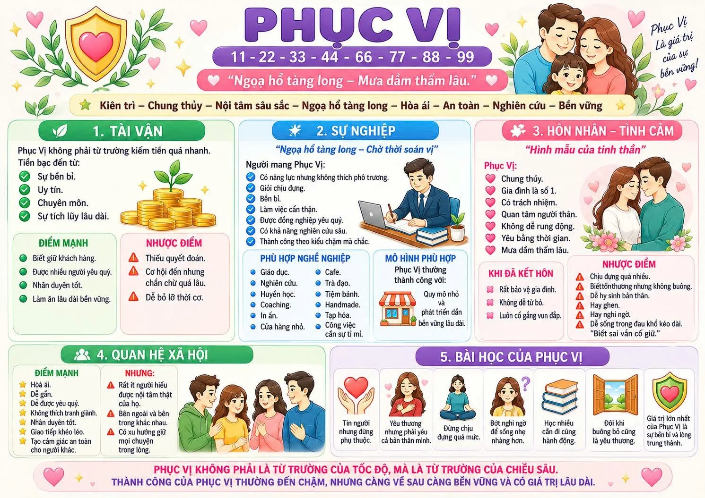

**Bản OCR chưa hiệu đính toàn văn** (điểm OCR: 65):

```text
Ũ ; v :
vờ S v. ÿ ¿”
Bà “ - « 4 . là gỡ "
11-22-33-44- 66 - 77-88 - 99 { của Số
VÀ lá ) vững
† œ*m TE 75609 .
+ ~— + %9 “Ngoạ hổ tàng long - Mưa dâm thẩm lâu.” ® ) M”. .e
wếz Tt Kiên trì - Chung thủy — Nội tâm sâu sắc — Ngọa hổ tàng long — Hòa ái — An toàn - Nghiên cứu —Bềnvững. ›- j
— ˆ ˆ —Y{YOc N — F —55é. ( Z4 ~ ˆ 2
4 1. TẠI VẬN | 2 2. SƯ NGHIỆP | 3. HÔN NHÂN ~ TÌNH CẮM
Phục Vị không phải từ trường kiếm tiền quá nhanh. | “Ngọạ hồ tàng long - Chờ thời soán vị” “Hình mẫu của tinh thần”
Tiền bạc đến từ: Người mang Phục Vị: Phục Vị: NI
@ Sựbên bỉ. '@ Gó năng lực nhưng không thích phô trương. r Chung thủy. ;
@ uyt. ‡ + Giải chi đựng. c4  Giađinh là số 1. $ j ®
| An 9524 tavế Qusamm 42
@ Sytích lũy lau dài. @ Đscdôngnhiepyua,r| UP HẠ 4 4 2 sẽ nhi
@ Có khả năng nghiên cứu sâu. cm L5 hông cô rung động: N ẤN.
ĐIỂM MẠNH NHƯỢC ĐIỂM '@ Thành công theo kiểu chậm mà chắc. —= 4 Yêu n un gian xà HN c
: 3 - - : Mưa dầm thẩm lâu. - lo
® biết giữ khách hàng. AÀ Thiếu quyết đoán. PHÙ HỢP NGHỀ NGHIỆP MÔ HÌNH PHÙ HỢP NHƯỢC ĐIỂM
@ Đượcnhiểungườiyêuquý. ZÀ Cơ hội đến nhưng ® Giáo dục. ® Cafe. Phục Vị thường KHIĐÃKẾTHÔN  A chị dựngquả thiêu
@ Nhân duyên tốt. chần chừ quá lâu. ® Nghiêncứu. ® Trà đạo. thành công với: || & Biếtnthương nhưng không buông.
ni HH ễ bỏ lỡ thời cơ. ® Huyểnhọc. ® Tiệm bánh. Quy mô nhỏ tho SO NA ng, nh bản thân.
@ Lànănludibónving  À Dễ bỏ l thời cơ @ Ooaching ® Handmade. . #8 Không dễtừ bồ, Ai Hay ghen.
® Inấn. ® Tạp hóa. pháttiểndển sợ Luậncốgắngvundấp. đÀ Hay nghỉ ngờ.
@ Củahàngnhỏ, @ Côngviệc bên vững lâu dài. , Dễ sống trong đau khổ kéo dài.
cần sự tỉ mỉ. “Biết sai vẫn cố giữ.”
n —%ặ - z
xš‹ 4. QUAN HỆ XÃ HỘI 5. BÀI HỌC CỦA PHỤC VỊ
ĐIỂM MẠNH NHƯNG:
Ý Hà. AA. Rất ít người hiểu Go : & ®' 2
® Dễgkn. được nội tâm thật  - T e ; N ⁄J 4 4 $
'#z Dễ được yêu quý. của họ. Ñ ( Ắ 2
ý Khôngthchtraphgiành A Bênngoàivàbên ZZA 4 >7 >⁄ => hôn Giá trị lớn nhất
Sở, Nhân duyên tốt. trongkhcme, (NA CÁ w / Tìnngười  Yêuthương mschii B9tnghingờ Học nhiều 08k - là
# Giaotipkhéoléo Có xuhướnggiữ le JVỤ CÌ nhưngdừng nhưngphiiyếu  Đừngchh đẻsốngnhẹ  cảnđicïng buông bỏ cũng - chê bô ng
'>, Tạo cảm giác an toàn mọi chuyện ..Z phụthuộc. cảbảnthânmình. đVnEQUẾPỨC nhànghơn  hànhđộng  làyêuthương.  trugthành.
cho người khác. trong lỏng. >) L
la PHỤC VỊ KHÔNG PHẢI LÀ TỪ TRƯỜNG CỦA TỐC ĐỘ, MÀ LÀ TỪ TRƯỜNG CỦA CHIỀU SÂU. ?
hổ THÀNH CÔNG CỦA PHỤC VỊ THƯỜNG ĐẾN CHẬM, NHƯNG CÀNG VỀ SAU CÀNG BỀN VỮNG VÀ CÓ GIÁ TRỊ LÂU DÀI. +
```

<a id="slide-010"></a>

### Slide 010: Thiên Y: đặc điểm và nguyên tắc xem kết cấu

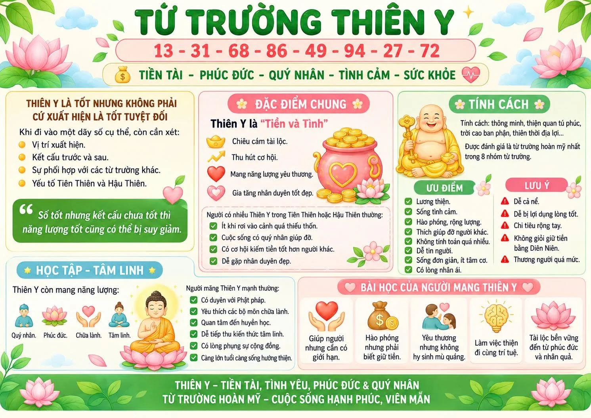

**Bản chép đã đối chiếu với ảnh nguồn:**

TỪ TRƯỜNG THIÊN Y

13 – 31 – 68 – 86 – 49 – 94 – 27 – 72

Tiền tài – Phúc đức – Quý nhân – Tình cảm – Sức khỏe.

#### Thiên Y là tốt nhưng không phải cứ xuất hiện là tốt tuyệt đối

Khi đi vào một dãy số cụ thể, còn cần xét: Vị trí xuất hiện. Kết cấu trước và sau. Sự phối hợp với các từ trường khác. Yếu tố Tiên Thiên và Hậu Thiên.

Số tốt nhưng kết cấu chưa tốt thì năng lượng tốt cũng có thể bị suy giảm.

#### Đặc điểm chung

Thiên Y là Tiền và Tình. Chiêu cảm tài lộc. Thu hút cơ hội. Mang năng lượng yêu thương. Gia tăng nhân duyên tốt đẹp.

Người có nhiều Thiên Y trong Tiên Thiên hoặc Hậu Thiên thường: Ít khi rơi vào cảnh quá thiếu thốn. Cuộc sống có quý nhân giúp đỡ. Có cơ hội kiếm tiền tốt hơn người khác. Dễ gặp nhân duyên đẹp.

#### Tính cách

Tính cách: thông minh, thiện quan tú phúc, trời cao ban phận, thiên thời địa lợi... Được đánh giá là từ trường hoàn mỹ nhất trong 8 nhóm từ trường.

Ưu điểm: Lương thiện. Sống tình cảm. Hào phóng, rộng lượng. Thích giúp đỡ người khác. Không tính toán quá nhiều. Dễ tin người. Sống đơn giản, ít tâm cơ. Có lòng nhân ái.

Lưu ý: Dễ cả nể. Dễ bị lợi dụng lòng tốt. Chi tiêu rộng tay. Không giỏi giữ tiền bằng Diên Niên. Thương người quá mức.

#### Học tập – Tâm linh

Thiên Y còn mang năng lượng: Quý nhân. Phúc đức. Chữa lành. Tâm linh.

Người mang Thiên Y mạnh thường: Có duyên với Phật pháp. Yêu thích các bộ môn chữa lành. Quan tâm đến huyền học. Dễ tiếp thu kiến thức tâm linh. Có lòng phụng sự cộng đồng. Càng lớn tuổi càng sống hướng thiện.

#### Bài học của người mang Thiên Y

Giúp người nhưng cần có giới hạn. Hào phóng nhưng phải biết giữ tiền. Yêu thương nhưng không hy sinh mù quáng. Làm việc thiện cần có trí tuệ. Tài lộc bền vững đến từ phúc đức và nhân quả.

THIÊN Y – TIỀN TÀI, TÌNH YÊU, PHÚC ĐỨC & QUÝ NHÂN. TỪ TRƯỜNG HOÀN MỸ – CUỘC SỐNG HẠNH PHÚC, VIÊN MÃN.

<a id="slide-011"></a>

### Slide 011: Thiên Y: tình cảm và quan hệ

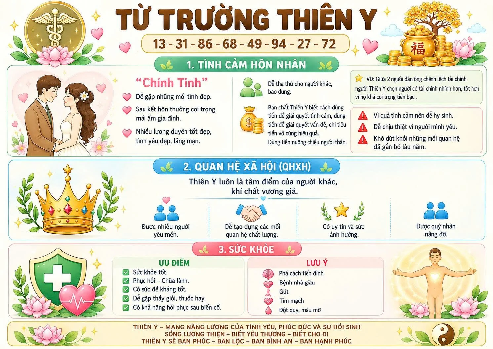

**Bản OCR chưa hiệu đính toàn văn** (điểm OCR: 66):

```text
“4 VN ° s . P no  2@.
:@7.; TỪ TRƯỜNG THIÊN Y #S.
L.& cu
N1.€C@, 7 — S
.A\ 972559572... o ( 13-31-86-68-49-94-27-72 2 Na? ø
xz TTTUTTYITT " [“
tố 1 TÍNH CÁM HỒN NHÂN. XZ H —
+ 66 H H ” 5 ng VD: Giữa 2 người đàn ông chênh lệch tài chính
9 Chính Tỉnh ao in chong khác, người Thiên Y chọn người có tài chính nhỉnh hơn, tốt hơn
9” lu % 9? Dễ gặp những mối tình đẹp. ìò , vì họ khá coi trọng tiển bạc..
SA Ñ QØ Sau kết hôn thường coi trọng Bản chất Thiên Y biết cách dùng - |
) mái ấm gia đình. tiền để giải quyết tình cảm, dùng A Vì quá tình cảm nên dễ hy sinh.
ạ © tiền để giải quyết vấn đề, chỉ tiêu ễ chịu thiệt vì người mì
hại Á >>» 9 Nhiều lương duyên tốt đẹp, tiền vô cùng hiệu quả. À - CD Dnn v l5 LAI sỀ
\ > tình yêu đẹp, lăng mạn. Dăngtểnnuông hiểu người thân, đẦÀ, Khó dứt khỏi những mối quan hệ
7 < đã gắn bó lâu năm.
Ớ 7 š si
‡ SỐ 2.QUAN HỆ XÃHỘI (QHXH) #7
Thiên Y luôn là tâm điểm của người khác,
M khí chất vương giả.
v an DU ee
Ÿ r] Ỉ Ỉ S ” Ị
sa - 4 .]ủù Nmm
+ + Được nhiều người ¡ Dễ tạo dựng các mối ¡ Có uy tín và sức ¡ Được quý nhân
ĩ yêu mến. Ố quan hệ chất lượng. ảnh hưởng. nâng đỡ.
= ‡ .. @œmxUE2. ^
— + ƯU ĐIỂM Lưu Ý đã
Sức khỏe tốt. @P Phá cách tiến đình —
ÿi Phục hồi - Chữa lành. CÐ Bệnh nhà giàu
\ -⁄^N Có sức đề kháng tốt. A Gút lạ,
Ệ Ñ á Dễ gặp thầy giỏi, thuốc hay. QÔ: Tìm mạch & ỹ z4
: `. Ễ ^ in ạ ^. =V
| DJ 4 Có khả năng hồi cu am biến cố. _ÿxv CÔ. Đột quy, máu mỡ ve) | (TA
⁄ THIÊN Y - MANG NĂNG LƯỢNG CỦA TÌNH YÊU, PHÚC ĐỨC VÀ SỰ HỒI SINH z^¬ ` PeY
 xtU ý + _. SỐNG LƯƠNG THIỆN - BIẾT YÊU THƯƠNG - BIẾT CHO ĐI +t e ?
— THIÊN Y SẼ BAN PHÚC - BAN LỘC - BAN BÌNH AN - BẠN HẠNH PHÚC <@` L\ Ly,
```

<a id="slide-012"></a>

### Slide 012: Thiên Y: tài vận và sự nghiệp

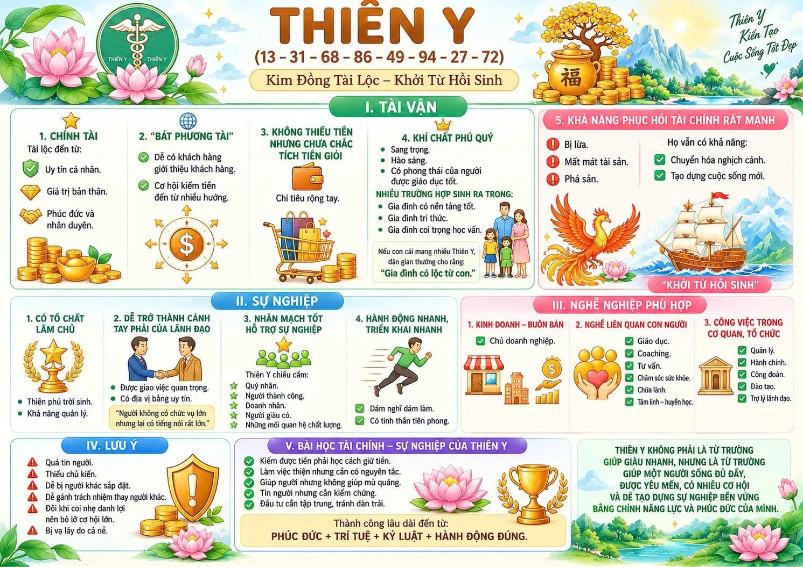

**Bản OCR chưa hiệu đính toàn văn** (điểm OCR: 63):

```text
L.M^ 4 `.
+ ng ái
_ ZÁóh , -_. ti
„xxx is ." 8254252//\. đế na,
| LØ) "Sa <: => g;2 L ly 7
(ở Xe" + (3-31-68-86-49-94-27-72)) => 7 XW 0u S9
xé ý? s/ “TRE VI Em TH ,Ñ0 2g V ý TM g l\\C ”,
r¬ về ố Kim Đồng Tài Lộc - Khởi Từ Hồi Sinh ái LG .
Ầ : <À@S-⁄^ * —= on sp
—¬— - : —— I. TÀI VAN = — —=—=- -
X ® NT vả; lL 5. KHẢ NĂNG PHỤC HỒI TÀI CHÍNH RẤT MẠNH
ít “ ÀI” 3. KHÔNG THIẾU TIỀN ( ú quý
LINH] C SE ElUOBG TÀI NHƯNG CHƯA CHẮC 4. KHÍ CHẤT PHÚ QUÝ Bị lừa. Họ vẫn có khả năng:
Tài lộc đến từ: ^. tị /ị t ® Sang trọng. u
s.- (@ Dễ có khách hàng TỊCH TIỀN GIÚI ® Hào sáng. 'Ý @ Mấtmáttài sản. Chuyển hóa nghịch cảnh.
9 Uy tín cá nhân. giới thiệu khách hàng. ® Có phong thái của người 80:4/1g cuộc sống ni
— tơ hội kiếm tiền được giáo dục tốt. @ Pási. —
SỘ? Gñá trị bản thân. đến từ nhiều hướng. Chỉ tiêu rộng tay. NHIỀU TRƯỜNG HỢP SINH RA TRONG: PP. LẠ
sa 4 * Gadmhcónổntigtế P3 - | Ha ⁄ 2W
„ đi wz xế & ® Gia đình tr thức. Ss ăn Ïgu ni
nhân duyên. Gia đình coi trọng học vấn. g\| lên | . ” “x Z//À:
CHẾ .)* ^â. —_ rx „
. Nếu con cái mạng nhiều Thiên Ý,  - dỰ lì | ZZA&x + N<== /] : ~
N C dân gian thưởng cho rằng: li | S Ñ = .
‡ “giadnhcólgctrcoa” A1442) (“6S 22””=Ẽ - =
_\ "A5 ” “KHỞI TỪ HỒI SINH”
II. SỰ NGHIỆP II. NGHỀ NGHIỆP PHÙ HỢP.
1. CÓ TỐ CHẤT 2. DỄ TRỞ THÀNH CÁNH 3. NHÂN MẠCH TỐT 4. HÀNH ĐỘNG NHANH,
LÃM CHỦ TAY PHẢI CỦA LÃNH ĐẠO HỖ TRỢ SỰ NGHIỆP TRIỂN KHAI NHANH - 1: KINH DOANH - BUÔN BÁN ._ 2. NGHỀ LIÊN QUAN CON NGƯỜI EnrkiE) ưng
li Chủ doanh nghiệp. 3 Giáo dục. Ễ
= E3 Coaching. 8 quản:
Aao sa = s] 3 Tưvấn. Hành chính.
Thiên Y chiếu cẩm: = g) Chăm sóc sức khỏe. Công đoàn.
® Đượcgioviệcquantọng  đ Quýnhân th 4 Ø3 omlih DI
® Thiênphútrốisnh. ® Cóđỉavibẩnguy tín -- s nu mm. iiiliÌ Q Tìnkh hinh. Trợlý nh đạo.
® Khảnãng quản lý. "Người không có chức vụ ln men HP Da nghĩ ám bạn)
nhưng li có tiếng nói rất lớn” s> - Những mối quan hệ chất lượng. Có tỉnh thần tiên phong.
IV: LƯU Ý = 11V. BÀI HỌC TÀI CHÍNH - SỰ NGHIỆP CỦA THIÊN Y ” E THIÊN Y KHÔNG PHẢI LÀ TỪ TRƯỜNG
4ð Quá tin người. (@ Kiếm được tiền phải học cách giữ tiền. ' GIÚP GIÀU NHANH, NHƯNG LÀ TỪ TRƯỜNG
AÀ Thiếu chủ kiến. @ Làm việc thiện nhưng cẩn có nguyên tắc. 4 P GIÚP MỘT NGƯỜI SỐNG ĐỦ ĐẨY,
.@, Dễ bị người khác sắp đặt. @ Giúp người nhưng không giúp mù quáng. ⁄/ é ĐƯỢC YÊU MẾN, CÓ NHIÊU CƠ HỘI NA
.Â,. Dễ gánh trách nhiệm thay người khác. 4 dị người nhưng cần 2 VÀ DỄ TẠO DỰNG SỰ NGHIỆP BỀN VỮNG
.Â, Đôi khi coi nhẹ danh lợi (@ Đã cân tập trung, tán si BẰNG CHÍNH NĂNG LỰC VÀ PHÚC ĐỨC CỦA MÌNH.
nên bỏ lỡ cơ hội lớn. z T07 si ¬ Á
Thành công lâu dài đến từ: '‹ ‡
.AA Bị vạ láy do cả nể.  hn ng ˆ ˆ - uế NHA I Ẩ
7 PHÚC ĐỨC + TRÍ TUỆ + KỶ LUẬT + HÀNH ĐỘNG ĐÚNG. n2
( | Út Ệ- UẬT ỘNG ĐÚNG. kệ, Re Ke: 2A \ ø.
HN \ 75 24
```

<a id="slide-013"></a>

### Slide 013: Diên Niên: đặc điểm và từ khóa

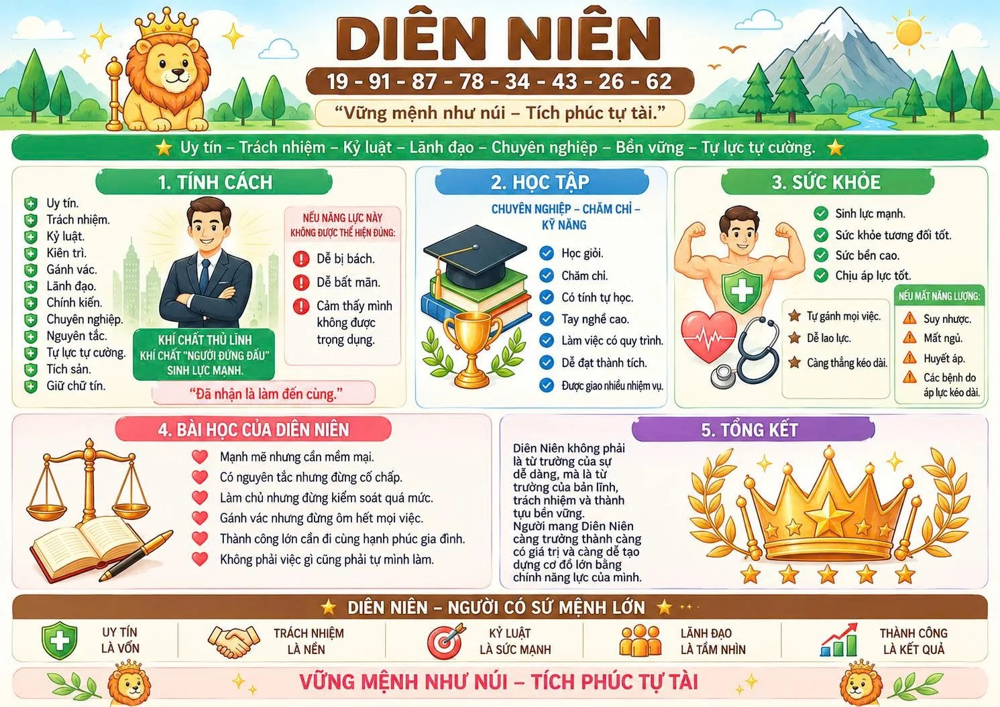

**Bản chép đã đối chiếu với ảnh nguồn:**

DIÊN NIÊN

19 – 91 – 87 – 78 – 34 – 43 – 26 – 62

Vững mệnh như núi – Tích phúc tự tài.

Uy tín – Trách nhiệm – Kỷ luật – Lãnh đạo – Chuyên nghiệp – Bền vững – Tự lực tự cường.

#### 1. Tính cách

Uy tín. Trách nhiệm. Kỷ luật. Kiên trì. Gánh vác. Lãnh đạo. Chính kiến. Chuyên nghiệp. Nguyên tắc. Tự lực tự cường. Tích sản. Giữ chữ tín.

Khí chất thủ lĩnh. Khí chất người đứng đầu. Sinh lực mạnh. Đã nhận là làm đến cùng.

Nếu năng lực này không được thể hiện đúng: Dễ bị bách. Dễ bất mãn. Cảm thấy mình không được trọng dụng.

#### 2. Học tập

Chuyên nghiệp – Chăm chỉ – Kỹ năng. Học giỏi. Chăm chỉ. Có tính tự học. Tay nghề cao. Làm việc có quy trình. Dễ đạt thành tích. Được giao nhiều nhiệm vụ.

#### 3. Sức khỏe (phát biểu của tài liệu nguồn)

Sinh lực mạnh. Sức khỏe tương đối tốt. Sức bền cao. Chịu áp lực tốt.

Nếu mất năng lượng: Tự gánh mọi việc. Dễ lao lực. Căng thẳng kéo dài. Suy nhược. Mất ngủ. Huyết áp. Các bệnh do áp lực kéo dài.

#### 4. Bài học của Diên Niên

Mạnh mẽ nhưng cần mềm mại. Có nguyên tắc nhưng đừng cố chấp. Làm chủ nhưng đừng kiểm soát quá mức. Gánh vác nhưng đừng ôm hết mọi việc. Thành công lớn cần đi cùng hạnh phúc gia đình. Không phải việc gì cũng phải tự mình làm.

#### 5. Tổng kết

Diên Niên không phải là từ trường của sự dễ dàng, mà là từ trường của bản lĩnh, trách nhiệm và thành tựu bền vững. Người mang Diên Niên càng trưởng thành càng có giá trị và càng dễ tạo dựng cơ đồ lớn bằng chính năng lực của mình.

DIÊN NIÊN – NGƯỜI CÓ SỨ MỆNH LỚN. Uy tín là vốn. Trách nhiệm là nền. Kỷ luật là sức mạnh. Lãnh đạo là tầm nhìn. Thành công là kết quả.

<a id="slide-014"></a>

### Slide 014: Diên Niên: tài vận, sự nghiệp và tình cảm

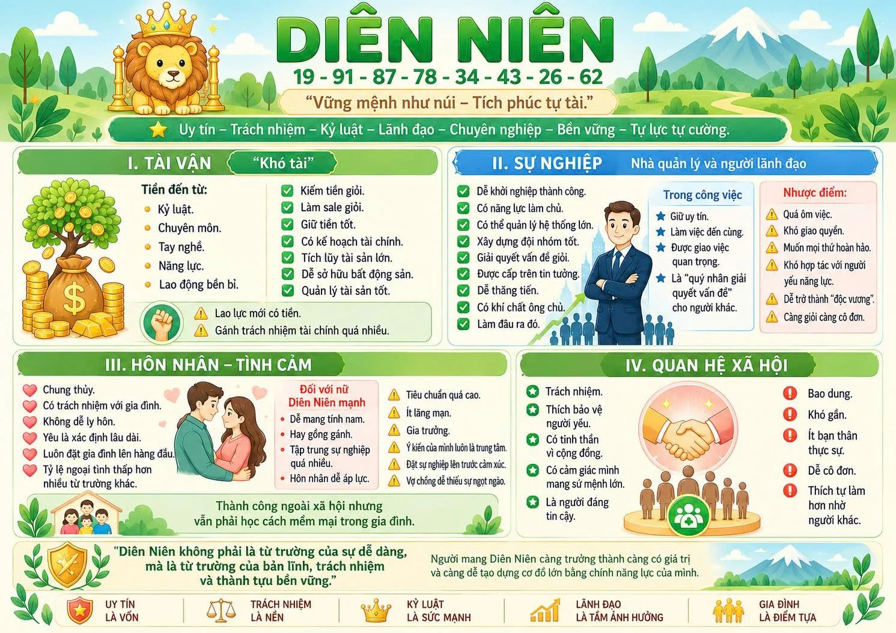

**Bản OCR chưa hiệu đính toàn văn** (điểm OCR: 63):

```text
Và ái mm.
DẤ> vào »
'G.-.SI SA 19-91-87-78-34-43-26-62.- '
. "| Y¬. “Vững mệnh như núi - Tích phúc tự tài”; nh
À œ5 HH, : _s8ả:_~ —
: 1 Uy tín - Trách nhiệm - Kỷ luật - Lãnh đạo = Chuyên nghiệp = Bền vững - Tự lực tự cường. ]
). ~ \
({ I. TÀI VẬN “II, SỰ NGHIỆP Nhà quản lý và người lãnh đạo
| đc v2 = Tiền đến từ: Kiếm tiền giỏi. DỄ khởi nghiệp thành công. Trong công việc Nhược điểm:
22009: @°s3 ° Kỷ luật. Làm sale giỏi. Có năng lực làm chủ. * Gữuy A tuáôm việc.
5 X  ° Chyênmm.  i NH P TK hôi . đt Làmvệcdốnoing  /À, Khó giao quy
⁄) ác i © Tay nghề. nhiên li nh - mi - ph. 2X Àw.. * 09c giao việc Muốn mọi thứ hoàn hảo.
“ ^^ - @ Tích lũy tài sản lớn. @ Giải quyết vấn đề giỏi. ấh quan trọng. xi x n
e. 77 © 3 ng . Dễ sở hữu bất động sản. Được cấp trên tin tưởng... Ai Là “quý nhân giải A bi hợp tác với người
E7 ì ® Lao động bền bỉ. 7. ” P - Á quý nhãn giải yếu năng lực.
= (a Ỹ ¿ Quản lý tài sản tốt. Dễ thăng tiến. D : quyết vấn đẻ” VÀ, Dễtrở hình "đệc vip
cá “Z7 „vómrmemeemrs So Có khí chất ông chủ, cho người khác. h hôn ng)
Z<p xạ ZÀ, Lao lực mới có tiền. | Ô, Găng giỏi càng cô đơn,
L tự 52) xe x7 À,. Gánh trách nhiệm tài chính quá nhiều. Làm ha 5%
III. HÔN NHÂN - TÌNH CẢM Ề IV.QUAN HỆ XÃHỘI XE
QØ Chung thủy. Đối với nữ Á Ti hiên qá on. @ Trách nhiệm. «e5 @© Bao dung,
QØ Gó trách nhiệm với gia đình. á Diên Niên mạnh h Thích bảo vệ 4 Ầ
9Ø Không dễ ly hôn. Ễ lẠ, » Dễ mang tính nam. Ạ hiếp _ 6 nh in / \ @ khógân.
QØ Yêu là xác định lâu dài. / Hay gồng gánh. A Gatườg. (Ð Có tình thân \\ \ j @  Ítbạn thân
QØ Luôn đặt gia đình lên hàng đầu | vs Su LH n sự nghiệp : nnaeeroepnil vì cộng đồng. Ñ 4 thực sự.
®Tÿlệngogitnhtháphơn  ' lê ng xed on“ | C5 có cảm giáo mình ®a Dễ cô đơn.
nhiều từ trường khác. 2) * Hônnhindšáp lực 4A, Vgchồng dễ hiếu sựngọt ngà. mang sứ mệnh lớn. ọ Em NI @ Thchtylam
mi NI NI NET NEGNIrIEG: ^ Ñ Ai đái x
“4S Thành công ngoài xã hội nhưng +] Là người đáng / ù Ũ hơn nhờ
| gẽ vẽ. vẫn phải học cách mềm mại trong gia đình. . ni G- ^W > người khác.
“Diên Niên không phải là từ trường của sự dễ dàng, - TC ạ 7
A là K s a * HA Người mang Diên Niên càng trưởng thành càng có giá trị
ýáØỳ mà là từ on Bo nhiệm và càng dễ tạo dựng cơ đồ lớn bằng chính năng lực của mình. ` SAU
UY TÍN TRÁCH NHIỆM KỶ LUẬT LÃNH ĐẠO. 929 GIA ĐÌNH
ỳị 9 LÀ VỐN | XJA LÀ NỀN | và LÀ SỨC MẠNH | II LÀ TẨM ẢNH HƯỚNG | Am LÀ ĐIỂM TỰA ¿ở
```

<a id="slide-015"></a>

### Slide 015: Lục Sát: đặc điểm và từ khóa

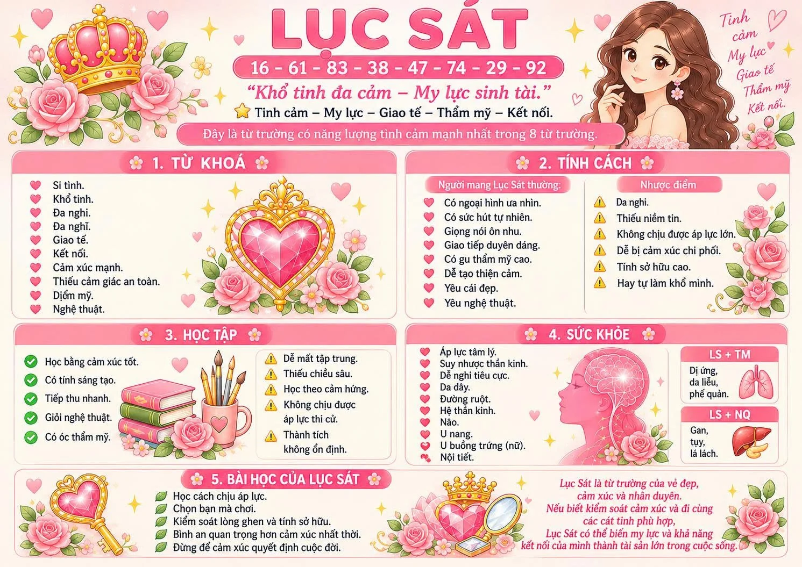

**Bản chép đã đối chiếu với ảnh nguồn:**

LỤC SÁT

16 – 61 – 83 – 38 – 47 – 74 – 29 – 92

Khổ tình đa cảm – Mỵ lực sinh tài.

Tình cảm – Mỵ lực – Giao tế – Thẩm mỹ – Kết nối. Đây là từ trường có năng lượng tình cảm mạnh nhất trong 8 từ trường.

#### 1. Từ khóa

Si tình. Khổ tình. Đa nghi. Đa nghĩ. Giao tế. Kết nối. Cảm xúc mạnh. Thiếu cảm giác an toàn. Diễm mỹ. Nghệ thuật.

#### 2. Tính cách

Người mang Lục Sát thường: Có ngoại hình ưa nhìn. Có sức hút tự nhiên. Giọng nói ôn nhu. Giao tiếp duyên dáng. Có gu thẩm mỹ cao. Dễ tạo thiện cảm. Yêu cái đẹp. Yêu nghệ thuật.

Nhược điểm: Đa nghi. Thiếu niềm tin. Không chịu được áp lực lớn. Dễ bị cảm xúc chi phối. Tính sở hữu cao. Hay tự làm khổ mình.

#### 3. Học tập

Học bằng cảm xúc tốt. Có tính sáng tạo. Tiếp thu nhanh. Giỏi nghệ thuật. Có óc thẩm mỹ.

Lưu ý: Dễ mất tập trung. Thiếu chiều sâu. Học theo cảm hứng. Không chịu được áp lực thi cử. Thành tích không ổn định.

#### 4. Sức khỏe (phát biểu của tài liệu nguồn)

Áp lực tâm lý. Suy nhược thần kinh. Dễ nghĩ tiêu cực. Dạ dày. Đường ruột. Hệ thần kinh. Não. U nang. U buồng trứng (nữ). Nội tiết.

LS + TM: Dị ứng, da liễu, phế quản. LS + NQ: Gan, tụy, lá lách.

#### 5. Bài học của Lục Sát

Học cách chịu áp lực. Chọn bạn mà chơi. Kiểm soát lòng ghen và tính sở hữu. Bình an quan trọng hơn cảm xúc nhất thời. Đừng để cảm xúc quyết định cuộc đời.

Lục Sát là từ trường của vẻ đẹp, cảm xúc và nhân duyên. Nếu biết kiểm soát cảm xúc và đi cùng các cát tinh phù hợp, Lục Sát có thể biến mỵ lực và khả năng kết nối của mình thành tài sản lớn trong cuộc sống.

<a id="slide-016"></a>

### Slide 016: Lục Sát: tài vận, sự nghiệp và tình cảm

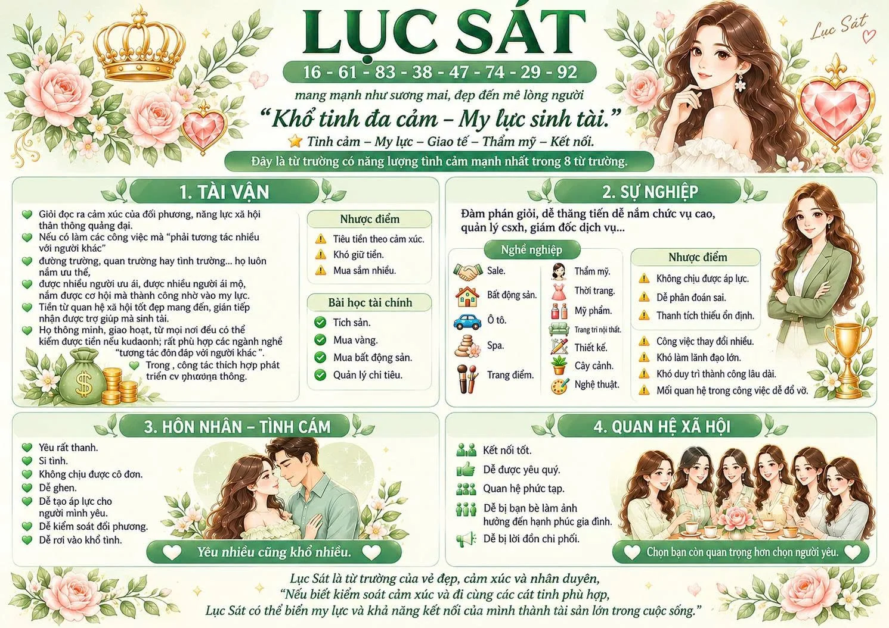

**Bản OCR chưa hiệu đính toàn văn** (điểm OCR: 58):

```text
Ñ b - L4 kì
về, À ` zz J .. Zm cư
xe / 3 đ V A ›W4 Ñ ` 7e l2

/ í BC K . => -  . J

ì ;a NA ề @, 7 Kê... \ V2 .
S „e2. TEEEELEEZEEZEELEED - v
7: 07⁄4 xá , <= S

wS g, zJ - &s ø mang mạnh như sương mai, đẹp đến mê lòng người sa XÃ | ẵ j
SN 2C ^_Õ1 “ ^ˆ.. 2 . — ÂU N °
9x ‹ < “Khổ tỉnh đa cảm - My lực sinh tài.” 2 ử, ìI
rs:® s VN. Œ e %Y Tỉnh cảm - My lực - Giao tế - Thẩm mỹ - Kết nối. m § Ì A1 ê đ¬
A) ~i ỦN % Đây là từ trường có năng lượng tình cảm mạnh nhất trong 8 từ trường: u Ai : AI HG4I
HP nợ. ..ì: 4đ,

số 1. TÀI VẬN ỳz s2 Z2
'® Giỏi đọc ra cảm xúc của đối phương, năng lực xã hội EmEocdiemN) Đàm phán giỏi, dễ thăng tiến dễ nắm chức vụ cao, 7 WXs \
thân thông quảng đại. . : cx. 5 quản lý csxh, giám đốc dịch vụ... 4 Ñ
® Nếu nh bác cE0g biệt tà hả suơng sáp hiệt 4Â Tiêu tiển theo cảm xúc. ni ”
đường trường, quan trường hay tình trường... họ luôn A Khógữ tiến. — Nhược điểm ) . Z )
nắm ưu thể, 4ð, Mua sắm nhiều. 42 se. Ô Tin? 2 esyaaaese. 2
$ đục nhồi ngời mui NHẾ HIẾM người ái mộ, —— X Thang 'g chị p lực. › 0 7 và
nấm được cơ hội mà thành công nhờ vào my lực. PO Tố TA % lộng sản. Ỹ A^ Dễ đoán sai. Á “^^
®  Triền từ quan hệ xã hội tốt đẹp mang đến, gián tiếp (Bài học tài chính đà 8Í Mỹ phẩm. - - ._ .. .,4
nhận được trợ giúp mà sinh tài, @ Tkhsin đà 0°. 4â. Thanh tích thiểu ồn định. 7
Họ thông minh, giao hoạt, từ mọi nơi đều có thể E {#3 Tamtiniint. ÁA '“x |
kiểm được tiền nếu kudaonh; rất phù hợp các ngành nghề ® Muavàng. -. Spa tt 4 Côngviệcthayđổinhiểu Ế Ñ M |
LN > “tương tác đôn đáp vời người khác ”. á 5 } %% ù ~ - xe
a è Ự Trong công tị th hợp phát ® Mua bạ động sản. ì ¬ Cây cảnh. A hT Ea đai. .ˆ¬ a ào "sả
sa è 2, triển w phương thông. @ Quản lý chỉ tiêu. ừỪ T99 êm SƯ nay, Khóc tì hàn ống lui = Ấy
>2 34c | (9ÿ Nghệ HUÊC  A Mối quan hệ trong công việc dễ đồ võ. ZØ AC Sn
êm] VN /
4 z ¬ h HN ` 4 TH S Ñ
NT 5.HÔNNHÂN-TÌNHCÁM TP NT 41QUANHỆXÃHỘ TT
s Yêu —— , ¬à điầ Kết nối tốt. X
Sĩ tình. ~- \; 4 Ỹ \, 2
®ð Không chịu được cô đơn. 7. : Hi, Dễ được yêu quý. . gỗ về ( Ca %> -
® Dễ ghen. . X.x / Ã ủZ 883 Quan hệ phức tạp. j St? VXxénCtc
ng my A 2S NT 0© - iãouwunaet ("S3 Ý SỸ)
® Dễkiểmsoátđổiphương. >>; su L...4⁄Z "NCT : seo he bi su Na ỐNG Ả Ễ
® Dễ rơi vào khổ tình. —m ỶẤ_”_ S “Dễ bị lời đồn chi phối. ÃÃ  36(447)ềk G22 XS
%9 Yêunhiềucũngkhổnhiều Œ ¬ ®Ø Chọn bạn còn quan trọng hơn chọn người yêu, @ |
- -= — - J
ĩ Ị tì CN 4 Í Lục Sát là từ trường của vẻ đẹp, cảm xúc và nhân duyên, s về @> ỹ 2 74
Sự Na) Z Z “Nếu biết kiểm soát cảm xúc và đi cùng các cát tỉnh phù hợp, >> = <<.
LỄ Ầ << »x Lục Sát có thể biển my lực và khả năng kết nối của mình thành tài sản lớn trong cuộc sống.” Z2 ý hà s
```

<a id="slide-017"></a>

### Slide 017: Họa Hại: đặc điểm và từ khóa

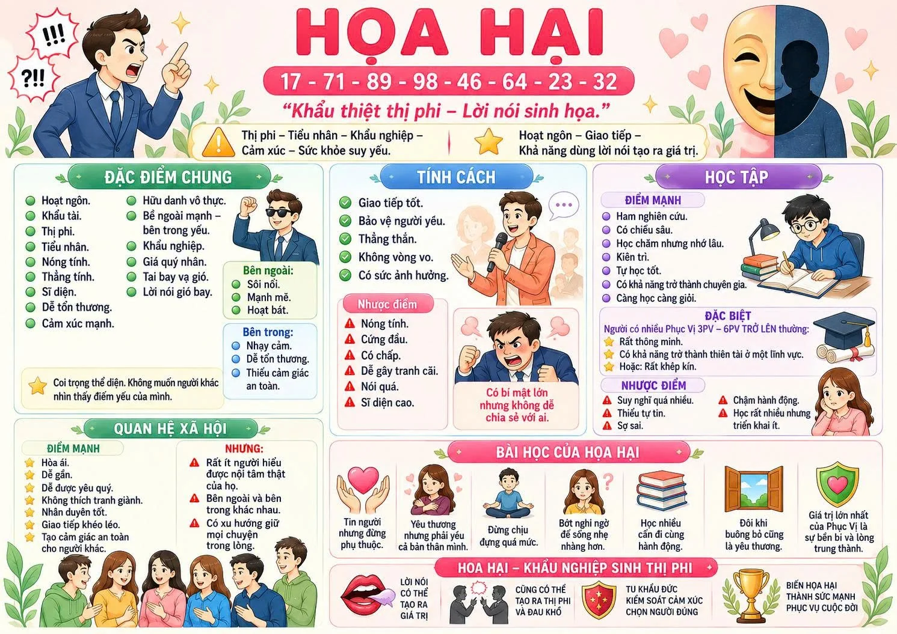

**Bản chép đã đối chiếu với ảnh nguồn:**

HỌA HẠI

17 – 71 – 89 – 98 – 46 – 64 – 23 – 32

Khẩu thiệt thị phi – Lời nói sinh họa.

Thị phi – Tiểu nhân – Khẩu nghiệp – Cảm xúc – Sức khỏe suy yếu. Hoạt ngôn – Giao tiếp – Khả năng dùng lời nói tạo ra giá trị.

#### Đặc điểm chung

Hoạt ngôn. Khẩu tài. Thị phi. Tiểu nhân. Nóng tính. Thẳng tính. Sĩ diện. Dễ tổn thương. Cảm xúc mạnh. Hữu danh vô thực. Bề ngoài mạnh – bên trong yếu. Khẩu nghiệp. Giả quý nhân. Tai bay vạ gió. Lời nói gió bay.

Coi trọng thể diện. Không muốn người khác nhìn thấy điểm yếu của mình.

#### Tính cách

Bên ngoài: Sôi nổi. Mạnh mẽ. Hoạt bát. Bên trong: Nhạy cảm. Dễ tổn thương. Thiếu cảm giác an toàn. Có bí mật lớn nhưng không dễ chia sẻ với ai.

Giao tiếp tốt. Bảo vệ người yếu. Thẳng thắn. Không vòng vo. Có sức ảnh hưởng.

Nhược điểm: Nóng tính. Cứng đầu. Cố chấp. Dễ gây tranh cãi. Nói quá. Sĩ diện cao.

#### Học tập

Điểm mạnh: Ham nghiên cứu. Có chiều sâu. Học chậm nhưng nhớ lâu. Kiên trì. Tự học tốt. Có khả năng trở thành chuyên gia. Càng học càng giỏi.

Đặc biệt [giữ nguyên nội dung nguồn dù ô này nhắc đến Phục Vị]: Người có nhiều Phục Vị 3PV–6PV trở lên thường rất thông minh, có khả năng trở thành thiên tài ở một lĩnh vực, hoặc rất khép kín.

Nhược điểm: Suy nghĩ quá nhiều. Thiếu tự tin. Sợ sai. Chậm hành động. Học rất nhiều nhưng triển khai ít.

#### Quan hệ xã hội

Điểm mạnh: Hòa ái. Dễ gần. Dễ được yêu quý. Không thích tranh giành. Nhân duyên tốt. Giao tiếp khéo léo. Tạo cảm giác an toàn cho người khác.

Nhưng: Rất ít người hiểu được nội tâm thật của họ. Bên ngoài và bên trong khác nhau. Có xu hướng giữ mọi chuyện trong lòng.

#### Bài học của Họa Hại

Tin người nhưng đừng phụ thuộc. Yêu thương nhưng phải yêu cả bản thân mình. Đừng chịu đựng quá mức. Bớt nghi ngờ để sống nhẹ nhàng hơn. Học nhiều cần cùng hành động. Đôi khi buông bỏ cũng là yêu thương.

Giá trị lớn nhất của Phục Vị là sự bền bỉ và lòng trung thành. [Câu này giữ nguyên theo ô cuối trong nguồn, có dấu hiệu lặp nội dung Phục Vị.]

HỌA HẠI – KHẨU NGHIỆP SINH THỊ PHI. Lời nói có thể tạo ra giá trị, cũng có thể tạo ra thị phi và đau khổ. Tu khẩu đức. Kiểm soát cảm xúc. Chọn người đúng. Biến Họa Hại thành sức mạnh phục vụ cuộc đời.

<a id="slide-018"></a>

### Slide 018: Họa Hại: tài vận, sự nghiệp và tình cảm

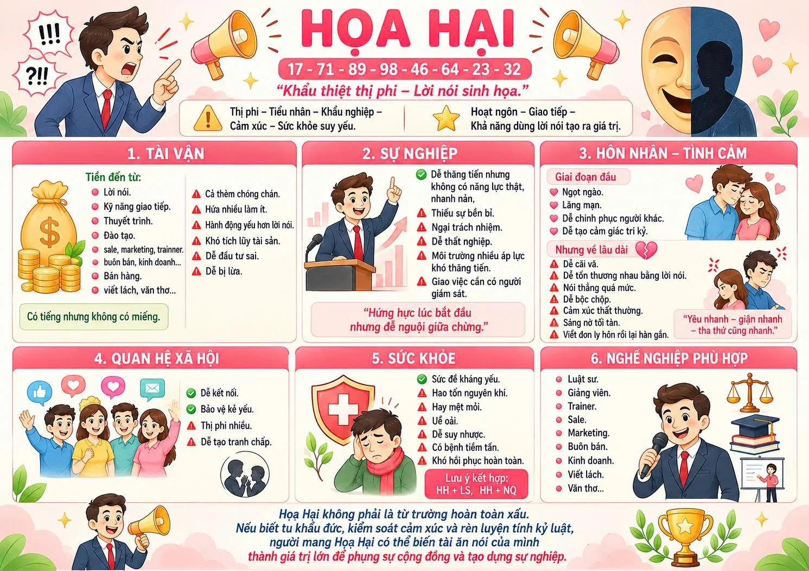

**Bản OCR chưa hiệu đính toàn văn** (điểm OCR: 61):

```text
^ ⁄ N ⁄Z ¬
vụ | A- vê Z
- — Gm° - _. A lZA
z : (5
2II ”¬Ậ4 Ỹ VY
... 2 Kiến E*xEEn HH? ..
1 N Thị phi - Tiểu nhân - Khẩu nghiệp - | và Hoạt ngôn - Giao tiếp -
€ ® ) Cảm xúc - Sức khỏe suy yếu. ZZÁ Khả năng dùng lời nói tạo ra giá trị. |
- Tiến đến từ: L (@ Dễ thăng tiến nhưng | (Giait ạn đề
#9 t9: A. Cả thêm chóng chán. đề không có năng lực thật | @ Ngyt mào =
7N... ® Kỹ năng giao tiếp. Hứa nhiều làm ít. 3 Thiếu sự bên bị 9 Lăng mạn. x @Œ? Ñ
Ầ Thuyết trình. Hành động yếu hơn lời nói ¬ n - 9 Dễ chỉnh phục người khác. ,
© Đào tạo. in : Ỹ Ngại trách nhiệm. 9 Dễ tạo cảm giác trị kỹ. / Ạ
( : —_— Khó tích lũy tài sản. Dễ thất nghiệp. : z Ể
Fas2V.. sale, marketing, trainner.. ã đi r íÁ . ._ Nhưng vê lâu dài . r4
| buôn bán knhdoanh,.| CS Dễ đầu tư ải le (9k hông he „ Dễ cãi vã. :
lu SE | @ Bán hàng. Dễ bị lừa. ng người ,. Dễ tổn thương nhau bằng lời nói. <> V7
CA*=2282 @ viết lách, văn thơ... ¬ đm/sát Nói thẳng quá mức. <
g Š Dễ bộc chộp. ?
khi  H? “Hứ c lúc bắt đầu A. Cảm xúc thất thường. "
Có tiếng nhưng không có miếng. cu . n n ˆ _ Sáng nờ tối tàn. Ũ "Yêu nhanh - giận nhanh
An GE người giúp chưng: Vẩtdoniyhônrổilgihàngấn. ¬ tha thứ cũng nhanh
| '@ Sức đề kháng yếu. © Luật sư. ...
9 u. '@ Dễ kết nối. [ ri . A. Hao tốn nguyên khí. Giảng viên. bN | Ạ
_. ỹ A km '@ Bảo vệ kẻ yếu. Í , r ] 7 Hay mệt mỏi. Trainer. ^ - cc đa,
VỆ. @ V534 “ØA Â Uấcñ: sua Ca
sJ xả ⁄4Áv gỗ j : Š _ Dễ suy nhược. Marketing. ZJ ã
Ñ z ã 5 ._ - ốc. c—
Z : Do nh dê ; 1 ẤÁ- -A. Có bệnh tiên tấn. Buôn bán. - ủi
à dư & Khó hồi phục hoàn toàn. Kinh doanh. =
⁄Z IH+N( Văn thơ... r-
4 ? Họa Hại không phải là từ trường hoàn toàn xấu. H
Nếu biết tu khẩu đức, kiểm soát cảm xúc và rèn luyện tính kỷ luật, { X 2 Ñ
&⁄ Ï ớ người mang Hoa Hại có thể biến tài ăn nói của mình ` {
```

<a id="slide-019"></a>

### Slide 019: Tuyệt Mệnh: đặc điểm và từ khóa

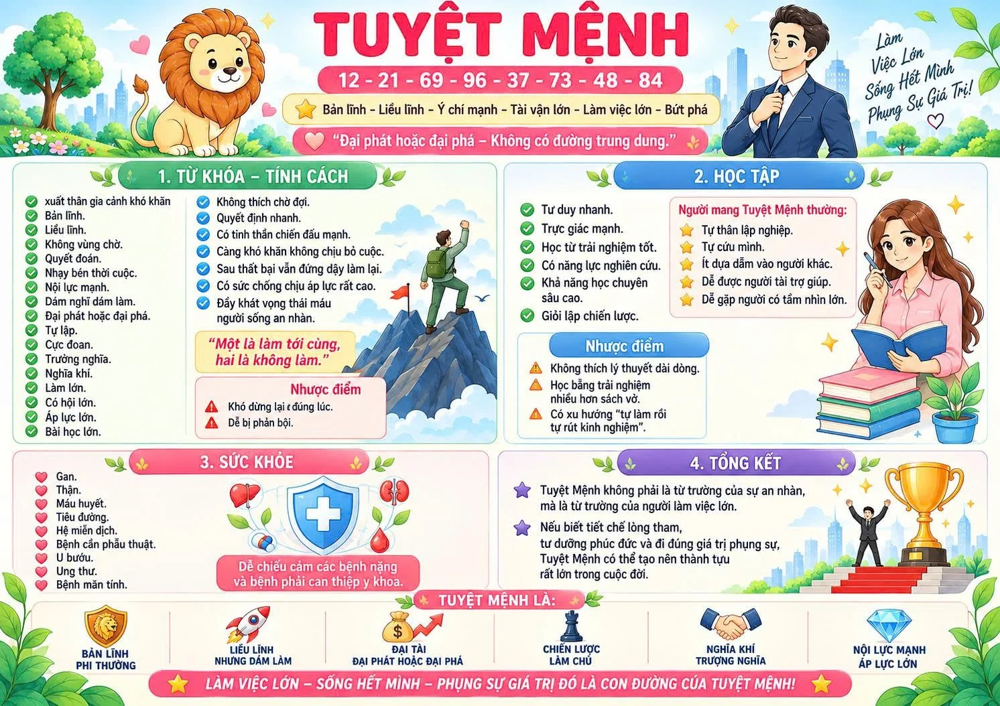

**Bản chép đã đối chiếu với ảnh nguồn:**

TUYỆT MỆNH

12 – 21 – 69 – 96 – 37 – 73 – 48 – 84

Bản lĩnh – Liều lĩnh – Ý chí mạnh – Tài vận lớn – Làm việc lớn – Bứt phá. Đại phát hoặc đại phá – Không có đường trung dung.

#### 1. Từ khóa – Tính cách

Xuất thân gia cảnh khó khăn. Bản lĩnh. Liều lĩnh. Không vững chờ. Quyết đoán. Nhạy bén thời cuộc. Nội lực mạnh. Dám nghĩ dám làm. Đại phát hoặc đại phá. Tự lập. Cực đoan. Trượng nghĩa. Nghĩa khí. Làm lớn. Có hội lớn. Áp lực lớn. Bài học lớn.

Không thích chờ đợi. Quyết định nhanh. Có tinh thần chiến đấu mạnh. Càng khó khăn không chịu bỏ cuộc. Sau thất bại vẫn đứng dậy làm lại. Có sức chống chịu áp lực rất cao. Đây khát vọng thái máu người sống an nhàn. [Câu khó hiểu giữ theo chữ trong ảnh nguồn.]

Một là làm tới cùng, hai là không làm.

Nhược điểm: Khó dừng lại đúng lúc. Dễ bị phản bội.

#### 2. Học tập

Tư duy nhanh. Trực giác mạnh. Học từ trải nghiệm tốt. Có năng lực nghiên cứu. Khả năng học chuyên sâu cao. Giỏi lập chiến lược.

Người mang Tuyệt Mệnh thường: Tự thân lập nghiệp. Tự cứu mình. Ít dựa dẫm vào người khác. Dễ được người tài trợ giúp. Dễ gặp người có tầm nhìn lớn.

Nhược điểm: Không thích lý thuyết dài dòng. Học bằng trải nghiệm nhiều hơn sách vở. Có xu hướng tự làm rồi tự rút kinh nghiệm.

#### 3. Sức khỏe (phát biểu của tài liệu nguồn)

Gan. Thận. Máu huyết. Tiểu đường. Hệ miễn dịch. Bệnh cần phẫu thuật. U bướu. Ung thư. Bệnh mãn tính. Dễ chiêu cảm các bệnh nặng và bệnh phải can thiệp y khoa.

#### 4. Tổng kết

Tuyệt Mệnh không phải là từ trường của sự an nhàn, mà là từ trường của người làm việc lớn. Nếu biết tiết chế lòng tham, tu dưỡng phúc đức và đi đúng giá trị phụng sự, Tuyệt Mệnh có thể tạo nên thành tựu rất lớn trong cuộc đời.

Bản lĩnh phi thường. Liều lĩnh nhưng dám làm. Đại tài, đại phát hoặc đại phá. Chiến lược làm chủ. Nghĩa khí, trượng nghĩa. Nội lực mạnh, áp lực lớn.

LÀM VIỆC LỚN – SỐNG HẾT MÌNH – PHỤNG SỰ GIÁ TRỊ: ĐÓ LÀ CON ĐƯỜNG CỦA TUYỆT MỆNH!

<a id="slide-020"></a>

### Slide 020: Tuyệt Mệnh: tài vận, sự nghiệp và tình cảm

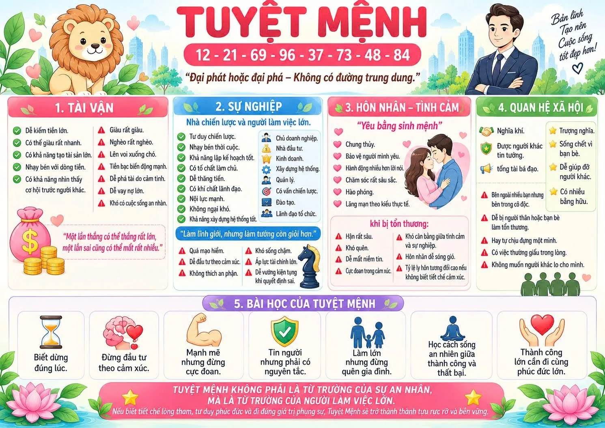

**Bản OCR chưa hiệu đính toàn văn** (điểm OCR: 54):

```text
c7 đc
IW- vợ SA ở Tạ nộ
. Ầ á
5⁄7 Nó ° ° L 2 À Cuậc đớn ï
m. 7 .X Ỉ | lự li d J
„xe. G0XXS.. 4 tá Wa
> "Ki VI, J Z Zc L :
v4 “Đại phút hoặc đại phá - Không có đường trung dung.” Lá Z Ẩ
⁄Z 4 < Œ#Z _ h ~, h
- Ñ ˆ à & ˆ ˆ Ñ 5 gì gã - = = D
W -oÓAALI L | ` 2.SỰNGHIỆP ®^Z >3. HỒN NHÂN - TÍNH CẮM | w“ 4. QUAN HỆ XÃ HỘI
| Nhà chiến lược và người làm việc lớn. “Và ñ ảnh”
@ 0š kiếm tiên n. A 08urftgiu, Ê nghờờnva bốn ni. œ. Yêu bằng sinh mệnh 6S Nhi Trưng nghi
TP: — ợc. ồn. Chủ doanh nghiệp. \ cu
@ Cóthếgiàurấtnhanh A Nghhtngè @ Nhạy bén thời cuộc. Ãi Nàdintr ® Chung thủy. 3” . Ộ Được người khác Sống chếtv
(@ Gkhảnängtạo tài sảnlón À lên với xuống chó. @ Khảnäng lập kếhoạchtốt. 7: Kinh doanh. 9Ø Bảo vệ người mình yêu. AA tin tưởng. bạn bè,

@ Nhạybénvớidòngtiển 4 Tnbạcbiếnđộngmạnh.  @) Có tố chất làm chủ. C YâydmghệthốnA ®Ø Hàmdộnhiuhonlini. JAMHINN. Ý g1: tống tài bá đạo. Dễ giúp đỡ.
@ Gókhảnăngnhìnthấp A Dễphátàidocảmtnh. @) Dễ thăng tiến. ôi quảng  thămsóc rất sàu sắc. S người khác.
cghộitrướcngườikhác A Dễvayngiớn. s vóOtEm 9 lỞ Gvándiếnvge Q9 Hào phí ề Ô CA Bangsimáobpnhng, Vĩ Cổ nhiều

=> .À, Khó có nuệc sống an nhàn. @m 5 E8 Đoto. 9 Uangmạntheokiuthựctế `: bền trong cô độc. bằng hữu.
Z2 1 © màn droigu, đối Ineptiduc = AA Dễtj người thân hoặc bạn bề
—Ấ te sooDusi. — khỉ bị tổn thương: miêu
mi “Một lồn thắng có thể thắng rất lún, Làm lĩnh giới, nhưng làm tướng còn giỏi hơn. AÀ Hãnrtsâ. A Kócnbàn is) Ai uy ty hi dựng nộnình
| Co sa mðilingidägoitlểmftrtnhồu” A qángghên-— AKhóốngdặn XU A Phan - nh im lA G6 hướng gấu tonglng,
C  g A Bdyodise, À lovciidinin SẤ, s m -AYiEyl6ntmgffisoréu - CÀ Không muốn người hếc lo cho mình.
=> À Khônthchanphận CÁ ng 9P  ngbittết hế ảmxức. : Ễ : : S
—=W—”_”” Z = 2 Fs es => N
f %5 5.BÀI HỌC CỦA TUYET MỆẸNH #7 |
- đa Tin người Làm lớn in N ⁄4
Tai ? h ñ ạ an nhiên giữa ¬ è
J Biế Ễ dừng Đừng đi ầu gì nhưng đừng nhưng phải có nhưng đừng thành chi và lớn cần đi cùng
„đúng lúc. theo cảm xúc. cực đoan. nguyên tắc. quên gia đình. thất bại. phúc đức lớn.
N 7 Z ¬ TUYỆT MỆNH KHÔNG PHẢI LÀ TỪ TRƯỜNG CỦA SỰ AN NHÂN, < TA Nê 1
^ . MÀ LÀ TỪ TRƯỜNG CỦA NGƯỜI LÀM VIỆC LỚN. X "và ^
N<  > - 6 11/68/90 neByiEesheise-yngidiet dat, 2 n1 nhe iniieienikPEYLRgnehGIWB san mình Ề + „` - 4i
```

<a id="slide-021"></a>

### Slide 021: Ngũ Quỷ: đặc điểm và từ khóa

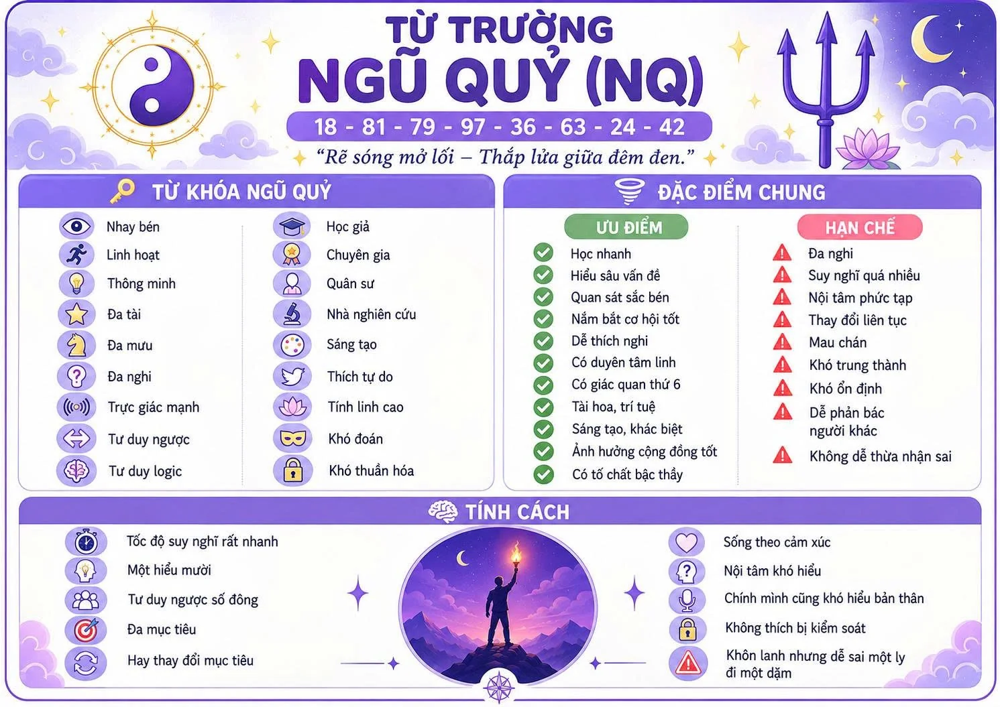

**Bản chép đã đối chiếu với ảnh nguồn:**

TỪ TRƯỜNG NGŨ QUỶ (NQ)

18 – 81 – 79 – 97 – 36 – 63 – 24 – 42

Rẽ sóng mở lối – Thắp lửa giữa đêm đen.

#### Từ khóa Ngũ Quỷ

Nhạy bén. Linh hoạt. Thông minh. Đa tài. Đa mưu. Đa nghi. Trực giác mạnh. Tư duy ngược. Tư duy logic. Học giả. Chuyên gia. Quân sư. Nhà nghiên cứu. Sáng tạo. Thích tự do. Tính linh cao. Khó đoán. Khó thuần hóa.

#### Đặc điểm chung

Ưu điểm: Học nhanh. Hiểu sâu vấn đề. Quan sát sắc bén. Nắm bắt cơ hội tốt. Dễ thích nghi. Có duyên tâm linh. Có giác quan thứ 6. Tài hoa, trí tuệ. Sáng tạo, khác biệt người khác. Ảnh hưởng cộng đồng tốt. Có tố chất bậc thầy.

Hạn chế: Đa nghi. Suy nghĩ quá nhiều. Nội tâm phức tạp. Thay đổi liên tục. Mau chán. Khó trung thành. Khó ổn định. Dễ phản bác người khác. Không dễ thừa nhận sai.

#### Tính cách

Tốc độ suy nghĩ rất nhanh. Một hiểu mười. Tư duy ngược số đông. Đa mục tiêu. Hay thay đổi mục tiêu. Sống theo cảm xúc. Nội tâm khó hiểu. Chính mình cũng khó hiểu bản thân. Không thích bị kiểm soát. Khôn lanh nhưng dễ sai một ly.

<a id="slide-022"></a>

### Slide 022: Ngũ Quỷ: tình cảm và sức khỏe

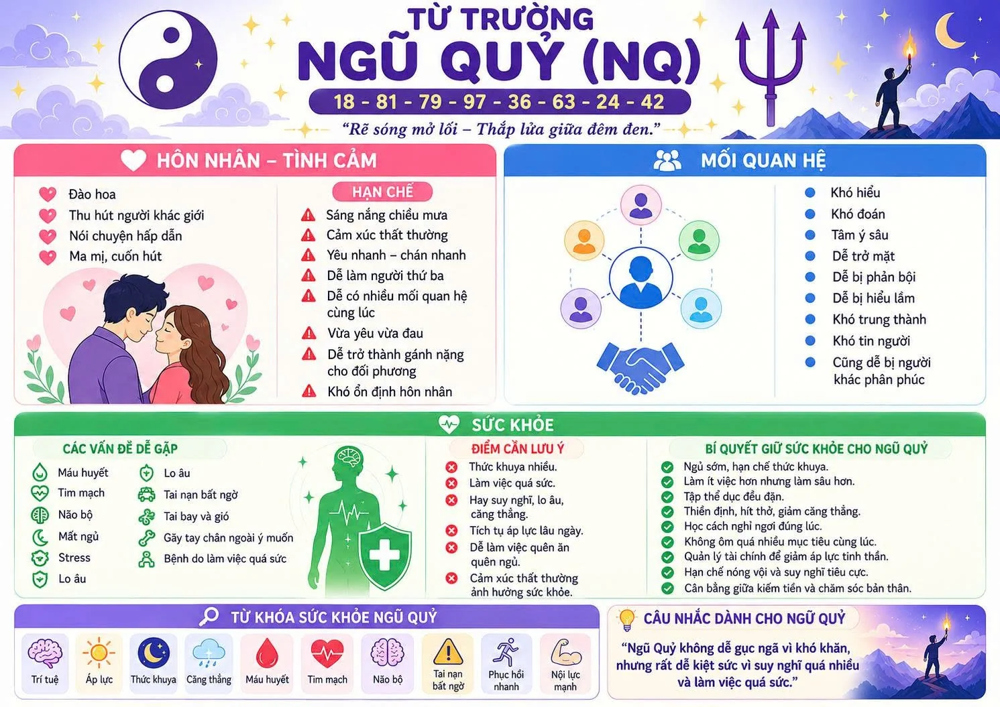

**Bản OCR chưa hiệu đính toàn văn** (điểm OCR: 69):

```text
Về ˆ
+ * TƯ TRƯỜNG + †
ga 4 =2 2
65 + +
+ ũ : ⁄
si k 18-81-79-97-36-63-24-42 +
.U- “Rẽ sóng mở lối - Thắp lửa giữa đêm đen.”
®% HÔN NHÂN - TÌNH CẢM 4S MỐI QUAN HỆ
® Đào hoa HẠN CHẾ | r ® Khó hiểu |
®% Thu hút người khác giới AÀ. Sáng nắng chiều mưa _.. .. ® Khó đoán |
®Ø Nói chuyện hấp dẫn 4A Cảm xúc thất thường @®) ! @ ® Tâm ý sâu
%9 Man, cuốn hút AÀ Yêu nhanh - chán nhanh P— ® Dếễtrở mặt
° ® .AA Dễ làm người thứ ba ¡ ® Dễ bị phản bội
.A Dễ có nhiều mối quan hệ ® A. 7 ® Dễ bị hiểu lầm
qg Quý v cùng lúc | LẠ Ữ (®) N
”» sự A ` g , ¡ , ® Khó trung thành
SỬ ÿ ừa (80:0ù = ¡ =
. r A va xì vn. Su : ¡ ® Khó tin người
- ĐA 4«<À ® Gmdiiisee
 2 khác phân phúc
4 A. Khó ồn định hôn nhân 2 Phẩnr
CÁC VẤN ĐỀ DỄ GẶP „ @œ ĐIỂM CẦN LƯU Ý BÍ QUYẾT GIỮ SỨC KHỎE CHO NGŨ QUỶ
- " @ Thức khuya nhiều. @ Ngủ sớm, hạn chế thức khuya.
9) ca. huyết  Ở Loâu S ‡ @ Làm việc quá sức. @ Làm ít việc hơn nhưng làm sâu hơn.
QØ Timmạch @à Tai nạn bất ngờ + + @ Hay suy nghĩ, lo âu, ® Tập thể dục đều đặn. :
Œ Ngob đ@ Ta bay và gó -Àw- căng thẳng. (@ Thiền định, hít thở, giảm căng thẳng.
gi - c ñ -@ Tích tụáp lực lâu ngày. @ Học cách nghỉ ngơi đúng lúc.
(q Mấtngủ đØ Gãy tay chân ngoài ý muốn + @ Dễ làm việc quên ăn \.@ Không ôm quá nhiều mục tiêu cùng lúc. |
G) Stres CỔ, Bệnh do làm việc quá sức s quênghi @ Quản lý tài chính để giảm áp lực tính thần.
G ti @ Cảm xúc thất thường @ Hạn chế nóng vội và suy nghĩ tiêu cực.
ảnh hưởng sức khỏe. '® Cân bằng giữa kiếm tiền và chăm sóc bản thân.
/Ô TỪ KHÓA SỨC KHỎE NGŨ QUỶ ( CÂU NHẮC DÀNH CHO NGỮ QUỶ “A_ Ầ :
. á
ở ® 2 @ ® xu _—.
Ki , và đ ® lgũ Quỷ không dễ gục ngã vì khó khăn,
= Si mu Vi ® A NI nhưng rất dễ kiệt sức vì suy nghĩ quá nhiều » Ai.
Trituệ Áplực Thứckhuya Căngthẳng Máuhuyết Timmạch Não bộ khu bá he êm J và làm việc quá sức.” “
```

<a id="slide-023"></a>

### Slide 023: Ngũ Quỷ: công việc và tài chính

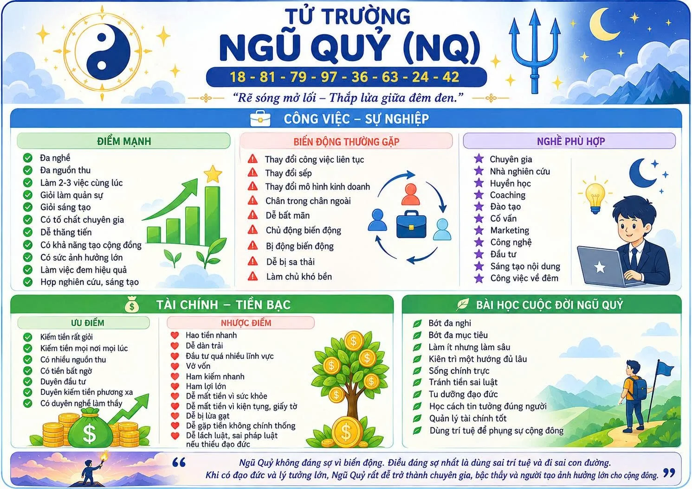

**Bản OCR chưa hiệu đính toàn văn** (điểm OCR: 72):

```text
4 2 `.
¬. TƯ TRƯỜNG "rem
+/⁄Z⁄^Â + T : vi,
_=
h. - NGỦ QUY (NO). + ư
+ XI
@qQUEEEOEEEOEEE . Ùị]°øÓ
ỹ —s>— “Rẽ sóng mở lối - Thắp lửa giữa đêm đen.” — ci>— é ¿
#š CÔNG VIỆC - SỰ NGHIỆP
ĐIỂM MẠNH BIẾN ĐỘNG THƯỜNG GẶP. NGHỀ PHÙ HỢP
® Đanghể .AÀ Thay đổi công việc liên tục X Chuyên gia +
® Đa nguồn thu & AA. Thay đổi sếp T% Nhà nghiên cứu r ( #
® 1àm23 việc cùng lúc AA Thay đổi mô hình kinh doanh ⁄à Huyền học vế £
© Goillàmuuốnsi AÀ. Chân trong chân ngoài X Coaching "Sư
® Giỏi sáng tạo na ° là A Đào tạo
® Có tố chất chuyên gia 4A Dễ bất mãn A  Cốvấn ›
@® Dễ thăng tiến 4À Chủ động biến động ˆ Marketing )
@ Có khả năng tạo cộng đồng AA. Bị động biến động . X% Công nghệ l<}
@ Có sức ảnh hưởng lớn vy me — AC Đầu tư tỸ
® Làm việc đem hiệu quả  n XÃ Sáng tạo nội dung L
® Hợp nghiên cứu, sáng tạo .À Làm chủ khó bền A Công việc về đêm Z¬]
¬ ˆ n = ¬ Eg: ưng
@ TÀI CHÍNH - TIỀN BẠC mm
ƯU ĐIỂM ) NHƯỢC ĐIỂM Ø Bớt đa nghĩ
® Kiếm tiền rất giỏi ®% Hảo tiền nhanh ZØ  Bớt đa mục tiêu
®. Kiếm tiền mọi nơi mọi lúc M4 Dễ đàn trải Ø Làm ít nhưng làm sâu
@® Có nhiều nguồn thu $® Đầu Đi quá nhiều lĩnh vực Ø Kiên trì một hướng đủ lâu
® Có tiền bất ngờ l4 n * kế . Ø Sống chính trực lE |
@® Duyên đầu tư nh kgilến li /Ø Tránh tiền sai luật
9 Dê: kiêm tiền phương » '® Dễ mất tiền vì sức khỏe Ø Tu dưỡng đạo đức  à CÀ
(@ Có duyên nghề làm thầy ® Dễ mất tiên vì kiện tụng, giấy tờ /Ø Họccách tin tưởng đúng người :
TT Ø Quản lý tài chính tốt | 1 („s4
ễ gặp tiền không chính thống Ñ “ti â đ -.PỊì)
® Dã lách luật, sai pháp luật Ø Dùng trí tuệ để phụng sự cộng đông -
nếu thiểu đạo đức ( 4
: s— @ 272 [13 Ngũ Quỷ không đáng sợ vì biến động. Điều đáng sợ nhất là dùng sai trí tuệ và đi sai con đường. |
“ ˆ Khi có đạo đức và lý tưởng lớn, Ngũ Quỷ rất đễ trở thành chuyên gia, bậc thầy và người tạo ảnh hưởng lớn cho cộng đông. 939
```

<a id="slide-024"></a>

### Slide 024: Ngũ Quỷ: học tập và huyền học

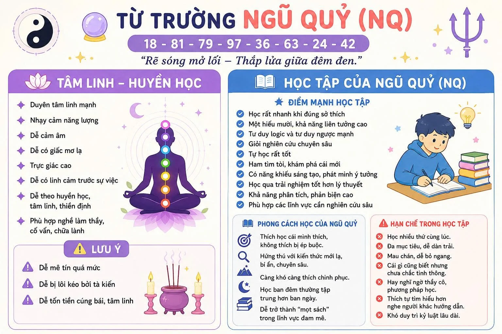

**Bản OCR chưa hiệu đính toàn văn** (điểm OCR: 74):

```text
xo . ` s ậ ự
“5À. @ TỪ TRƯỜNG NGŨ QUỶ (NQ)
/ ° \
ø”r :
` Mu, 13-81-79-97-36-63-24-42 . Ý °
-+: “Rẽ sóng mở lối — Thắp lửa giữa đêm đen.” +
ậ ˆ _¬ ˆ 2 ~ 2
xŠØ TÂM LINH - HUYỀN HỌC IRÑ HỌC TẬP CỦA NGŨ QUÝ (NQ)
4#: Duyên tâm lĩnh mạnh £ + 1Š ĐIỂM MẠNH HỌC TẬP vo
SN Ù lọc rất nhan ¡ đúng sở thíc! = -
HS + ©n hanh khi đi hích
*# Nhạy cảm năng lượng P @ Một hiếu mười, khả năng liên tưởng cao Ñ
4 Dễ cảm âm @® Tư duy logic và tư duy ngược mạnh qưnga
5 ¬ '® Giỏi nghiên cứu chuyên sâu Ñ CS, v
kề nà E UP >KX mm:
+ Trực giác cao '®© Ham tìm tòi, khám phá cái mới —=
w_U" Ễ . '® Có năng khiếu sáng tạo, phát minh ý tưởng Wv
*‡ Dễ có linh cảm trước sự việc ÑẰ $ '® Học qua trải nghiệm tốt hơn lý thuyết Ễ @ 24 (gối
4 Dễ theo huyền học, !® Khả năng phân tích, phản biện cao Ềz==
tâm linh, thiền định ˆ . '®© Phù hợp các lĩnh vực cần nghiên cứu sâu
“‡ Phù hợp nghề làm thầy, 7Á IÑÑ) PHONG CÁCH HỌC CỦA NGŨ QUỶ AÀHẠNCHẾTRONGHOCTẬP |
cố vấn, chữa lành : mối Q Ñ :
@ Thích học cái mình thích, @ Học nhiều thứ cùng lúc.
HH ¿2 Luu ( An không thích bị ép buộc. @ Đa mục tiêu, dễ dàn trải.
Q Hứng thú với kiến thức mới lạ, '@ Mau chán, dễ bỏ ngang.
4Ô, Dễ mê tín quá mức + || xx bí ẩn, chuyên sâu. @ Cái gì cũng biết nhưng
— ộ [) Cảng khó càng thích chỉnh phục. 6 nha
In : m :
Dễ Là seo ch tà Giệc | Ị c Học ban đêm thường tập phương pháp học.
ÂA. Dễ tốn tiền cúng bái, tâm linh trung hơn bạn ngày. @ Thích tự tìm hiểu hơn
=2 Dễ trở thành “mọt sách” nghe người khác thưởng che |
\ J trong lĩnh vực đam mê. @ Khó duy trì kỷ luật lâu dài.
```

<a id="slide-025"></a>

### Slide 025: Mối liên kết các từ trường NLS

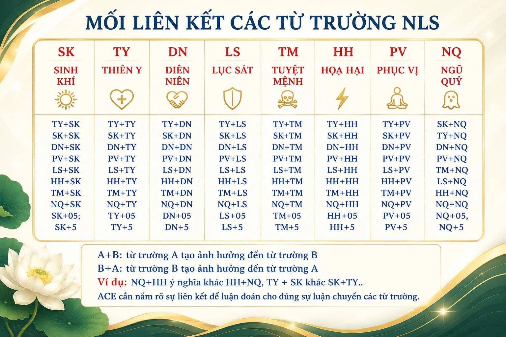

**Bản chép đã đối chiếu với ảnh nguồn:**

MỐI LIÊN KẾT CÁC TỪ TRƯỜNG NLS

| SK – Sinh Khí | TY – Thiên Y | DN – Diên Niên | LS – Lục Sát | TM – Tuyệt Mệnh | HH – Họa Hại | PV – Phục Vị | NQ – Ngũ Quỷ |
| --- | --- | --- | --- | --- | --- | --- | --- |
| TY+SK | TY+TY | TY+DN | TY+LS | TY+TM | TY+HH | TY+PV | SK+NQ |
| SK+SK | SK+TY | SK+DN | SK+LS | SK+TM | SK+HH | SK+PV | TY+NQ |
| DN+SK | DN+TY | DN+DN | DN+LS | DN+TM | DN+HH | DN+PV | DN+NQ |
| PV+SK | PV+TY | PV+DN | PV+LS | PV+TM | PV+HH | PV+PV | PV+NQ |
| LS+SK | LS+TY | LS+DN | LS+LS | LS+TM | LS+HH | LS+PV | TM+NQ |
| HH+SK | HH+TY | HH+DN | HH+LS | HH+TM | HH+HH | HH+PV | LS+NQ |
| TM+SK | TM+TY | TM+DN | TM+LS | TM+TM | TM+HH | TM+PV | HH+NQ |
| NQ+SK | NQ+TY | NQ+DN | NQ+LS | NQ+TM | NQ+HH | NQ+PV | NQ+NQ |
| SK+05 | TY+05 | DN+05 | LS+05 | TM+05 | HH+05 | PV+05 | NQ+05 |
| SK+5 | TY+5 | DN+5 | LS+5 | TM+5 | HH+5 | PV+5 | NQ+5 |

A+B: từ trường A tạo ảnh hưởng đến từ trường B.

B+A: từ trường B tạo ảnh hưởng đến từ trường A.

Ví dụ: NQ+HH ý nghĩa khác HH+NQ, TY+SK khác SK+TY.

ACE cần nắm rõ sự liên kết để luận đoán cho đúng sự luận chuyển các từ trường.

<a id="slide-026"></a>

### Slide 026: Số 0 và tính chất đặc biệt

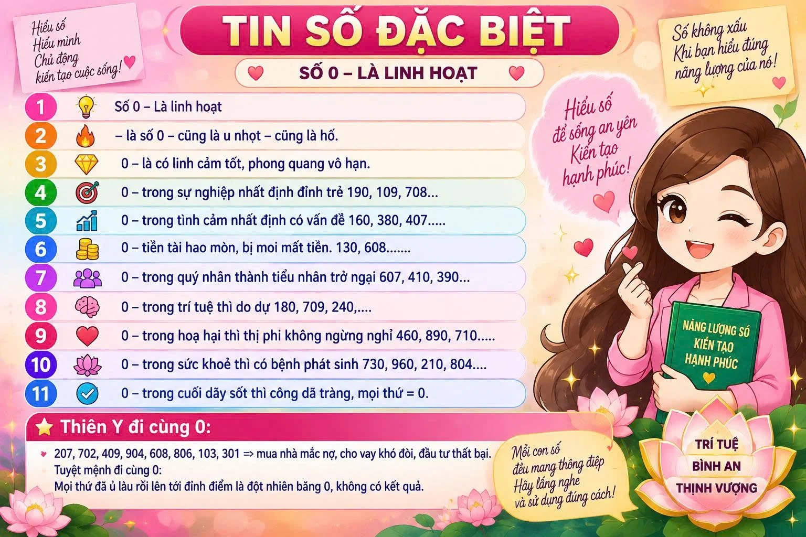

**Bản chép đã đối chiếu với ảnh nguồn:**

TIN SỐ ĐẶC BIỆT

SỐ 0 – LÀ LINH HOẠT

1. Số 0 – Là linh hoạt

2. – là số 0 – cũng là u nhọt – cũng là hố.

3. 0 – là có linh cảm tốt, phong quang vô hạn.

4. 0 – trong sự nghiệp nhất định đỉnh trẻ [nguồn ghi “đỉnh trẻ”, có thể là “đình trệ”] 190, 109, 708...

5. 0 – trong tình cảm nhất định có vấn đề 160, 380, 407.....

6. 0 – tiền tài hao mòn, bị moi mất tiền. 130, 608.......

7. 0 – trong quý nhân thành tiểu nhân trở ngại 607, 410, 390...

8. 0 – trong trí tuệ thì do dự 180, 709, 240,....

9. 0 – trong hoạ hại thì thị phi không ngừng nghỉ 460, 890, 710.....

10. 0 – trong sức khoẻ thì có bệnh phát sinh 730, 960, 210, 804....

11. 0 – trong cuối dãy sốt [nguồn ghi “dãy sốt”] thì công dã tràng, mọi thứ = 0.

#### Thiên Y đi cùng 0:

207, 702, 409, 904, 608, 806, 103, 301 => mua nhà mắc nợ, cho vay khó đòi, đầu tư thất bại.

Tuyệt mệnh đi cùng 0:

Mọi thứ đã ủ lâu rồi lên tới đỉnh điểm là đột nhiên bằng 0, không có kết quả.

Ghi chú bên cạnh: Hiểu số – Hiểu mình – Chủ động kiến tạo cuộc sống! Số không xấu khi bạn hiểu đúng năng lượng của nó! Hiểu số để sống an yên – Kiến tạo hạnh phúc! Mỗi con số đều mang thông điệp. Hãy lắng nghe và sử dụng đúng cách! Trí tuệ – Bình an – Thịnh vượng.

<a id="slide-027"></a>

### Slide 027: Số 5 và đặc tính

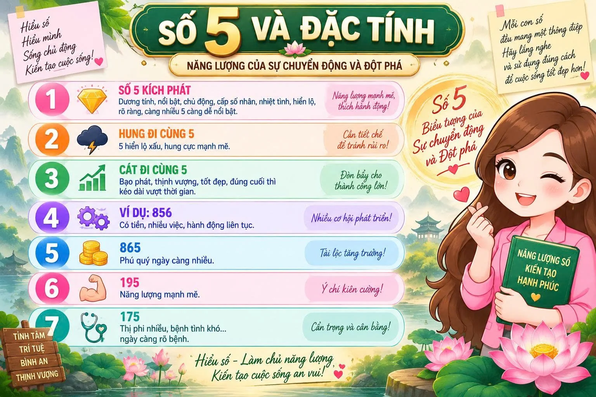

**Bản chép đã đối chiếu với ảnh nguồn:**

SỐ 5 VÀ ĐẶC TÍNH

NĂNG LƯỢNG CỦA SỰ CHUYỂN ĐỘNG VÀ ĐỘT PHÁ

#### 1. Số 5 kích phát

Dương tính, nổi bật, chủ động, cấp số nhân, nhiệt tình, hiển lộ, rõ ràng, càng nhiều 5 càng dễ nổi bật. (Năng lượng mạnh mẽ, thích hành động!)

#### 2. Hung đi cùng 5

5 hiển lộ xấu, hung cực mạnh mẽ. (Cần tiết chế để tránh rủi ro!)

#### 3. Cát đi cùng 5

Bạo phát, thịnh vượng, tốt đẹp, đúng cuối thì kéo dài vượt thời gian. (Đòn bẩy cho thành công lớn!)

#### 4. Ví dụ: 856

Có tiền, nhiều việc, hành động liên tục. (Nhiều cơ hội phát triển!)

#### 5. 865

Phú quý ngày càng nhiều. (Tài lộc tăng trưởng!)

#### 6. 195

Năng lượng mạnh mẽ. (Ý chí kiên cường!)

#### 7. 175

Thị phi nhiều, bệnh tình khó... ngày càng rõ bệnh. (Cẩn trọng và cân bằng!)

Ghi chú bên cạnh: Số 5 – Biểu tượng của sự chuyển động và đột phá. Hiểu số – Hiểu mình – Sống chủ động – Kiến tạo cuộc sống! Mỗi con số đều mang một thông điệp. Hãy lắng nghe và sử dụng đúng cách để cuộc sống tốt đẹp hơn! Hiểu số – Làm chủ năng lượng. Kiến tạo cuộc sống an vui! Tĩnh tâm – Trí tuệ – Bình an – Thịnh vượng.

<a id="slide-028"></a>

### Slide 028: Lưu ý về số 0 và số 5

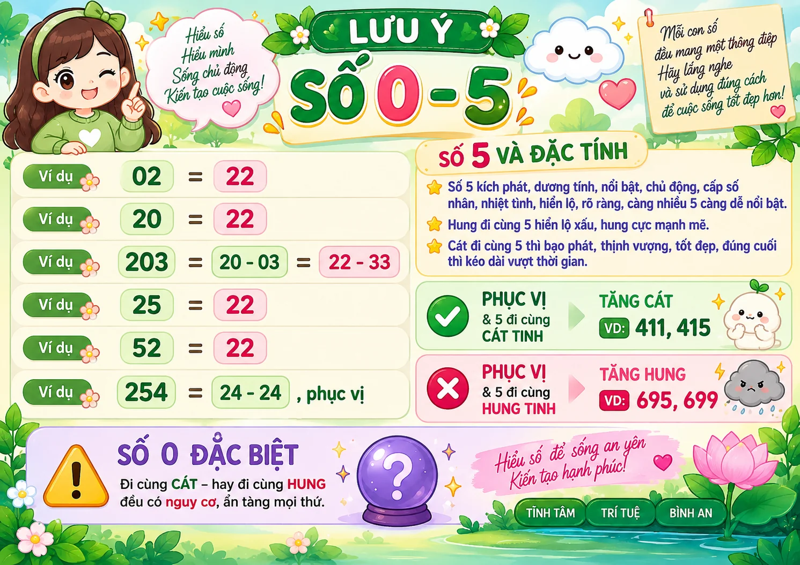

**Bản chép đã đối chiếu với ảnh nguồn:**

LƯU Ý SỐ 0–5

Hiểu số. Hiểu mình. Sống chủ động. Kiến tạo cuộc sống! Mỗi con số đều mang một thông điệp. Hãy lắng nghe và sử dụng đúng cách để cuộc sống tốt đẹp hơn!

#### Ví dụ trong nguồn

| Dãy minh họa | Biến đổi ghi trong slide |
| --- | --- |
| 02 | 22 |
| 20 | 22 |
| 203 | 20–03 = 22–33 |
| 25 | 22 |
| 52 | 22 |
| 254 | 24–24, phục vị |

#### Số 5 và đặc tính

Số 5 kích phát, dương tính, nổi bật, chủ động, cấp số nhân, nhiệt tình, hiển lộ, rõ ràng, càng nhiều 5 càng dễ nổi bật.

Hung đi cùng 5 hiển lộ xấu, hung cực mạnh mẽ.

Cát đi cùng 5 thì bạo phát, thịnh vượng, tốt đẹp, đứng cuối thì kéo dài vượt thời gian.

Phục Vị & 5 đi cùng cát tinh: tăng cát. Ví dụ: 411, 415.

Phục Vị & 5 đi cùng hung tinh: tăng hung. Ví dụ: 695, 699.

#### Số 0 đặc biệt

Đi cùng cát – hay đi cùng hung đều có nguy cơ, ẩn tàng mọi thứ.

Hiểu số để sống an yên – Kiến tạo hạnh phúc! Tĩnh tâm. Trí tuệ. Bình an.

<a id="slide-029"></a>

### Slide 029: Sinh Khí kết hợp số 0

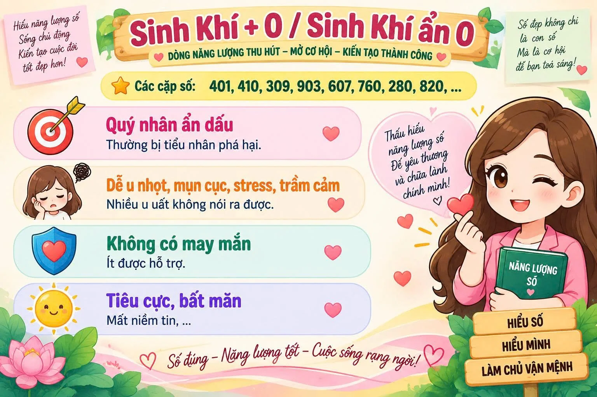

**Bản OCR chưa hiệu đính toàn văn** (điểm OCR: 61):

```text
ế œ ø e 2 .
Háunig my? œV mạo ẩA Số p khôn ch
HA ¬ Sinh Khi+ 0 / Sinh Khí an 0% bon 6i
nh @  QEơ: ® DỒNG NẴNG LƯỢNG THU HT - MỞ CƠ HỘI - KIẾN TẠO THÀNH CÔNg q; ===Z - - i
Từ Gác cặp số: 401, 410, 309, 903, 607, 760, 280, 820, ...
Quý nhân ẩn dấu ". 4ˆ
Thường bị tiểu nhân phá hại. tự ản Ôn Á
4® . =—m M‡ vi. (W=
Í <+ Dê u nhọt, mụn cục, stress, trầm cảm v kh mi
Ấ : Nhiều u uất không nói ra được. œ% ‹) gá
. GA @ Ầ
Không có may mắn -ˆ  ——
Ít được hỗ trợ. ⁄ | NĂNG Ñ
%# & lƯỢNp M3ÂHES#
À SỐ ⁄
HN sˆ x— v Á
(@ »- Tiêu cực, bất măn g é ... \ ậ
Nhờ „ Mấtniềm tin, ..
4
v lề
```

<a id="slide-030"></a>

### Slide 030: Lục Sát kết hợp số 0

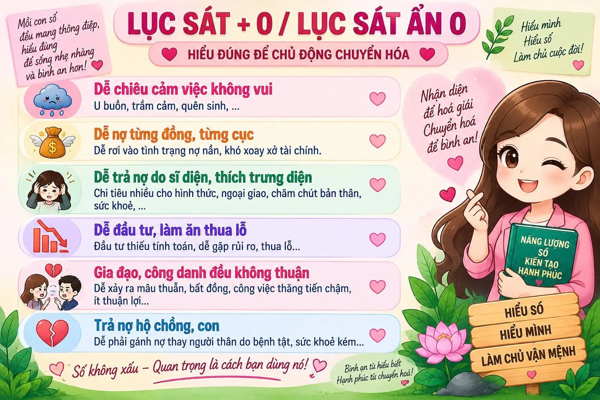

**Bản OCR chưa hiệu đính toàn văn** (điểm OCR: 68):

```text
S 4 4 x2
ã; con SỐ - —.
#z== LỤC SÁT +0/ LỤC SÁT ẨN 0 vợ
rẩu đù à - F = ng ¬ r ` lô 4. đi
kê nhàng ® HIẾU ĐÚNG ĐỀ CHỦ ĐỘNG CHUYỂN HÓA 9 ) làm chủ cuộc đài
TẾ Nà m hơn 9 — — ọ
Dễ chiêu cảm việc không vui Nhận thiên
. U buồn, trầm cảm, quên sinh, ... 9 để hoá giá 4
z ẩn hoá
= Dễ nợ từng đồng, từng cục S CHẾ ¬
Dễ rơi vào tình trạng nợ nần, khó xoay xở tài chính. để - ( `
` 4. Dễ trả nợ do sĩ diện, thích trưng diện l, J Wø Ế
Ứ SNÌ Chỉ tiêu nhiều cho hình thức, ngoại giao, chăm chút bản thân, @# c
Tx, sức khoẻ, ... ⁄Z%^ 5
D>A, - Dễ đầu tư, làm ăn thua lỗ đá 7 PS
lÌM Đầu tư thiếu tính toán, dễ gặp rủi ro, thua lỗ... ẹ N Í ÔNG ƯợNG
= = = = = tà ® KIẾN Tạo CÁ
„.S?. Gia đạo, công danh đều không thuận Ồ¿( S7 Z4
J 6: = ồn Dễ xảy ra mâu thuẫn, bất đồng, công việc thăng tiếnchậm, 2 2 Ẩ &^
TA? NA ít thuận lợi... 7
Trả nợ hộ chồng, con „ì
¡ KH Dễ phải gánh nợ thay người thân do bệnh tật, sức khoẻ kém... 9 - xêềy. -
PO T7 g0.
3> — nề 9T
 - ——u („| :
```

<a id="slide-031"></a>

### Slide 031: Diên Niên kết hợp số 0

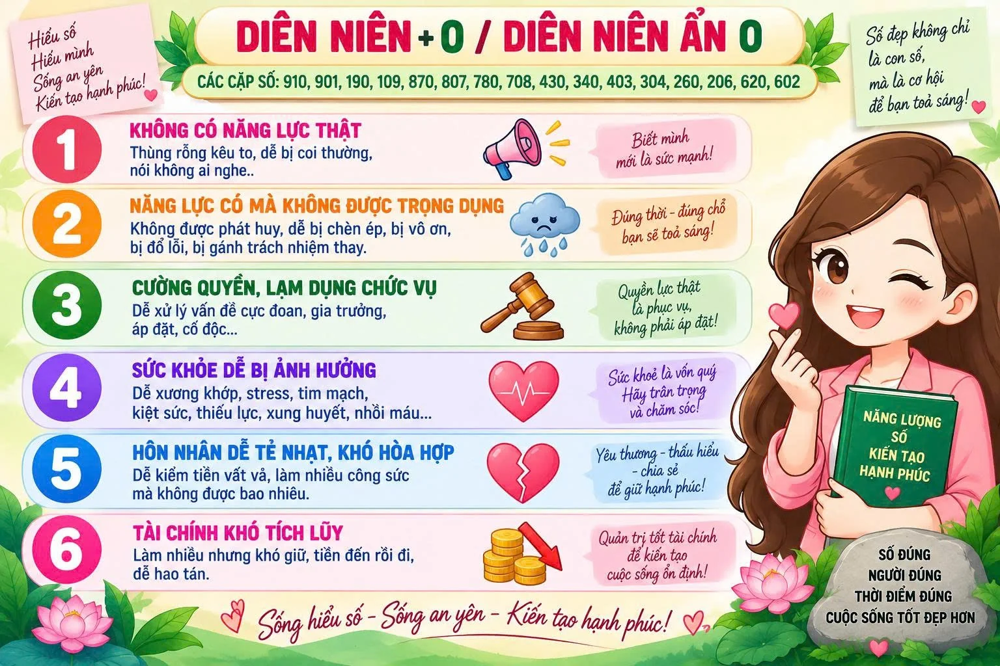

**Bản OCR chưa hiệu đính toàn văn** (điểm OCR: 65):

```text
Hệ N+0 / DIE NÂN0 gaylepei
Tiếu nhờ là cm Số
ống quá l nh phíc! CÁC CẶP số: 910, 901, 190, 109, 870, 807, 780, 708, 430, 340, 403, 304, 260, 206, 620, 602 mà là hi 7
Kón thô _— s để bạn boả sáng:
ng mu EU Điết mình ặ
Thùng rỗng kêu to, dễ bị coi thường, ( \ Ẹ 4 là sức mạnh! _-
nói không ai nghe.. mối là sức m ˆ<
# á ZZ”. Ù
a - tjời - đúng chỗ SN. À \
Không được phát huy, dễ bị chèn ép, bị vô ơn, - . số tủ sáng! Ø7 |
bị đổ lỗi, bị gánh trách nhiệm thay. 4020 á í
n . \
/ CƯỜNG QUYỀN, LẠM DỤNG CHỨC VỤ Quyền le tật ` J
| Dễ xử lý vấn đề cực đoan, gia trưởng, đi hp in |
\ áp đặt, cố độc... không phải áp đâU s
Z — R ở
SỨC KHÓE DE BỊ ÁNH HƯỚNG ˆ XZA cm.
Dễ xương khớp, stress, tim mạch, ‹ ; đãu trên trọng /Ã —”——<
kiệt sức, thiếu lực, xung huyết, nhồi máu... Š và chăm sóc' . NẴNG LƯỢNg
ợờ? T3 Nụ k1 2 ri ma - < P „SỐ
HÔN NHÂN DỄ TẺ NHẠT,KHÓHÒAHỢP 27D, @Ðm Và tàng cháy hết KIẾN TẠO
Dễ kiểm tiền vất vả, làm nhiều công sức cà nh ⁄ HẠNH PHÚc
\ mà không được bao nhiêu. ÿ đögghekghil | ( ; V :
lÍNH K U SA Quntjttàidinh và —m.
Làm nhiều nhưng khó giữ, tiền đến rồi đi, C -N để kiến tạo .A SỐ ĐÚNG
dễ hao tán. =_> cuộc sống ổn định! NGƯỜIĐÚNG `
.È: = NT  n ñ 5 THỜI ĐIỂM ĐÚNG 7
; Ni đấu luẩu số - đáng A/y lốp - Ấu đạo ÁenÁ phúc! v2). Á CUỘC SỐNG TỐT ĐẸP HƠN-
k —I Vv
```

<a id="slide-032"></a>

### Slide 032: Ngũ Quỷ kết hợp số 0

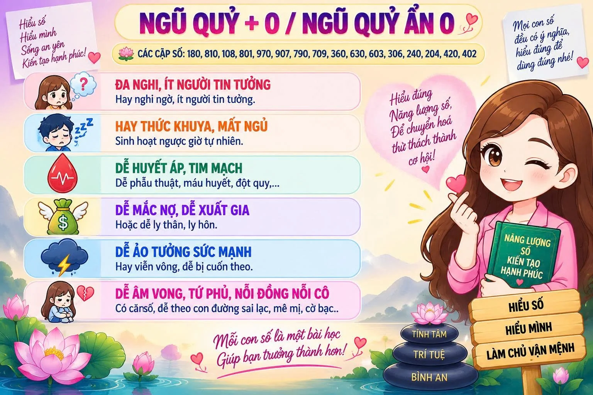

**Bản OCR chưa hiệu đính toàn văn** (điểm OCR: 58):

```text
~ 2 ~ 2
đi NGŨ OUÝ + 0 / NGŨ QUÝ AN0 nh
- li phíc] {Ö CÁC CẬP Số: 180, 810, 108, 801, 970, 907, 790, 709, 360, 630, 603, 306, 240, 204, 420, 402 in
⁄IA ể 2HI, ] L Ủ L Ẩ Z
Hay nghỉ ngờ, ít người tin tưởng. Hi ph. đế - m AT
z Ni lụt 7 VÀ
P52 JYA, MÃ bi Ầ -
_~>. Sinh hoạt ngược giờ tự nhiên. du áp. Í ø< \
DỄ HUYẾT ÁP, TIM MẠCH % R”
Dễ phẫu thuật, máu huyết, đột quy,...
z z ~ S7 m
DẼ MÁC NƠ, DE XUẤT GIA ›7ớ⁄(
ề. Hoặc dễ ly thân, ly hôn. / /“TR P.
" lỗ đ G —.—- ⁄ Í MĂNG LƯỢNg
DỄ Ả0 TƯỞNG SỨC MẠNH ) ( í xô
Ñ : Hay viễn vông, dễ bị cuốn theo. ) \ TĂNh TẠO
...... .Ề.ỆJ ni m— Sg si 5 vi HÚC =
m“ Øs ị . v x-_— mu
Ầ @x Có cănsố, đễ theo con đường sai lạc, mê mị, cờ bạc.. ” \ MiỂU SỐ:
lự › ĐA (Mất cu số fà mật đài đợc SH \  nf0MN.-
3 Qiúp bạ: tưởng thành Áøn/ ý v ng Em. u A CHỦ VẬN MỆNH
À 2 ( » un.
<< ——. BÌNHAÑ "®
```

<a id="slide-033"></a>

### Slide 033: Họa Hại kết hợp số 0

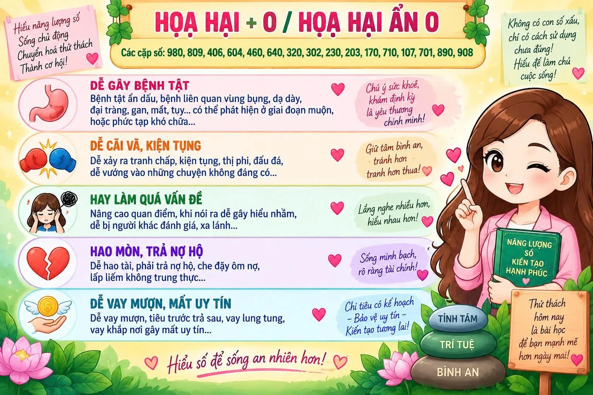

**Bản OCR chưa hiệu đính toàn văn** (điểm OCR: 64):

```text
M x
\ì P số Tư n .
_ HỌA HẠI+0/HỌA HẠIẨN 0 SỐ «sc-s2
Sống d nh ; chí có . ụ
| thuy hỏi tứ ưa Các cặp số: 980, 809, 406, 604, 460, 640, 320, 302, 230, 203, 170, 710, 107, 701, 890, 908 chưa đông
Thành cơ hỗ" ——————— —
_ H3 ˆ ˆ lộc sống!
ĩ DỄ GÂY BỆNH TẬT ® (/srko .
Œ Bệnh tật ẩn dấu, bệnh liên quan vùng bụng, dạ dày, khám định kỳ
s đại tràng, gan, mắt, tụy... có thể phát hiện ở giai đoạn muộn, là yêu thương ¡ S 7
Nà hoặc phức tạp khó chữa... chính mình! :
»Á⁄z_ ĐẼ CÃI VÃ, KIỆN TỤNG @ G96 bình an AP"” —`\
4Q, Dễ xảy ra tranh chấp, kiện tụng, thị phi, đấu đá, tránh hơn $9 . M ~
MA À dễ vướng vào những chuyện không đáng có... tranh hơn thual 9? q ` À ‹ “3
= ˆ ? J
:đ4S8AØ® HAY LÀM QUÁ VẤN ĐỀ \ Ễ ⁄ N
4 on TP: % Jáng nghe nhiêu lơ, 2
) Nâng cao quan điểm, khi nói ra dễ gây hiểu nhầm, in kml ⁄
dễ bị người khác đánh giá, xa lánh... hiểu "9 (( (“S8
. : /I MT
HA0 MÒN, TRẢ Nợ HỘ S“g ninh benh, “Ả ( s6 |
\ Dễ hao tài, phải trả nợ hộ, che đấy ôm nợ, Vl hi | ( KIÊN TẠO ,
Ắ bố rô ràng tài $ ÌL HẠNH PHÚC ⁄
NA. lấp liếm không trung thực... , —⁄¿ li <<
 - 5 > 5 ( > ø E
ng hh VÃ 2z nh
DỄ VAY MƯỢN, MẤT UY TÍN Chi tiêu có kể hoạc ii Thứ (Í
N ị Dễ vay mượn, tiêu trước trả sau, vay lung tung, g - Bảo vệ ug tín T xm.-_— ể hôm nau
Z vay khắp nơi gây mất uy tín... Kiến tạo tương lại 4 là bài học
ba R- HE n ñ P CA R TRÍ TUỆ oi ng l ị
&. la 4 lý sốn an nhiên hơn/ w Ấm J hơn ngày mailqg |
có má. lv Hi dc dâng 0 nh : 4 ` Áu BÌNH AN Em
```

<a id="slide-034"></a>

### Slide 034: Tuyệt Mệnh kết hợp số 0

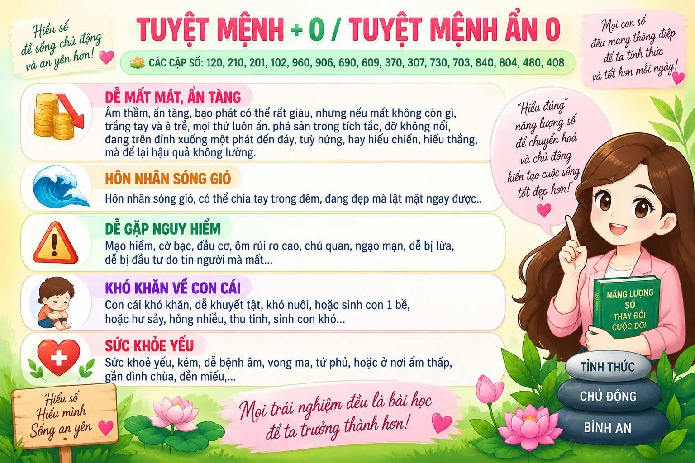

**Bản OCR chưa hiệu đính toàn văn** (điểm OCR: 70):

```text
^ ^ˆ^ ^ˆ ^ˆ ^ .
PT số ⁄ lọi 09h SỐ -
kn TUYET MỆNH +0 /TUYET MENHAN0 40
A gen “ta tính hức
và uðy hơn Kl 1 CÁC CẶP SỐ: 120, 210, 201, 102, 960, 906, 690, 609, 370, 307, 730, 703, 840, 804, 480, 408 đi buá Ap!
và tất hơn mỗi nộ đu
4 Z -
œ DỄ MẤT MÁT, ẨN TÀNG — -
- Âm thầm, ẩn tàng, bạo phát có thể rất giàu, nhưng nếu mất không còn gì, Tiểu - :
Lï = trắng tay và ê trề, mọi thứ luôn ấn. phá sản trong tích tắc, đỡ không nổi, năng lượn) w
— đang trên đỉnh xuống một phát đến đáy, tuỳ hứng, hay hiếu chiến, hiếu thắng, để chuyển hoá. .“SŸÕÊg 4
i mà để lại hậu quả không lường. và chì độn; ⁄
HÔN NHÂN SÓNG GIÓ Lá 4U
Hôn nhân sóng gió, có thể chia tay trong đêm, đang đẹp mà lật mặt ngay được.. :
% P -
DỄ GẶP NGUY HIỂM \ w cớ
Mạo hiểm, cờ bạc, đầu cơ, ôm rủi ro cao, chủ quan, ngạo mạn, dễ bị lừa, _
dễ bị đầu tư do tin người mà mất... Á 7/
yø  KHÓ KHĂN VỀ CON CÁI | mm
2 Con cái khó khăn, dễ khuyết tật, khó nuôi, hoặc sinh con 1 bề, | SỨ
= hoặc hư sảy, hỏng nhiều, thu tinh, sinh con khó... . | HA -
SỨC KHỎE YẾU NhuẾ SỐ).
" 4 Sức khoẻ yếu, kém, dễ bệnh âm, vong ma, tứ phủ, hoặc ở nơi ẩm thấp, y ĐU TÌNH THỨC
` gần đình chùa, đền miếu,... Ñ L loa vs )
Ì á X - TIẾN
Nhé lan TU ÔN ˆ to
điều mìó L7 /đu trái nghiệm in We® .
An X để ta trưởng đành : - 2> BÌNHAN
Ể h . 7 du -G -
```

<a id="slide-035"></a>

### Slide 035: Thiên Y kết hợp số 0

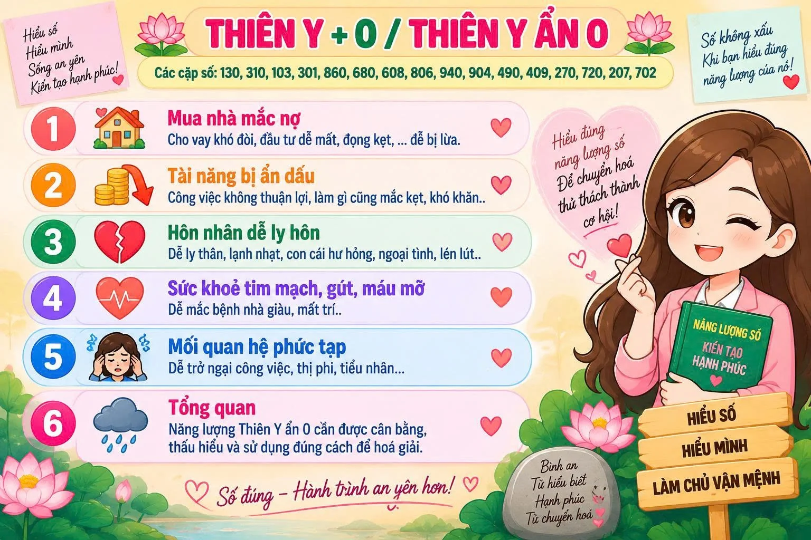

**Bản OCR chưa hiệu đính toàn văn** (điểm OCR: 65):

```text
Hài 5z +0 / Sá không xấu
SP Ôi, uan,
The hạnh phúc. Các cặp số: 130, 310, 103, 301, 860, 680, 608, 806, 940, 904, 490, 409, 270, 720, 207, 702 năng) lượng của nổ"
7A
gu y ˆ 4
ni Cho vay khó đòi, đầu tư dễ mất, đọng kẹt, ... đễ bị lừa. Hiôu đúng - “2
_, ^.,
c-S năng heo, 2 là
EzÀA ø chuuô Z
ng HN . Ạ Đồ 9 3 thanh
È S# Công việc không thuận lợi, làm gì cũng mắc kẹt, khó khăn.. dù bóc: ï -
 s, ˆ ân dà ˆ œ hội
@®) Hôn nhân dễ ly hôn 4 J
Ð Dễ ly thân, lạnh nhạt, con cái hư hỏng, ngoại tình, lén lút.. ) s 7
ˆ
Sức khoẻ tim mạch, gút, máu mỡ /
XS Dễ mắc bệnh nhà giàu, mất trí. ( HR<x—=
⁄ 7 Em Mi NÀNG LƯỢNG số
í 2/ØØ„\$ Mối quan hệ phức tạp . Ki Tin
là qé®\ Dễ trở ngại công việc, thị phi, tiểu nhân... / ⁄ "ah
.
, U số
Cà Năng lượng Thiên Y ẩn 0 cần được cân bằng, ng L :
2 0 thấu hiểu và sử dụng đúng cách để hoá giải. HIẾU MÌNH
A7 Dnha  Ñ —
.>= Lh.l, ô / v7 Tuháubố ., CHỦ VẬN MỆNH
Sế đúng - 1ành bì an gêu đơn: 0o kẻ LÀM CHỦ \
```

<a id="slide-036"></a>

### Slide 036: Quy trình luận số

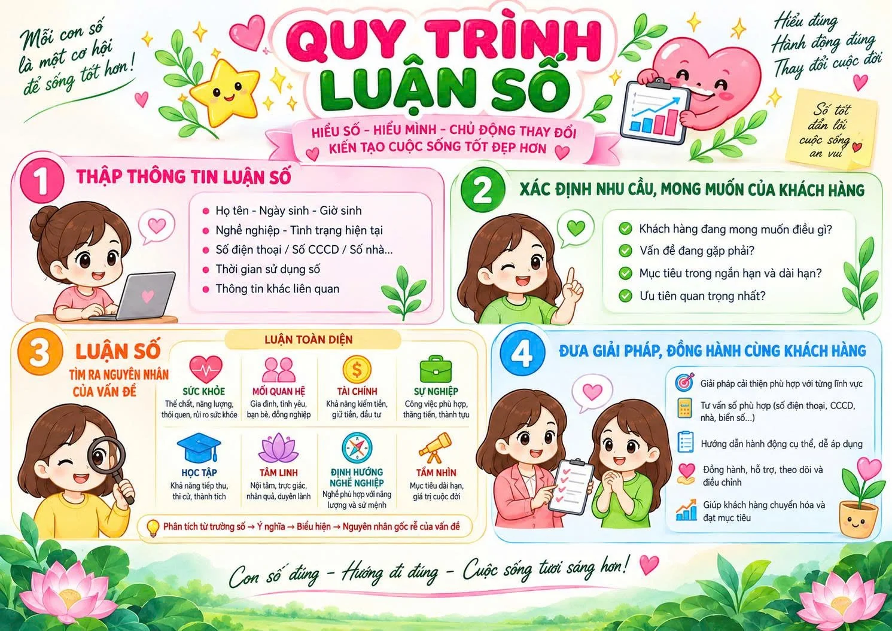

**Bản chép đã đối chiếu với ảnh nguồn:**

QUY TRÌNH LUẬN SỐ

Hiểu số – Hiểu mình – Chủ động thay đổi – Kiến tạo cuộc sống tốt đẹp hơn.

Mỗi con số là một cơ hội để sống tốt hơn! Hiểu đúng. Hành động đúng. Thay đổi cuộc đời. Số tốt dẫn lối cuộc sống an vui.

#### 1. Thập thông tin luận số [tiêu đề ghi trong nguồn]

Họ tên – Ngày sinh – Giờ sinh. Nghề nghiệp – Tình trạng hiện tại. Số điện thoại / Số CCCD / Số nhà... Thời gian sử dụng số. Thông tin khác liên quan.

#### 2. Xác định nhu cầu, mong muốn của khách hàng

Khách hàng đang mong muốn điều gì? Vấn đề đang gặp phải? Mục tiêu trong ngắn hạn và dài hạn? Ưu tiên quan trọng nhất?

#### 3. Luận số – Tìm ra nguyên nhân của vấn đề

Luận toàn diện theo các chủ đề trong tài liệu:

- Sức khỏe: Thể chất, năng lượng, thói quen, rủi ro sức khỏe.
- Mối quan hệ: Gia đình, tình yêu, bạn bè, đồng nghiệp.
- Tài chính: Khả năng kiếm tiền, giữ tiền, đầu tư.
- Sự nghiệp: Công việc phù hợp, thăng tiến, thành tựu.
- Học tập: Khả năng tiếp thu, thi cử, thành tích.
- Tâm linh: Nội tâm, trực giác, nhân quả, duyên lành.
- Định hướng nghề nghiệp: Nghề phù hợp với năng lượng và sứ mệnh.
- Tầm nhìn: Mục tiêu dài hạn, giá trị cuộc đời.

Phân tích từ trường số → Ý nghĩa → Biểu hiện → Nguyên nhân gốc rễ của vấn đề.

#### 4. Đưa giải pháp, đồng hành cùng khách hàng

Giải pháp cải thiện phù hợp với từng lĩnh vực. Tư vấn số phù hợp (số điện thoại, CCCD, nhà, biển số...). Hướng dẫn hành động cụ thể, dễ áp dụng. Đồng hành, hỗ trợ, theo dõi và điều chỉnh. Giúp khách hàng chuyển hóa và đạt mục tiêu.

Con số đúng – Hướng đi đúng – Cuộc sống tươi sáng hơn!

<a id="slide-037"></a>

### Slide 037: Câu hỏi khai thác thông tin

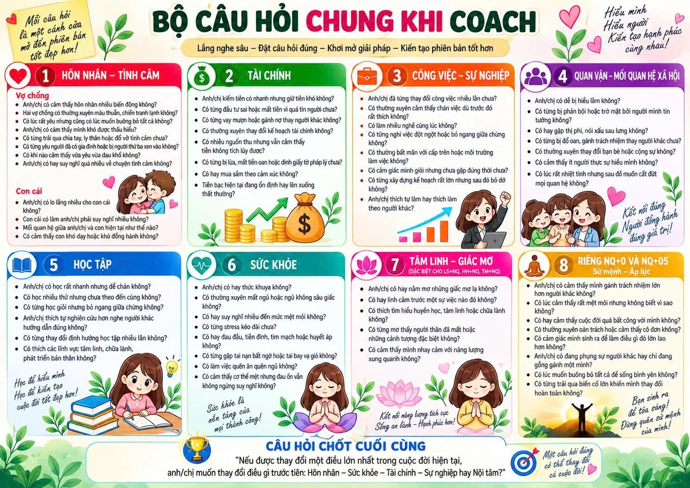

**Bản OCR chưa hiệu đính toàn văn** (điểm OCR: 66):

```text
- ^ˆ gì ?2 HN
\ 4# câu Bối gểu CA
| /đổ câu : ~¬ 7 %
n gánh. gn //ốa xgườ Á pháo
Ạ ốc phiên Bến ° —¬— n G đế áp hô?
vở đun. .. Lắng nghe sâu - Đặt câu hỏi đúng - Khơi mở giải pháp - Kiến tạo phiên bản tốt hơn gi) Tu như
gấp GP Ôi ¬ š HA
@) 1 HÔN NHÂN - TÌNH CÂM 2 TÀI CHÍNH 3) CÔNG VIỆC - SỰ NGHIỆP CÀ 4. QUAN VẬN - MỐI QUAN HỆ XÃ HỘI
Vợ chống Anh/chị kiến tiền có nhanh nhưng giữ tin khó không?.  Anh/chị đã từng thay đổi công việc nhiều làn chưa? ¡ có dễ bị hiểu lâm khôi
'®  Anh/chị có cảm thấy hôn nhân nhiều biển động không?. ⁄ ph . ¬ sô 0246 Ép " kiến ng đ - mm sà n n vs + Anhíeh có dễ ị hệ lêm không? -
® Hdivợchống có thưởng xuyên mâu thuẫn, chiến ranh gnh không? |. ® Có từng đều tự sai oặc mất tên vì quá tín người chưa? E no: Ỹ Có từng bị phản bội hoặc trở mặt bởi người mình tín
:® Có lúc rất yêu nhưng cũng có lúc muốn buông bỏ tất cả không? 1® Gó từng vay mượn hoặc gánh nợ thay người khác không? $: Gố âm nhiều nghệ cing ức Không? tưởng không?
1® Anh/cị có cảm thấy mình khó dượ thấu hiểu? ® Có thường xuyên thay đổi kế hoạch tài chính không?. si tin nghi đột nght hoặc bỏ ng NGg 1® Có hay gặp thị ph, nói xấu sau lưng không?
œ Cố từng trải qua ch tay, lý thân hoặc đồ vỡ ảnh cảm chị? ® Có nhiều nguồn thu nhưng vẫn cảm thấy không? 1 Có từng bị đồ oan, gánh trách nhiệm thay người khác chưa?
$ 39g giỚ 0e SnhoKclingg- 9019 ạn vo ng? tiên không tích lúy dược? 6 ất ấp trẻ ờ 1® Có thường xuyên thay đổi bạn bè hoặc cộng sự không?
1® Cá khinào cảm thấy vừa yêu vừa đau khổ không? gtích lũy + Có thường bất mãn với cấp trên hoặc mồi tường g xuyên thay đổi bạn bè hoặc cộng sự không
'®. Anh/chị có hay suy nghĩ quá nhiều vẻ chuyện tình cảm không? 1® Có từng bị lùa, mất tiền oan hoặc dính giấy tờ pháp lý chưa? làm việc không? ' Có cảm thấy ít người thực sự hiểu mình không?
1® Có hay mua sắm theo cảm xúc không? l - cán - in hon gặp đứng thời. mi Có lúc rất nhiệt tình nhưng sau đồ muốn cất đứt |
, qg ® Tiên bạc hiện tại đang ổn định hay lên xuống s me 5.0960) hog ii lớp lân ưng s9) 9906 mọi quan hệ không?
Con cái thất hưởng? „ í .®
1®. Anh/chịcó lo lắng nhiều cho con cái SỔ + Anhchithíchtlàmhaythíchim “đãẸ 1 @ Ñ ấu
không? Ẽ theo người khác? , Ly x l số đúng -
1® Con cái có làm anh/chị phải suy nghĩ nhiều không? | 2] Mô bình
'® Mối quan hệ giữa anh/chị và con hiện tại như thể nào? ĩ MẠ “s 4 4Ø@à» lờ li trị
1® Có cảm thấy con khó dạy hoặc khó đồng hành không? „ lh] ÿ ; S 2 CƯ] 2 Augf"
5 HỌ0CTẬP 6 SỨC KHỎE v 7 ) TÂM LINH - GIÁC MƠ 8 RIÊNG NG+0 VÀ NG+05
ÚC lÀ (ĐẶC BIỆT CHO (5£NG, HH+NG, TM+NG) Sứ mệnh - Áp lực
 Anh/chị có học rất nhanh nhưng để chán không?  Anh/chị có hay thức khuya không? | «A0 tếp nhi bờ những 06 ng KhđEP na
: : ỗ in hs số gi an HH lơn người khác không?.
ặ t - nhiều thứ = theo m - pm in xuyên mất ngủ hoặc ngủ không sâu giấc ® Có hay inh cảm trước một sự Việc nào đó không? ' Cố lúc cản thấy rất một mới những không biết sao
ng học giới những bỏ ngăng giữề chủng không? s? hố . 1® Có thích tìm hiểu huyền học, tâm linh hoặc chữa lành không?
® Anh/chị thích tự nghiên cứu hơn nghe người khác 0 hy 00 Lo không? 1s Có hay cảm thấy cuộc đời quá bất công với mình không?.
hướng dẫn đúng không? Si mà 1$ Có từng mơ thấy người thân đã mất hoặc 1® Có thường xuyên oán trách hoặc cảm thấy cô đơn không?.
Có từng thay đổi định hướng học tập nhiều lẫn không?. ® Có hay đau đầu, tiền đình, tìm mạch hoặc huyết áp những cảnh tượng đặc biệt không? 1 Có cảm giác mình sinh ra để làm điều gì đó lớn lao
Có thích các lĩnh vực tâm linh, chữa lành, không? . Cố cảm thấy mình nhay cảm với năng lượng | hơn không?
phát triển bản thân không? KVềU | œ_ Có từng gặp tai nạn bất ngờ hoặc tai bay vạ gió không? xung quanh không? | 1s Anh/chị có đang phụng sự người khác hay chỉ đang
gi 's Có làm việc quên ăn quên ngủ không?. gồng gánh một mình?.
để ki P Có cảm thấy cơ thể mệt nhưng đau ốn vẫn. #9 0ó lúc muốn buông bỏ tất cả để sống bình yên không?
là - diến 9? J không ngừng suy nghĩ không? d - &% 5 '_ Có từng trải qua biến cổ lớn khiển mình thay đổi
-ˆ An Ñ : NN hoàn toàn không? ch |
- ai té? c< Z_R ). sp Bé Ê, VY N ư Tà ‹ W đu ti
ì => — làn tô vn vi Ạ 6à Z2) (6ư6ng kng táee.-lÍ ÁPIẤM ì để cự. số nội
S r : ! Pa Ễ x._mi mì _ lá
\ ~— N—= ve Hành << Đi ĐÔ gi
ÕỡỒỡỡ37Ĩƒm7'K— Xã Nà, s44 "co ạ
CÂU HỎI CHỐT CUỐI CÙNG A
N “Nấ cv? 5 ất ˆ : hiâ h lột Á
` # Nếu được thay đổi một điều lớn nhất trong cuộc đời hiện tại, @ in 4 J
Ẩ anh/chị muốn thay đổi điều gì trước tiên: Hôn nhân - Sức khỏe ~ Tài chính - Sự nghiệp hay Nội tâm?” cả cuộc đài ? |
```

<a id="slide-038"></a>

### Slide 038: Câu hỏi đối chiếu theo kết hợp từ trường

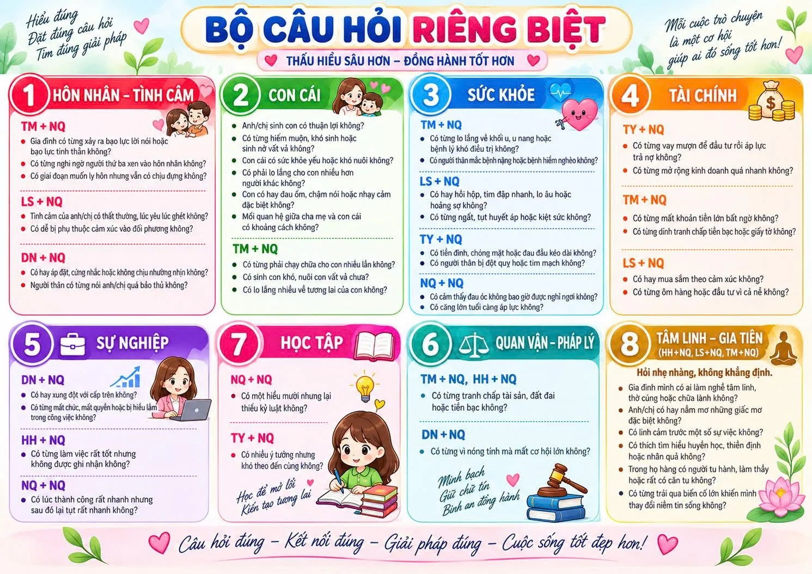

**Bản OCR chưa hiệu đính toàn văn** (điểm OCR: 63):

```text
_— ˆ _ 2" , ˆ^ mm
điếi đê? Ga - suậc tò cgên
„+ đáng 0B TU, h An
2u ẨNn 5 ni hp | mm
Tin d9 đố ° xo GoosoosBuyuh ° . . Xe
r ® THẤU HIỂU SÂU HƠN - ĐỒNGHÀNH TỐTHƠN. ”
iu du. dư AE Ca dd LU  ld  vn ủ
⁄ xe
- z Ệ ;.ÐẤN Ã m 2 R ỹ À ñ - ;
@m NHÂN - TÌNH CÂM Ÿ (2) CON CÁI (3) sỨCKHỎE Q8. TÀICHÍNH ZÈÿ
mm. Ñ (CO. p - Œ
TM+NQ «“” PA. Z | ® Anh/chị sinh con có thuận lợi không? TM+NQ X TY+NQ
cà. Á tì ất ái B ¬ Á
'® Gia đình có từng vây ra bạo lực lồi nổi hoặc Có từng hiểm muộn, khó sinh hoặc ® Có từng lo lắng về khối u,u nang hoặc h _~"
tt Sinh nờ vất vả không? bệnh lý khó điều trị không? ® Có từng vay mượn để đầu tư rồi áp lực
® Gốtìngnghingờngườithứbaxenvàohônnhânkhông? | | ® Con đi có sức khỏe yểu hoặc khó nuôi không? | | '® Cóngườithân mắc bệnhnặng hoặc bệnh hiểm nghèo không? trả nợ không?
1® Có giai đoạn muốn lyhôn nhưng vẫn có chịu dựng không? | | ® Có phải lo lắng cho con nhiều hơn TH AC ntrECGsEPsEsiceooecoroececcc '®_ 0ó từng mở rộng kinh doanh quá nhanh không?
: người khác không? LS+NQ 99020 đ GG
77777777: 11 & Cơn có hay đau ốm, chậm nói hoặc nhạy cảm Có hay hồi hộp, tìm đập nhanh, lo âu hoặc
LS+NQ đặc biệt không? hoảng sợ không? TM+NQ
° Tình cảm của anh/ch ó thất thường, lúc yêu lúc ghét không? ° Mối quan hệ giữa cha mẹ và con cái ® Có từng ngất, tụt huyết áp hoặc kiệt sức không? '® Có từng mất khoản tiền lớn bất ngờ không?
® Có dễ bị phụ thuộc cảm xúc vào đổi phương không? M7" vn ng  s uụ đó từng dính tranh chấp tiền bạc hoặc giấy tờ không?
DN+NG II TM bể NQ '® Có tiền đỉnh, chóng mặt hoặc đau đầu kéo dài không? oi am
.. Ã '® Có từng phải chạy chữa cho con nhiều lần không? '® Có người thân bị đột quy hoặc tìm mạch không? LS+NQ
° AE Kho na Bo no bẻ 1® Có sinh con khó, nuôi con vất vả chưa? NGỰNG ——— '® Có hay mua sắm theo cảm xúc không?
® Người từng ? B ư Ta |  nn
(gười thân có từng nói anh/chị quá bảo thủ không: '® 0ó lo lắng nhiều về tương lại của con không? hiện 1® Có từng ôm hàng hoặc đầu tư vì cả nễ không?
1® Có căng lớn tuổi cảng áp lực không?
#8 SỰ NGHIỆP ) nọcTậP Z|9. 90A VẬN- MP LÝ TẠM LINH - GIÁ TIÊN E Ạ
(5) N 2v Š 9 : cư. | >8 ở (HH+NQ,LS+NQ,TM+N0) ) LỆ
si g Hỏi nhẹ nhàng, không khẳng định.
DN+NQ ⁄4ã ® | Ng+NQ -@- TM+NG, HH+NQ sen. hụn: xo. n :
: : ° ,
® G6nyxungditvicpuonion? (9S x4 '® Có một hiểu mười nhưng lại ® Có từng tranh chấp tài sản, đất đai thờ cúng hoặc chữa lành không?
°® Gá từng mất chức, mất quyền hoặcbị hiểu lằm. Ni g thiểu kỷ luật không? 2 hoặc tiền bạc không? '_ Anh/chị có hay nằm mơ những giấc mơ.
trong công việc không? : £  — = .Ỉ”—”méé Ể ỷề đặc biệt không?
ẫHẾN Í TY+NQ DN+NQ 1® Có inh cảm trước một số sự việc không?
® Có từng làm việc rất tốt hưng s Gốnhằujưởnnhng  Â ® Cốtìngvinóngtnhmàmấtcơhộilónkhông? | ° xi ion
không được ghi nhận không? khó theo đến cùng không? (»~ - JÃ . - Aoh V ® Trong họ hàng có người tu hành, làm thầy
đa. CN lai Ha XE HG SỐ . ; Í sá 2ô hoặc rất có căn tu không?
NQ+NQ PU v cíẢÁó= gái ất TẾ
mu Ai n / k 2 / x 1® Có từng trải qua biến cố lớn khiển mình
Có ắc thành công rất nhanh nhưng. #. ,. 2S = đ đây đà cu
sau đó lại tụt rất nhanh không?. liốt — \ giá” .. thay đổi niềm tìn sống không?
sư G  NG =————— HH
xi PP. in Ấn in
Sa .ỖỖ  Y` XU 74
```

<a id="slide-039"></a>

### Slide 039: Cách kết hợp số

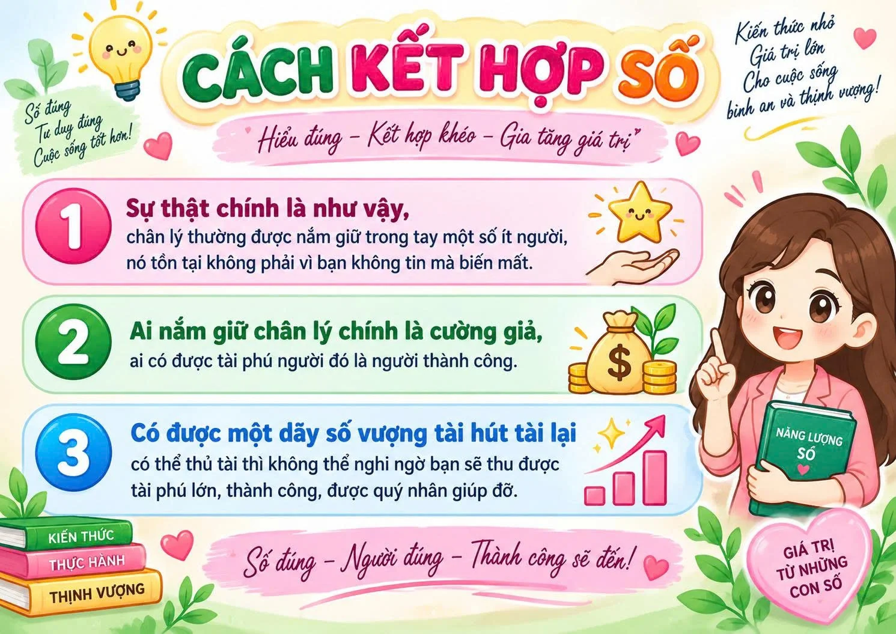

**Bản OCR chưa hiệu đính toàn văn** (điểm OCR: 61):

```text
S.f
` , = ắ
~ —. 4u thức nhỏ
r . - @. w2 : œ2, tr 7/2 9
V 2Ý CÁCH KẾT HỢP SỐ S75
\ d øS. U
1 77C KT SN
duy A Ị M - ⁄ - 7 ¬ - ~ ~- ., * _
-
ZãA ¬¬ mm... ˆ ⁄ XẠ v
Sự thật chính là như vậy, a xœ. ^
chân lý thường được nắm giữ trong tay mộtsốítngười, SA é
Ñ nó tồn tại không phải vì bạn không tin mà biến mất. <Rs : ; Z
ST ..l135 8e
Ai năm giữ chân lý chính làcường giả, ^ \ tg ,⁄
ai có được tài phú người đó là người thành công. = >>
- (ru
Í Có được một dãy số vượng tài hút tài lại $⁄4$ lưƯm
có thể thủ tài thì không thể nghi ngờ bạn sẽ thu được | NỔ ba ¬
tài phú lớn, thành công, được quý nhân giúp đỡ. J 2X ..
KIẾN THỨC ì .<@ - s N P. Ắ \
— . Z ` ˆ ưỚT. GIÁ TRÌ
THINH VƯỢN! —5]""“—
```

<a id="slide-040"></a>

### Slide 040: Cách kết hợp số (lặp lại)


**Bản OCR chưa hiệu đính toàn văn** (điểm OCR: 61):

```text
S.f
` , = ắ
~ —. 4u thức nhỏ
r . - @. w2 : œ2, tr 7/2 9
V 2Ý CÁCH KẾT HỢP SỐ S75
\ d øS. U
1 77C KT SN
duy A Ị M - ⁄ - 7 ¬ - ~ ~- ., * _
-
ZãA ¬¬ mm... ˆ ⁄ XẠ v
Sự thật chính là như vậy, a xœ. ^
chân lý thường được nắm giữ trong tay mộtsốítngười, SA é
Ñ nó tồn tại không phải vì bạn không tin mà biến mất. <Rs : ; Z
ST ..l135 8e
Ai năm giữ chân lý chính làcường giả, ^ \ tg ,⁄
ai có được tài phú người đó là người thành công. = >>
- (ru
Í Có được một dãy số vượng tài hút tài lại $⁄4$ lưƯm
có thể thủ tài thì không thể nghi ngờ bạn sẽ thu được | NỔ ba ¬
tài phú lớn, thành công, được quý nhân giúp đỡ. J 2X ..
KIẾN THỨC ì .<@ - s N P. Ắ \
— . Z ` ˆ ưỚT. GIÁ TRÌ
THINH VƯỢN! —5]""“—
```

<a id="slide-041"></a>

### Slide 041: Nguyên tắc thiết kế kết cấu số

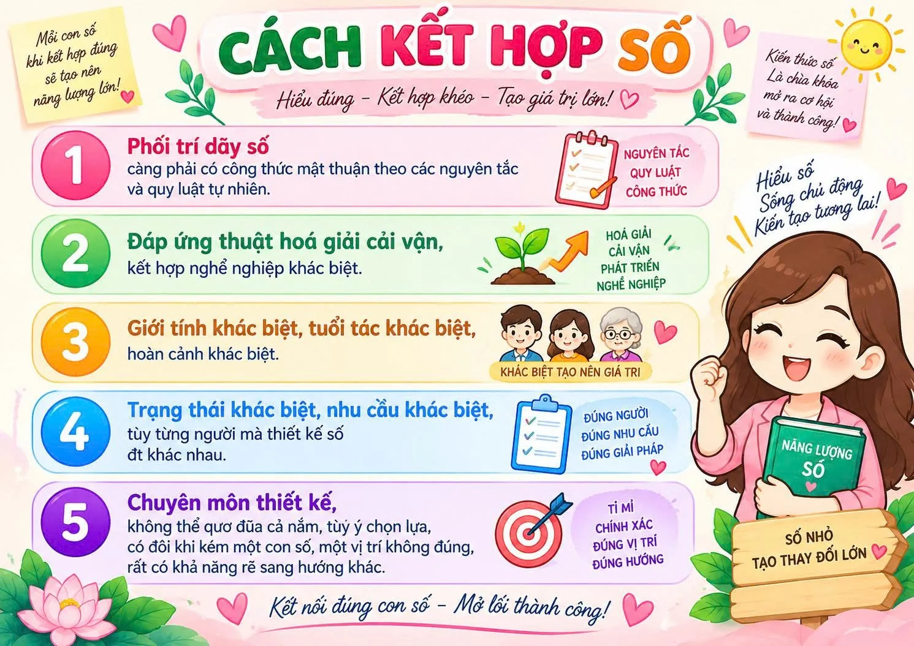

**Bản OCR chưa hiệu đính toàn văn** (điểm OCR: 64):

```text
xổ vớ
x„ Sẻ cá KẾT HỢP SỐ }> „.;©:
„„  cAẠcCH P SO l7 „.;S?
D vÀ 320262 8Á
¬ "Khẩu đúng - Kết Ágp ẢÁóo - 2o giá ý đn/ 2 2n ơn
và 5 ước
| Phối vì dãy La nu ~ NGUYÊN TÁC n
càng phải có công thức mật thuận theo các nguyên tắc QUY LUẬT (Au§ế
và quy luật tự nhiên. CÔNG THỨC u chủ, đế / 02
n - ——m—-=— 2x tạø 0696
Đó ứ th ôth 2 9 - gió Ai $ HOÁ GIẢI 2 Ni Z
áp ứng thuật hoá giải củi vận, „ CẢVẬN Z2 CÔN Á
kết hợp nghể nghiệp khác biệt. ^ PHÁT TRIỀN
NGHỀ NGHIỆP ;
ĐT NÓ ñ . AE ñ . :
Giới tính khóc biệt, tuổi tác khác biệt, Lư”, Ca @e: . {
hoàn cảnh khác biệt. " Z%2^
— KHÁC BIỆT TẠO NÊN GIÁ TRI ì
Trạng thái khác biệt, nhu cầu khác biệt, 3 suxe xeười 4S».
{ tùy từng người mà thiết kế số púxeNnUclu | Ấ —
đt khác nhau. ĐÚNG GIẢI PHÁP (⁄) MANG LƯợnc, À
lũ GT5537ÐD0ACS>3Ỡ)3CS=":'777:ú 4 Z .s A
⁄ — 7N NHI Ñ v Ặ ]
Chuyên môn thiết kế, tìMÌ ; àha”-.
không thể quơ đũa cả nắm, tùý ý chọn lựa, CHÍNH XÁC à
có đôi khi kém một con số, một vị trí không đúng, ĐÚNG VỊ TRÍ  - na ;
rất có khả năng rẽ sang hướng khác. ĐÚNG HƯỚNG = TẠO THẢ L  ui
= == —
- Q9 /Ø nối đứng ơm số - /Í2 Øí đàn cào) ÔØ 72782
```

<a id="slide-042"></a>

### Slide 042: Quan điểm ứng dụng số trong tài liệu

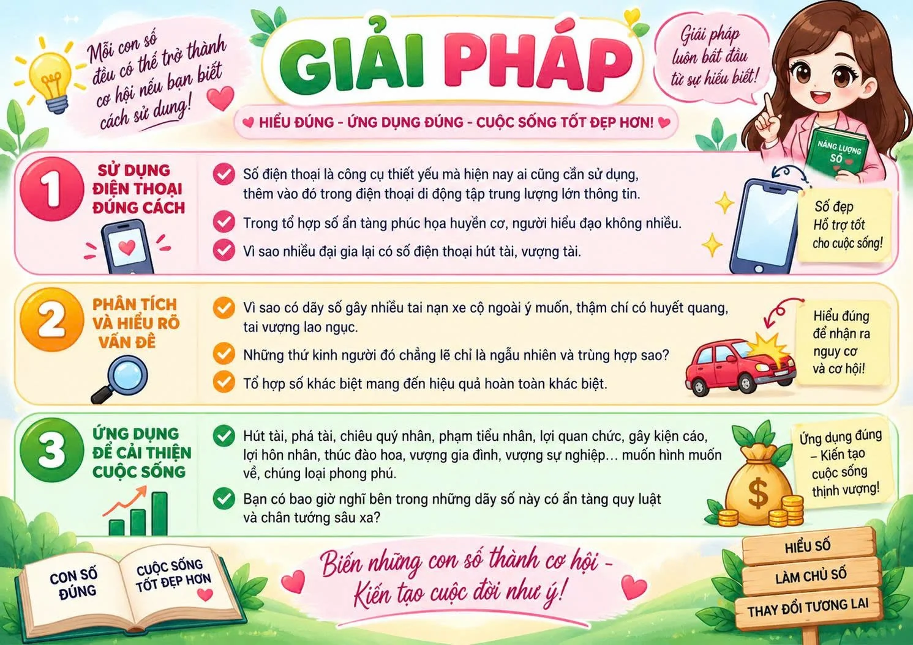

**Bản OCR chưa hiệu đính toàn văn** (điểm OCR: 70):

```text
& ch Ốc hành › ¬ ˆ ki (⁄% VA
Mối 9 vá tở hi lànbátdu (
EU đà Ó bạn bi \ #wlút ki
œ hội ; dunjl $“ — \ =
k cách Sử Ố” ® HIỂU ĐÚNG - ỨNG DỤNG ĐÚNG - CUỘC SỐNG TỐT ĐẸP HƠN! %9 G1] Sàn )
À w Z Ñ Ta. -
H SỐ
ä SỬ DỤNG © Số điện thoại là công cụ thiết yếu mà hiện nay ai cũng cần sử dụng, \ |
mê thêm vào đó trong điện thoại di động tập trung lượng lớn thông tin. ề = .
Ô đẹp
ù @© Trong tổ hợp số ẩn tàng phúc họa huyền cơ, người hiểu đạo không nhiều. J Hồ trợ tốt
Z , : CA NT HẠ . J lị
- Ũ = @© Vì sao nhiều đại gia lại có số điện thoại hút tài, vượng tài. j cho cuộc sống
z& L7 ⁄
á : PHÂN TÍCH ® Vì sao có dãy số gây nhiều tai nạn xe cộ ngoài ý muốn, thậm chí có huyết quang, ._¬ Hiểu đún
VÀ HIẾU RO tai vượng lao ngục. mô
VẤN ĐỀ g gu s 4 để nhận ra
© Những thứ kinh người đó chẳng lẽ chỉlàngẫu nhiênvàtrùnghợpsao? . 7Ï À‹< = nguy cơ
CA và cơ hội!
2 Tổ hợp số khác biệt mang đến hiệu quả hoàn toàn khác biệt. te -4Y
í ỨNG DỤNG ® Hút tài, phá tài, chiêu quý nhân, phạm tiểu nhân, lợi quan chức, gây kiện cáo, í Ứng dụng đúng
ĐỂ CẢI THIỆN lợi hôn nhân, thúc đào hoa, vượng gia đình,vượngsự nghiệp...muốnhình muốn ¬ - Kiến tạo
cuộc SỐNG về, chúng loại phong phú. cuộc sống
| . ® Bạn có bao giờ nghĩ bên trong những dãy số này có ẩn tàng quy luật œ thịnh vượvei
Ế siñ và chân tướng sâu xa? s5
¬ —. 3 3ÁẶMÄGÄGƯỜ II
Onsố Ý cugcsốwe \ 4 fĐiến những cøn, số Ứhàn, cơ đột - .
tt c Ốt ĐẸP RƠN R . ; -
\ ÚNG AI ' 2 / \
MS “VỊ (đến tạo cuộc đề) n ý, % lề  nmnnT
_~> v- — ———<<9-1———— .
= . nh IIR
```

<a id="slide-043"></a>

### Slide 043: Lợi ích học tập theo tài liệu

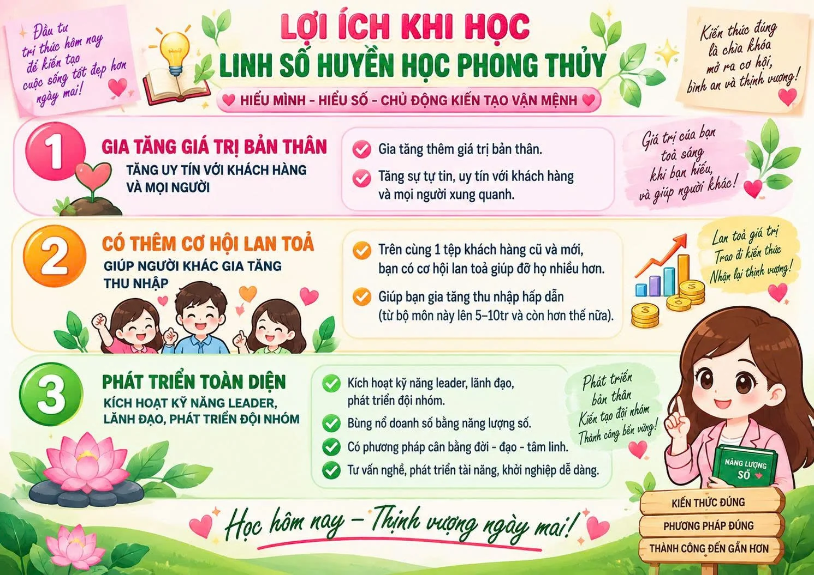

**Bản OCR chưa hiệu đính toàn văn** (điểm OCR: 60):

```text
ẩ ‡
ms„„ ^+¿WV LỢIÍCHKHIHỌC A%z iu,
tai = § ¬ x ? À ghàa
/ biết tt „ s
;i mạ E ÿ ý LINH SỐ HUYỀN HỤC PHONG THỦY G2 ..
ni nội! ; => ” — Lạh 0K Thôn v boẾg
gà ¬ % ~ .® HIỂU MÌNH - HIỂU SỐ - CHỦ ĐỘNG KIẾN TẠO VẬN MỆNH 9} U $ẹ,
r - : - Qátriek /m
GIÁ TẦNG GIÁ TRỊ BAN THÂN. @2 Gia tăng thêm giá trị bản thân. toà số 3 1
TĂNG UY TÍN VỚI KHÁCH HÀNG ă 1 UY tín với Khách hà / hạn hiếu
& © Tăng sự tự tin, uy tín với khách hàng hi Bạt h}M, /
VÀ MỌI NGƯỜI và mọi người xung quanh. và g1? xới lá -s©#
M ˆ - ˆ M - á.
toà giá tri
co THÊM cơ HỘI LAN T0Á Ø2 Trên cùng 1 tệp khách hàng cũ và mới, lấn thức
GIÚP NGƯỜI KHÁC GIA TĂNG bạn có cơ hội lan toả giúp đỡ họ nhiều hơn. g 60099).
THU NHẬP u .  . ại u
v ở 9 9% w Ø2 Giúp bạn gia tăng thu nhập hấp dẫn - Ả
Ñ | ) A NV, No | (từ bộ môn này lên 5-10tr và còn hơn thế nữa). 2
Ắ
v $ s Ể 3 . (7 - ể ⁄
PHÁT TRIỂN TOÀN DIỆN (@) Kích hoạt kỹ năng leader, lãnh đạo, [274 trất
KÍCH HOẠT KỸ NĂNG LEADER, phát triển đội nhóm. bản sự ÁT
LĂNH ĐẠO, PHÁT TRIỂN ĐỘI NHÓM )  Bùng nổ doanh số bằng năng lượng số. - ế ai Ấy - là»
4 'Ổ) Có phương pháp cân bằng đời - đạo - tâm linh. %# c (Re
Ở) Tư vấn nghề, phát triển tài năng, khởi nghiệp dễ dàng. gi
&” r= =—
s§ ffpc đâm nây — 7x20 vung xoào xayý/ 92 ( noenuvoe 1]
tớ. lu ở ” THÀNH CÔNG ĐẾN GẦN HƠN,
kA. cả - g
Kả im mm NGHờ hNC San iu,
```

<a id="slide-044"></a>

### Slide 044: Công cụ kết nối và thấu hiểu khách hàng

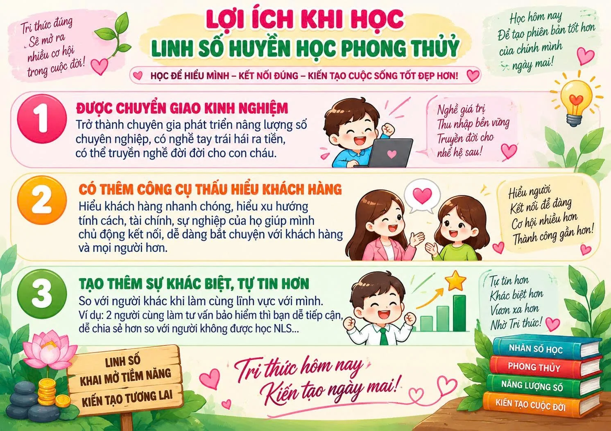

**Bản OCR chưa hiệu đính toàn văn** (điểm OCR: 64):

```text
^
.. LỢI ÍCH KHI HỌC chi vn
: G2 mở na R ^ ý L là”, r ẵ
hờ Mh LINH SỐ HUYEN HỌC PHONG THỦY: si, ri,
ô : &„ ngàu mau:
trong oiộc VÀ S9 HỌC ĐỂ HIỂU MÌNH - KẾT NỐI ĐÚNG - KIẾN TẠO CUỘC SỐNG TỐT ĐẸPHƠN! (2 M5 Ni
¬Í -
ĐƯỢCCHUYỂNGIAOKINHNGHỆM  2SEŠA ¡ (¡ii ÿ
Trở thành chuyên gia phát triển nâng lượng số © Thu nhập bồn vững I
chuyên nghiệp, có nghề tay trái hái ra tiền, — Truyền đời cho %ò
có thể truyền nghề đời đời cho con cháu. Z ZZX nhế hệ saul g
5 4
Gà CÓ THÊM CÔNG CỤ THẤU HIỂU KHÁCH HÀNG : Hiệu người
U27 Hiểu khách hàng nhanh chóng, hiểu xu hướng vé ⁄. Kết nổi đồ đàng
tính cách, tài chính, sự nghiệp của họ giúp mình cố Ti vé. (ø hội nhiều hơn ï
chủ động kết nối, dễ dàng bắt chuyện với khách hàng . 2 Á Thành sô) gần hơn
và mọi người hơn. “W2 I #$ ©
! TẠO THÊM SỰKHÁCBIỆT,TUTINHƠN SA ⁄ Ýừ (Traale  Ÿ
nh ni nha | / Khác biệt hơn
So với người khác khi làm cùng lĩnh vực với mình. Z2. -
Ví dụ: 2 người cùng làm tư vấn bảo hiểm thì bạn dễ tiếp cận, ®©m Vm, n : 4
, dễ chia sẻ hơn so với người không được học NLS... ẹ N_)y Nhờ Trị thức! L4
VN —ïDn
/ .\@ý 7 _ NHĂNsOHọc | ggố
Y3 AT HA mm
œ giả LU n q9 7 1//2/000008ÿ2 » An: ki LƯỢNG SỐ ~¬
4 MIẾN TẠO TƯƠNG q  K. ⁄4đ Z TIẾT TẠO C0  Đgp DI 4
ˆ „ - =
à .
```

<a id="slide-045"></a>

### Slide 045: Lý do học theo tài liệu

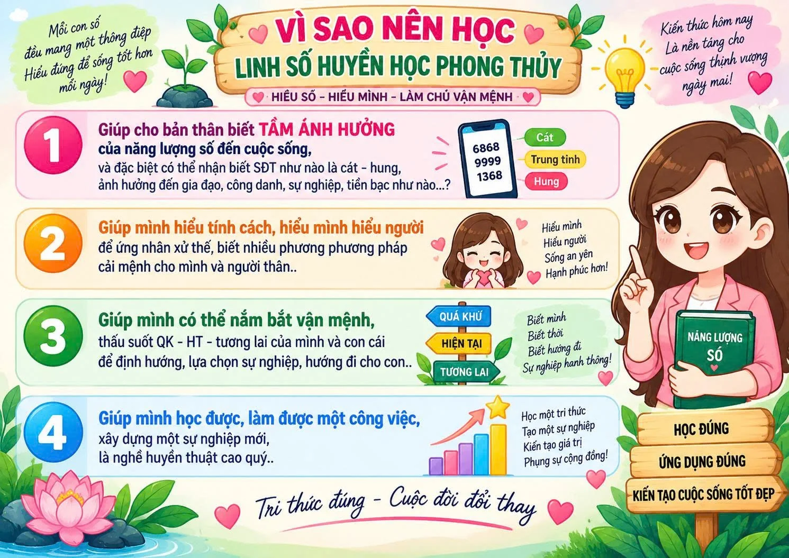

**Bản OCR chưa hiệu đính toàn văn** (điểm OCR: 57):

```text
$ ấ . ⁄ lì AẠ ê Ñ ¿ ¿c hâm
1072 “1 = SẩŸ“ ø VÌ SAO NÊN HỌC ø nu
đều „su tốt ơn ( . Ầ S › ` TS,
x _ LINH SỐ HUYỀN HỌC PHONG THỦY Ở - (, -szss r2
nổi ng >=“{ 9 HIỀU SỐ - HIỂU MÌNH - LÀM CHÚ VẬN MỆNH - 9 5
Giúp cho bản thân biết TẦM ÁNH HƯỚNG ` PP si Nà
của năng lượng số đến cuộc sống, ;....— á
vàđặcbiệtcóthểnhậnbiếtSĐTnhưnàolàcát-hung, | 5999 | 9n
ảnh hưởng đến gia đạo, công danh, sự nghiệp, tiền bạc như nào...? L
Giúp mình hiểu tính cách, hiểu mình hiểu người 9 ngư -
Á đểứngnhân xửthế,biếtnhiềuphươngphươngpháp Sổ Hóu su Sn |
cải mệnh cho mình và người thân.. S ni phúc hơn! À
Giúp mình có thể nắm bắt vận mệnh, QUÁ KHỨ Bángh \ Á =-.
me ến, - Biết thãi  NÁNGLƯUNG MP
ni TC - ai ca lai ca hiến - = Ế HIỆN TẠI Ì v ¬ „ „e R
ể định hướng, lựa chọn sự nghiệp, hướng đi cho con.. Ñ\ mxyBeesBð7 chớp s N. | > ˆ
nể Ñ s _ _ P ôt trị thức
Giúp mình học được, làm được một công việc - U :
Q l.. HÀ sự . vn lợc mộ gviệc, li. s N2n Ù HỌC ĐÚNG ⁄
‹ là nghề huyền thuật cao quý.. F Phụng sự cộng đồng! - (NGDỊNGBÍNG
._" ¬ 2 i 9 - ˆ
~^\w 4% 1 “ ấíng - (uôc đỡ; đổ; |-KIẾN TẠO CUỘC SỐNG TỐT ĐẸP
v 1 si thúc đi Cuộc đội đối; ⁄áa„ ù
Ne⁄ q $ 1⁄ ———— KH. ti t |
```

<a id="slide-046"></a>

### Slide 046: Lưu ý khi xem và lựa chọn SIM

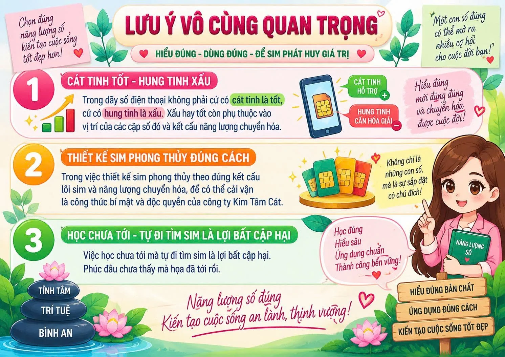

**Bản OCR chưa hiệu đính toàn văn** (điểm OCR: 59):

```text
: D ` S v 4đ
Ôn HH LƯU Ý VŨ CUNG 0UAN TRONG in
kiến tạp quật sô] ~ - - : nhiều cợ hộ là
tít tp hơd \_® HIỂU ĐÚNG - DÙNG ĐÚNG - ĐỂ SIM PHÁT HUY GIÁ TRỊ. ® ch cuộc đời no
CÁT TINH TỐT - HUNG TINH XẤU  CÁT TINH Húuắiug V 4
_ HỔ TRỤ ni đúng E
Øñ. Trong dãy số điện thoại không phải cứ có @#FtffRlö tốt mối đìn]
_⁄ZR cứ có hung tính là xấu. Xấu hay tốt còn phụ thuộc vào pà chuyên Ai về
r vị trí của các cặp số đó và kết cấu năng lượng chuyển hóa. mầu
“ ®9 Ñ THIẾT KẾ SIM PHONG THỦY ĐÚNG CÁCH HN Xe NHI
? Ễ ® : xi ô, ợ⁄
t7 Trong việc thiết kế sim phong thủy theo đúng kết cấu ân hữu - - ~=~
bá lõi sim và nãng lượng chuyển hóa, để có thể cải vận Mì Là CC ” g hon . # 2
và là công thức bí mật và độc quyền của công ty Kim Tâm Cát. 5C Ñ
`» ma TỔ ì TT BẤT DA Họ: đúng Ÿ /ấ ếap
H0C CHƯA TÚI - TỰ ĐI TÌM SIM LA LỢI BẤT CẬP HAI 198 s ( S4 _>
l Mì iäửAao
i Việc học chưa tới mà tự đi tìm sim là lợi bất cập hại. Ủng dụng nến má Hi s
(U12... Phúc đâu chưa thấy mà họa đã tớ rỗi. Thìn ông bố HỘ L
tự i27 — sĩ |
—— Ghi HẦM
(4 TUỆ, đP nÀ v) * ph vưốu ÚNGDỤNGĐÚNGCÁCH -
b^” P lv, U ") N
„ >St Kiến tạp cuậc sống an Tỉ <‹, X7, ÄĐ“"}°NhbÏ ẸP.
BÌNHAN 9 quà no... ïy. HP VNI M 6Eineuesierire,
<<... ->22 _—X———Ã  _. : — zt |
```

<a id="slide-047"></a>

### Slide 047: Slide trống

_Slide trống trong file gốc; không tự bổ sung nội dung._

<a id="slide-048"></a>

### Slide 048: Bảng liên kết các từ trường (nhắc lại)


**Bản OCR chưa hiệu đính toàn văn** (điểm OCR: 82):

```text
MỐI LIÊN KẾT CÁC TỪ TRƯỜNG NLS
SK TY DN LS TM | HH PV NQ
; SINH THIÊN Y DIÊN LỤCSÁT TUYỆT HOẠHẠI PHỤC VỊ NGŨ
KHI NIÊN MỆNH QUY
._¬ |
* TS ts“ 7 à ñn
TY+SK TY+TY TY+DN TY+LS TY+TM TY+HH TY+PV SK+NQ
SK+SK SK+TY SK+DN SK+LS SK+TM | SK+HH SK+PV TY+NQ
DN+SK DN+TY DN+DN DN+LS DN+TM DN+HH DN+PV DN+NQ
| PV+SK PVTY PV+DN PV+LS PV+TM PV+HH PV+PV PV+NQ
LS+SK LS+TY LS+DN LS+LS LS+TM LS+HH LS+PV TM+NQ |
HH+SK HH+TY HH+DN HH+LS HH+TM HH+HH HH+PV LS+NQ
TM+SK TM+TY TM+DN TM+LS TM+TM TM+HH TM+PV HH+NQ
NQ+SK NQ+TY NQ+DN NQ+LS NQ+TM NQ+HH NQ+PV NQ+NQ
SK+05; TY+05 DN+05 LS+05 TM+05 HH+05 PV+05 NQ+05,
SK+5 TY+5 | DN+5 LS+5 TM+5 HH+5 | PV+5 NQ+5
R A+B: từ trường A tạo ảnh hưởng đến từ trường B | ZÃ
ì | ù B+A: từ trường B tạo ảnh hưởng đến từ trường A uẾ
` Là „ Ví dụ: NQ+HH ý nghĩa khác HH+NQ, TY + SK khác SK+TY.. _ ¬
Œ . E= ACE cần nắm rỡ sự liên kết để luận đoán cho đúng sự luận chuyển các từ trường... :
uá r8 = .äzz-_= 5:55 -
```

<a id="slide-049"></a>

### Slide 049: Sơ đồ chuyển hóa Thiên Y

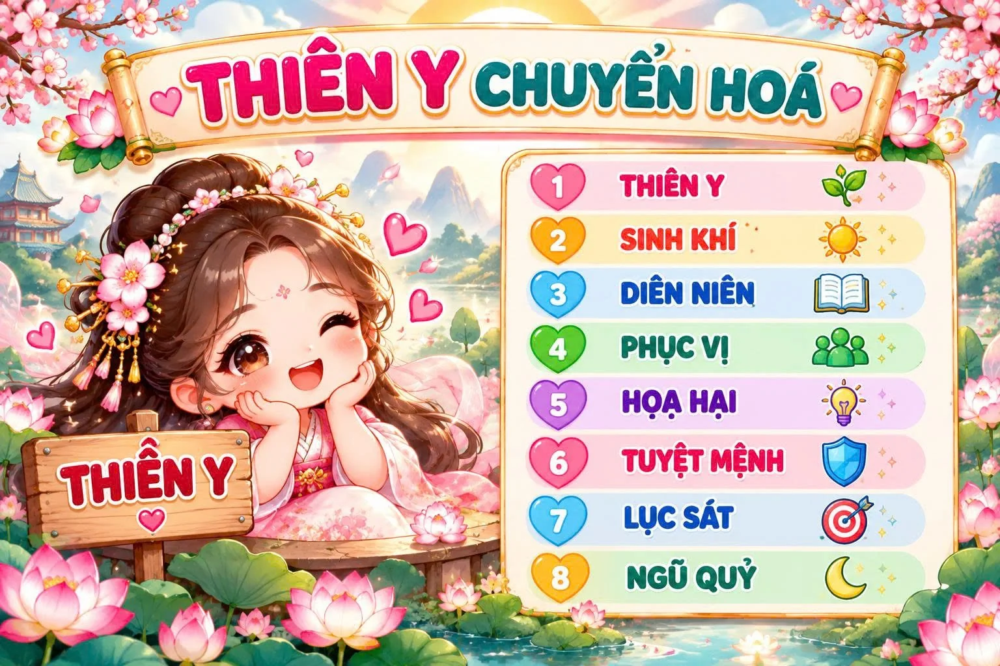

**Bản OCR chưa hiệu đính toàn văn** (điểm OCR: 34):

```text
S ! c => Œœ= ( bò ^ˆ? - 4 .‹ — gu
& U LIAJl) s CHUYEN HOA 5
5... ch N hs ' E.
Có. - ò... Ở?› DIÊN NIÊN ..HM
, 4 cu ƒ la Ầ S S Ø PHỤC VỊ A8 = Ễ
r: í„ QC "“SU HỌẠHẠI  G
S „zA .-¬ . N ⁄Á lý Ñ N Ñ ỳ È
Ñ THIENY Z2 Ÿ x Ợ ,
— eo nợỂ 5 C7) Lục SÁT `
: g ¬ < 3 = ~ Ụ Ñ , G la
. mm. NGU QUY Œ&
> tu à — Í m -  S su ._ ¬
```

<a id="slide-050"></a>

### Slide 050: Thiên Y + Thiên Y

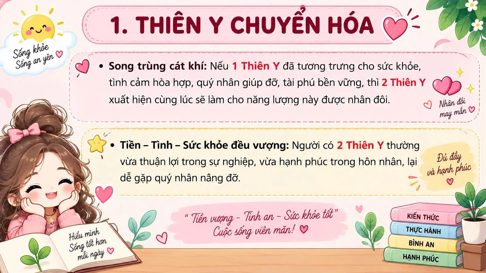

**Bản OCR chưa hiệu đính toàn văn** (điểm OCR: 70):

```text
xi, ⁄ ^ ~. 2 N ” ả
-œ^- (1. THIÊN Y CHUYỂN HÓA (2< ĐP
Sống q? s Song trùng cát khí: Nếu 1 Thiên Y đã tương trưng cho sức khỏe, Bì

di tình cảm hòa hợp, quý nhân giúp đỡ, tài phú bền vững, thì 2 Thiên Y «e4? z
Z.. xuất hiện cùng lúc sẽ làm cho năng lượng này được nhân đôi. <). Nhân đồ
“46P. '†'UO ƯYOUOƯÐ HC
cm mm" ——__Ắ]”S“””"”"
; N # s Tiền - Tình - Sức khỏe đều vượng: Người có 2 Thiên Y thường |
2 Ñ 4 `. vừa thuận lợi trong sự nghiệp, vừa hạnh phúc trong hôn nhân, lại Đi đây „

/ N N x _x / ˆ ˆ ~ và hạnh phúc

⁄4 2 dê gặp quý nhân nâng đỡ. = 9 „

: N w —————xÃA.Ỷ. ÿ

cà ca Kỳ \

xa .__ NT
Z È 1⁄4 q) Cuộc sống vi mãn? 9 Ø \- TMChàm
\ L4 DANH PHÚC | TẾ
```

<a id="slide-051"></a>

### Slide 051: Thiên Y + Thiên Y (tiếp)

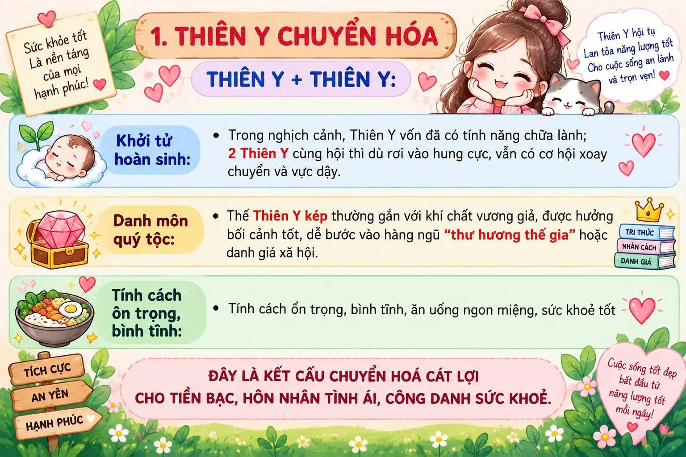

**Bản OCR chưa hiệu đính toàn văn** (điểm OCR: 61):

```text
- — s
mi e ể TỰ. Z274 "o4 sên Ý hội tụ
sức wèe tốt 1. THIÊN Ý CHUYEN HÒA j 2/ZZA)G | nh
Di n, ”
a 0 ˆ ˆ 9 Ñ b
Ko NI THIÊN Y + THIÊN Y: (z “A' „ ệ nen riø
; AC EHGSEEEIEESGGEANIEESEG.-2 oan] 2E = -:72—x>:. @¬ (NH) ^¬ @K 2s, xe
| tØ.= ởi tủ Trong nghịch cảnh, Thiên Y vốn đã có tính năng chữa lành; `
| $ ., ` Kh tứ. hiê ` nã treo cơ hồi %
| ; hoàn sinh: 2T lên Y cùng hội thì dù rơi vào hung cực, vẫn có cơ hội xoay
(& chuyển và vực dậy.
^ AnmA + Danh môn... * Thế Thiên Y kép thường gắn với khí chất vương giả, được hưởng $
Z .. Uanh mon. mi — -—
'ØY72Z: quýtôc. bối cảnh tốt, dễ bước vào hàng ngũ “thư hương thế gia” hoặc (Lm múc (—
¬e: ..M”]. SÏ_n. giá xã hội [wancx
L2 in ĩ (ae [(I
| -¬.. Tính cách in —— _"
©i ôn trọng, s Tính cách ổn trọng, bình tĩnh, ăn uống ngon miệng, sức khoẻ tốt 9?
` —_ 2>. bình tĩnh: -_ xa
- — 4
z Nn ¬ ~¬ ~ 4 P / Cuộc ống t5 \
Tịch CƯ 24 ĐÂY LÀ KẾT CẤU CHUYỂN HOÁ CÁT LỢI khá TP,
AN YÊN _.. CHO TIỀN BẠC, HÔN NHÂN TÌNH ÁI, CÔNG DANH SỨC KHOẺ. Tô hạn tốt
. VN 4|
HẠNH PHÚC. V/ l ] = L .
—ïnnG J «% ; ) . cm v #
-®% : 279 Tu { ạt
```

<a id="slide-052"></a>

### Slide 052: Thiên Y + Sinh Khí

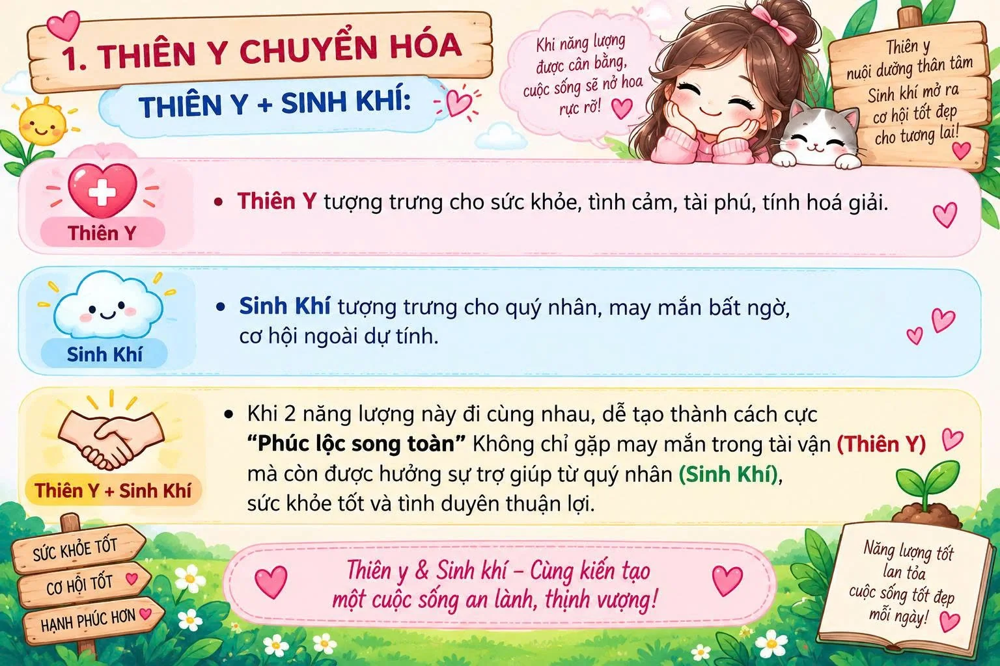

**Bản OCR chưa hiệu đính toàn văn** (điểm OCR: 64):

```text
: _"mzx-XZN |
- ”  m: „ Z4... v
^ˆ Kh lượng > W” ^ Ễ
1. THIÊN Y CHUYỂN HÓA 3. sr: RA
s ˆ íứí `n¬ ộc sống sẽ nở hoa Ñ 0 snhkhímởra -
VÈỔA. - THIÊNY +SINH KHÍ: ;02- “¿sọ Ẩ- ¬ ĐỒNG min,
- ” mm ng
+, S s Thiên Y tượng trưng cho sức khỏe, tình cảm, tài phú, tính hoá giải. g9 `
Thiên Y
. Em. .= re WTO D N
l s Sinh Khí tượng trưng cho quý nhân, may mắn bất ngờ,
x——< cơ hội ngoài dự tính. 9
“SinhKhí - :
'. HỆ _.. . Khi2 năng lượng này đi cùng nhau, dễ tạo thành cách cực ì
-: “Phúc lộc song toàn” Không chỉ gặp may mắn trong tài vận (Thiên Y) 11⁄2
mà còn được hưởng sự trợ giúp từ quý nhân (Sinh Khí), ⁄
. sức khỏe tốt và tình duyên thuận lợi. - :
tri; 1 - , ng Ẹ c - ` Năng lượng tốt |
an v sự á q? Thiên y & Sinh khí - Cùng kiến tạo (ao) đàn tủa j
, một cuộc sống an lành, thịnh vượng! > kR.
gã :
```

<a id="slide-053"></a>

### Slide 053: Thiên Y + Sinh Khí (tiếp)


**Bản OCR chưa hiệu đính toàn văn** (điểm OCR: 57):

```text
LÍ 1 774% ^N HN
® 5 ` . ỹA ~ v.v 9 Cí \ P. Ñ lu.
(ng _ 1. THIÊN Y CHUYEN HOA -Z#SSV.- (ma
l Fan, GEE c7 N ˆ Phúc đế (
` úc SỐ ê í “ NT nh
nh ho 9$ THIÊNY+SINHKHÍ: ®,Z 1U r K#NW
sư ùn đe A.-~ÿŠ”X Z
“BE 4 ì ⁄ N AM
TẾ, Am K „ ` m. P 7Ôn
- Ca BIỂU HIỆN TRONG CUỘC SỐNG: ` _¬ su
Trong s Trong công việc: Chỉ tiền chiêu ra được cơ hội, gặp được 1 |
công việc: quý nhân giúp sức, quy mô lớn lên, thu lại tiền tài gấp nhiều lần. 9
2 v
.œ Trong s Trong quan hệ xã hội: Tình duyên ấm áp, hôn nhân thuận hòa, -
ni quan hệ xã hội: xã giao được lòng người. lv]
„CỐ VÔ Trongsứckhỏe ° hang sư khốc l¬ tỉnh phấn: Nội Hn 1u So quan ít bệnh „|
: . - tỉnh thần: tật nặng, có khả năng phục hồi tốt.I:láng người có xu hướng 9
À xá thon gọn 4
w® >7 XƯỐN 7 ,
- ANNHIÊN 2$ —. ưa n + Sức khỏe tốt
A —o z - ˆ ~ E mm
“eucuc c4 SØ “PHÚC TRỜI BAN -MAY NHÂN THẾP. (9 "7 ôn tóm
c4 % S ˆ -:79-59920/0/0opessorer - Cứ s# v Cuộc sống viên hồn #
YEU VI ` : .2_~ = _- ÑN v
ni HN ng # -
```

<a id="slide-054"></a>

### Slide 054: Thiên Y + Diên Niên


**Bản OCR chưa hiệu đính toàn văn** (điểm OCR: 55):

```text
› 2 Ô È*. ( 4. THIÊ ỂN HÓA Ì |
Àó 778A |1. THIÊN Y CHUYỂN HÓA | 42 ^^
I⁄Z% / le ˆA Ễ HH đa. La ta nay nắn
[s] é PA ” THIÊN Y + DIEN NIÊN: A Í Kếnte nh
2z _S Ãe 102* tt áp hơi
 I ‹ 2 Đâu là cách cực cát lợi, dễ làm chủ, dễ độc lập một phươn, Sống tích ©f€ ⁄⁄ˆ ⁄
: Dâu p một phương, ng 2 <4
 KšMUật 7 am ® biểu hiện cụ thể như : Tạo gói Và Ạ N42
me (HỆ ` — ợ sẦ cọ gác đó im
< 1 m . A2
Ls Ầ Trong s Có quý nhân nâng đỡ, cơ hội thăng tiến bên vững, thích hợp. 0s hội rộng mở
côn tr : lã x S kna  n M z AI 5 : ứng bước
g việc ănh đạo hoặc quản lý tập thể. Cũng dễ tự lập nghiệp làm chủ. lui công) 9
ố mTTX
4 75 Trong
Ầ CĐ&i tình cảm-  es Vợchồng hòa thuận, tình cảm ổn định lâu dài, ít sóng gió. 6a ảnh ấm bi
>7 ~xÂN, hôn nhân: ngh híc bờ ln ÿ
- — ——==ÓØ7Ẳ7
KV A: A T mm hiến ả
. . dd . khỏe se Tâm thể ổn định, ít loạn động, dễ vượt qua khó khăn và Sức khóc đ.
W4 - tỉnh thân: duy trì phong thái điềm tĩnh Tâm on vĩng Vệ
NV TH  x TN  uạ
C. n —= mua. |
—< —=— . a Cu
“nn nh phu nàn m2 9 “KINH DOANH PHÁT ĐẠT, DANH LỢI SONG THU” (2 Ẩh$ 52⁄2
_ LAN TÒÁ GIÁ TM) , JđbesgEt đu -7—Ấ//ẸỂg am + A XS
về na bàn "21. sốc ở HAI CN Gà «
```

<a id="slide-055"></a>

### Slide 055: Thiên Y + Phục Vị


**Bản OCR chưa hiệu đính toàn văn** (điểm OCR: 69):

```text
sub . 2 km - 1. THIÊN Ý CHUYEN HOA Ì . ở, ;
âm an BA “. Ị kéo dài «
phúc đến ZZ% \M Ê s . Cuộc sống an lành ⁄
kiên Ạ ~ Ầ YWw THIÊNY+PHỤC VỊ: Q02: 0 =
ụ - ¬I m ững bề, lộ
>. q4 Si l Đây là trạng thái Thiên y kéo dài, sự tốt đẹp sẽ miên man không ngừng. : S s thiện lành
x2? MÃ b Biểu hiện cụ thể: ch và
C5 (Hà - >
¬ Trong s Dễ được quý nhân chỉ dẫn, công việc ổn định chắc chắn, Quý nhân dẫn lối
Z công việc: càng về sau càng vững. Quý nhân chủ trưởng bổi trong nhà công việc hanh thông
hoặc người lớn tuổi hoặc lãnh đạo cơ quan. S v
| # và Trong ° Tài lộc kéo dài, miên man không ngừng, kiếm tốt và ổn định, TH DỀ 4 me) |
{ tài vận: tích luỹ được tài. e v
uc ——/.Ẽ.
mz- „~ Trong s_ Quan hệ yêu đương hoặc hôn nhân thường mang tính Yêu thương su
| t tình cảm: “dưỡng nuôi lâu dài”, ấm áp, an lành, bền lâu. ng p v |
TC PS” + Củn
⁄ ⁄ Ầ Trong s Dễ được quý nhân chỉ dẫn, công việc ổn định chắc chắn, Quan hệ hời hòa
2œ quan hệ xã hội: càng về sau càng vững. Quý nhân chủ trưởng bổi trong nhà nên ý
\ Ầ Co Ÿ hoặc người lớn tuổi hoặc lãnh đạo cơ quan. ưa)
Ñ [ S3 —== ‹
3 mEulw Í _- TT ý cuộc sống tốt đẹp
( TRÍTUỆ ⁄ 92: “DANH LỢI ĐU ĐÂY , ĐẠI NGHIỆP THANH CÔNG ” À ga th
xe. 1. iu , một tôn TP
Xem. 4 nề ï  nG $# 5 di
```

<a id="slide-056"></a>

### Slide 056: Thiên Y + Họa Hại


**Bản OCR chưa hiệu đính toàn văn** (điểm OCR: 62):

```text
Là 0u verxv.>~. XP
- qaweœ. l„ ¡ 1.THIÊN Y CHUYỂN HÓA ] Z8 L2
7 CS ⁄⁄ .Ã
vớt 69) Q2 Í THIÊNY +HOẠHẠI:  œ .Ú U11 MPUỜ”
xế\ ngày! 9 âu “ GP ⁄, Ñ tế Ược nhiều rồi! S
e —.. Dễ hao tài, chỉ tiền vì bệnh tật, hoạ từ miệng mà ra. Lỡ lời mà hao tán, đ & Ấp và 4u
hay ăn uống. @ È - ‹ ^^ ` <“xX<
- S% Không có - ˆ . n môn ˆ P ni -
0 9g s Dùng tiền không kiếm soát, chỉ tiêu không cần nhắc dẫn đến hao tài,
í $ năng lực quản Hay thể hiện thái quá,sĩ diện cao, lỡ lời mà tán tài (⁄
œ trị tài chính:
| ^ ú ng . s Luôn sống vì ánh mắt của người khác. V2 |
| : "8 ũ | 80] ọ chà Tiêu tiền để giữ thể diện, hơn là để nâng cao chất lượng cuộc sống.
$ Œ=”\ la .` Ñ ? TA ˆ bì ˆ ˆ Ñ XỔ 4
c*—m Hưdanh. s Giàu tiền bạc nhưng nghèo bản lĩnh, luôn cần sự công nhận từ người khác. lệ
sS=Ẽ
đa À Tìncảm —— ø
7 c nhiều sống gió: ° Có thể vì yêu mà kiệt quệ tiền lẫn tinh thần. \ Ế
j Ầ —n
22. Ag ¡
—_—_— 7 #
sức KHỎE TỐT — , .A ~
ve: M2 DANH LỢI ĐỦ ĐẦY , ĐẠI NGHIỆP THÀNH CÔNG Q2 ,CÃI ˆ nu„
7 TÀI CHÍNH VỮNG Thân khỏe
5. pNVU | ” Vạn sự tốt đẹi
CUỘC SỐNG AN VÀ 7 s , lò —_ .: "
: # S x SE, tú S
```

<a id="slide-057"></a>

### Slide 057: Thiên Y + Họa Hại (tiếp)


**Bản OCR chưa hiệu đính toàn văn** (điểm OCR: 60):

```text
“ŒmN `m. ề
- (Zễ Ñ ^ˆ ˆ z # >
nẻnnh ¬ 882<en ' 1. THIÊN Y CHUYEN HOA Ï - s.g
Sống đẹp CAI “2A ` ¿ - ah . Sốngtchcực |
mỗi ngàu! JR^. Ê ñ lỗi khó khăn SE
 .Í. .xl Ả NI THIÊN Ý + HỌA HAI: đềulàcơhộidể (` Kiểm soát tối
~> - <{ ” | 2 4 @=z= LÊ 7725727279982, trưởng thành Bìnhanhơn ]
Í SÚC KHÓ óE (~-— G Ẩ ‡ lê ` gếi ĩ
= Ô cau ö: FJN Câ puà BIẾU HIỆN TRONG ĐỜI SÔNG 7 và tốt a hơn! Hạnh phíchơn |
HE SAĐNH: X;zE N "NI:  ...
HẠNHPHÚC |7 CHIA đề Sàn 2> Zã | .
CN Z Trong s Có năng lực kiếm tiền nhưng thường hao tiền vì bỏ lỡ hoặc bị cản trở
«2z TA ng vn 2
: công việc: bởi sĩ diện, hoặc nội tâm mâu thuẫn.
no 4 v.~ x Trong s Dễ được yêu mến nhờ Thiên Y, nhưng cũng dễ vướng thị phi vì |
| C9 œ ` \ quan hệ xã hội: “in Hại. làm hoang mà có người theo, nhưng vì miệng mà đánh mất 12 |
ZsZ Uy mối quan hệ. Ti.
nh LẢn x
Trong s Nhiều lúc ấm áp, được che chở, nhưng cũng dễ tan vỡ vì cái tôi, sĩ 1
tình cảm: diện hoặc vì nói mà không làm,hứa suông.
: K G2) Thể chất kém :
⁄ EU bó s Thể chất kém, dễ béo, tăng cân, bị bệnh liên quan răng miệng, dạ dày. 9
+¿\W dễ béo -
~ - RE NHI NI Ea Mega hư án
: ¡ “MA Ỹ Ă Ă ÊM DÂV CỒNG ” lến tạo phiên bản
NHI ni. QÔ “ MÂY CHE NỬA TRĂNG, TRĂM CHUYỆN DẬY SÓNG”. ©2 - &W
2 am Se m _ AE To
W. *, vớ AC "ùn
```

<a id="slide-058"></a>

### Slide 058: Thiên Y + Lục Sát


**Bản OCR chưa hiệu đính toàn văn** (điểm OCR: 53):

```text
.”.. = ỂNHÓA Ì (2< ĐỀ
(van) ` 27H Ï 1 THIÊN Y CHUYỂN HÓA j („n:
cm.  A.Y  nn —= biết cân Bên Ai
w. xé ọS2„ THIÊNY+LỤCSÁT:  Q2„ |ứ ro
Re P . ly, TU Am H7
se. ; 7⁄7 tạ /⁄% ¬ đà Tiêu tiền không kiểm soát, dễ chỉ cho yếu tố tính nữ. bền vữn9' S2 ch ng. l-

í . 1 ^>- Ví dụ như: Nữ thì thích làm đẹp, mua sắm, phẫu thuật thẩm mỹ... HỆUQUA Í,
ANH V1 4 CA (VN. nam chỉ tiền cho nữ giới. Í HẠNH PHÚC LỮ,
'9Biểuhiệncụthể: 72 “ —=

4 4z s K ] - ệ .⁄
. Ly, NG s Dễ vì mình tranh ám đấu, ghen tị, đố kị mà hao tốn vận khí. 9

9 , T ñ Lợi

Š nhi: s Dễ ngoại tình, có người khác chen chân vào mối quan hệ. 9

cò ® bi. tácxãhôi: ® Dễ Sứt mẻ tình cảm, xa nhau. (VÁ

Z>4S4h ¿2À Hưng đi

Đ—=HI ựn =i?? LE==œe=eree=>re=enerrrrrrr=rr==rrrrrrrrrrrx======-=-=-=-====---=-----------=-=-ỉ-==-=--------==-]---- —==1

. .© Ñ - s : 7 ⁄)ì

. 2: è..w. Họchành s Học hành không tập trung, kém hiệu quả, bằng cấp không cao. 9S |
v4 — - mm 2227270 tư HH ERDEE HE: SE TH HE NNN BE nu SON o7

S z < Z - An, ® ⁄
lễ €°: Thể chất s Dễ có tổn thương về thân thể. 9
Lo. V. =
cm. ° ba. - . . ˆ Giá trị thật về
` Chị tiêu thông mình 22 $ ĐƯỢC CÔ MAT CÓ, HÌNH THỨC HƠN NỘI DUNG ” lv) “7 Lhônbnvimg. Ê

Hạnh phúc thật Sự % 2 . # hơn vẻ bề ngoài! r

X.. N  N M  —. _~ +
```

<a id="slide-059"></a>

### Slide 059: Thiên Y + Tuyệt Mệnh


**Bản OCR chưa hiệu đính toàn văn** (điểm OCR: 61):

```text
“4A 07
duuinh - A9 - = ể 4 V
_Aami, (0288. | 1. THIÊN Y CHUYỂN HÓA ): ¬
Sống đẹp lê, bã ST tu biểt
. '9/ nu: NN ˆ& ^ kiểu ĐỀ. NI
ghi + )M¬ . (. THIÊN Y + TUYỆT MỆNH: › | tà gia khóa KHI
=—. ¬ AN Í b4 - - — — li để vượt gu „=V lÀ

: EÀ “N CA A Là tượng chủ hao tài, đạibikịchtrongcuộcsống, ° mọi hi. váng é Ï THỰC HÀNH Ì

Š . là» À 4 & n TT hiến Ết : trong Cử?

` 2 › ngoài ra có những biểu hiện cụ thể như: q” á CHUYỂN HÓA

@zZ# À % - sạn = ® Từ ngọt ngào - an yên có thể biến thành cực đoan - đau khổ. Trong , |
ý c Ñ Biểu thành tình yêu Chính là không toan tính,một lòng một dạ, khắc cốt nghỉ tâm, ỳỹ⁄ |
í S c cực đoan - đau khổ. Tính sở hữu cao,đần làm đối phương ngạt thở, chịu không nói

“Z Chuyện tình cảm nan mm 1”
- - vốnđầylãngmạn, ® Chuyện tình cảm vốn đầy lãng mạn, dễ trở thành đoạn tuyệt, chia la. (7

¿ dễ trở thành Cơ hội cho người thứ ba chen vào

⁄ ` đoạn tuyệt, chia lìa.
= ø 2 đTiên bạc kiểm tốt,

= .. kiếm nhanh e Tiền bạc kiếm tốt, kiếm nhanh, nhưng không tụ được, bị chính VÁ

, cề= << — nhưng không sự thông minh, tự tin, cao ngạo của bản thân mà phá tài.

" tụ được. Ã — xả
> mm - rmss  azó. ¬Š
TÂMAN 3 ” - 1 Tô ki nhện

7 : —_— na. 5 = 4 L đềi là bà
trísÁNs SỬ TM) q2 “ ĐƯỢC CÓ MẤT CÓ, HÌNH THỨC HƠN NỘIDUNG” (2 ẤP GốN ưn z
gời BÌNH A\ 2 % i , — cư HT “Xe.

"hết › N2 Dzoe E đÁ nu . :
```

<a id="slide-060"></a>

### Slide 060: Thiên Y + Tuyệt Mệnh (tiếp)


**Bản OCR chưa hiệu đính toàn văn** (điểm OCR: 59):

```text
; ố K4 — XI la
c Z2 Ï 1. THIÊN ÝY CHUYEN HOA co Thăng
( nổ ngòi Ø7 VÀ - - ——- trong tâm
Mh Z ^ ˆ ^ N ấn lối bình an Z5?
› xà a sa IÁ X2 THIÊNY+TUYỆTMỆNH: (2 Vi: ĐIỆN
v 9 Ấ );® khó khăn thành kiên
— A Z~ Ñ tin, S in 1 ghi! ng
PP ` ` ( sẽ Khi cách cục chủ đạo là Thiên y hoá Tuyệt mệnh: S Di Thy
Z đ LÔÁ "X « EN S
LÀ
la Ỗ s Tỉnh đẹp mà ngắn ngủi. Cho đi quá nhiều trong tình cảm, -
`@4: Tình cảm: là phía hy sinh. lv; |
xì s Cơ hội đến nhanh nhưng vì chủ quan hoặc làm đường mà ˆ
> „ Công việc: biến thành thất bại lớn. Hành sự liều không để bản thân lộc,
v có đường lui.
Ế ^ == Tp Ngư ng n _=
| 7 Nội tâm: s Vừa dễ yêu cũng dễ hận, mọi nỗi đau giữ trong lòng. g |
non NE c, GIR SEN
 ÝEUTWL CS “ ” )ƒ Mgitrdinghiệm Ÿ
— máuuÊu j ) ý HẠNH PHÚC MONG MANH, PHÚC HOA ĐAU THƯƠNG ®% dầu là cơ hội
CHỮA LÀNH ~¬ để trưởng nhà
9 Ì 1, ; . Hit Bo hơn!
r BÌNH AN ^ % ¬ . - : - - — . s Ếc) 5 9
% % VN H4 lề  . vn
```

<a id="slide-061"></a>

### Slide 061: Thiên Y + Ngũ Quỷ


**Bản OCR chưa hiệu đính toàn văn** (điểm OCR: 65):

```text
câu mình ¬ LIIÊ ỂN HÓA HẠ. " khó khã,
nổ sóc mình = 1. THIÊN Y CHUYEN HOA ˆ ⁄Z 3 Am là bài học
ai annhiên = HT -
nủmờ! „— &Q  THIÊNY+NGŨQUỶ (0z; SỔ. ~M,. ”p v
9 .s." ⁄ (hi &A (( xát muức |
Cách cục này có thể dân động ra các tình huống như sau (⁄Z 1, gia kg —
(⁄7⁄ 2. SN Í_ BÌNHAN
2 bế Nz> .A x^ NẤ HạNnPHÚC
( <. em. lẠNH PHÚC
5 . \(\ THÀNH cÔNG |
ớ) nh s Dễ bị lừa gạt trong tiền bạc, dù họ rất cảnh giác thì cũng sẽ bị gạt. Không thì cũng là lh
la SS: “ trong tiể su luôn phải gánh nợ thay cho người, trả nợ thay cho người. Thậm chí hao tài ở những ý gu
SN ion iemisb nghĩ điên khùng, sáng ý vô nghĩa...
| G>) Tình cảm s Tình cảm không ổn định, nắng mưa thất thường, yêu ghét khó phân, V4 |
Km không ổn định cảm xúc không ổn định, cũng dễ xuất hiện người thứ ba.
> à- Chiêu ra Ế
ˆ& C tiểu nhân s Chiêu ra tiểu nhân, quý khí không còn. 9
^^ % ˆ % < ° Ê,
Nà V Dễ mập, s Cách cục này dễ mập, ăn uống ngon, nhưng có thể sinh mụn, da không được đẹp, LÁ
về /j )ì* ănuống ngon thức khuya, đau đầu chóng mặt, thị lực suy giảm.
gu VN CV RRIN Hôn ...
Q12 HẠNH PHÚC MONG MANH, PHÚC HOÁ ĐAU THƯƠNG (2 phôi in thơ
~ -~ ˆ~ nh mìni
—ZTAAN NHÊN. đang chờ bạn!
TINH THC ỸÑðu„ P - - l chờ bạn!
=> sò s% . #%..  . . % $# 9
```

<a id="slide-062"></a>

### Slide 062: Sơ đồ chuyển hóa Lục Sát


**Bản OCR chưa hiệu đính toàn văn** (điểm OCR: 35):

```text
—”< 4 SN
T0 ỂN MÓA va, SỔ
5." €3 “LỤC SÁT CHUYỂN HóA vi, #
Xy vu %) muênv >
: ' ST mầ. ì @. SINH KHÍ
€¡ 49) Š
Ễ h > 2e. | øsV.. $ : —4
u
Acg ZA KẾ & Si. >z< RE En ' sả
Bộ, TT TY VI In “
há ˆ^ aso⁄m C2 \ E= Ñ — =
(LUVCSAT:SsSs... .#r
Ì. — ¬" x ~Ks} (G& NGŨ QUỶ Ề
```

<a id="slide-063"></a>

### Slide 063: Lục Sát + Sinh Khí


**Bản OCR chưa hiệu đính toàn văn** (điểm OCR: 54):

```text
.  c?n => - ưi - -
xe, 298A G3 6. LỤC SÁT CHUYỂN HÓA X( „.
¬n tạo hô Z XW ——=mz Ti
luân, tp tốn .AiI lì 2 2 HT
sốc SP ©  LỤCSÁT + SINH KHÍ ` L9 nuln
7 CA 2 4 i Ƒ . Ễ an, ~: ngà!
~ kế - Gáy Khéo lóo - Tình t - Tạp giá bị - Sống vui sống đẹp 9 tà tp nh
( " ẤN -
- ã Š \ ^ s . s =
Sẻ ¬ p= Peermppsgegers uy Ầ N.
(35A TÀITHUYPHU - @€?‹ TÌNH CẮM
Z á 4
Vô cùng giỏi giao tiếp và kết nối mà sinh tài Thông minh, tinh tế, nhạy bén nên là người —
li mm Hn có HP H trong tình cảm rất khéo léo, mềm mại, có phần Ế. <& Ñ
hi .~ in > lãng mạn, ôn nhu, nhan sắc thăng hạng, đẹ ^a.
năng lực quản lý tài chính tốt, thích tiêu tiền "g in . ~_ Tu X
| cho nhiều sở thích và niềm vui cá nhân, mà sang quý. Nhiều người theo đuổi và yêu thích “4a
... có những đam mê đồ mới, cũng là kết cấu q* va
dễ có xe đẹp, điện thoại xin... Em hư ắ xe `
F Giao tiếp tốt - Úz hội nông mở M. tổu há TẾ Œ& ~› \
Ễ. | .
„òL Ế= ——=45-37-677750707/:E2G, ST...
” xa -—
gan Sở LAUU Hồi đếchyên hóa - Ñồn luôn m ngà, "EmSTT
[ TaựchÀN Š sa. “Sống an yên và hạnh phúc hơn) 9 YÊU THưỚN,
và gwnAn 5à. ì ——. ó nan,
r &Y ˆ : k —~ - 2 2. P _. -
```

<a id="slide-064"></a>

### Slide 064: Lục Sát + Sinh Khí (tiếp)


**Bản OCR chưa hiệu đính toàn văn** (điểm OCR: 55):

```text
4Q SH _. —
.. 2 ¿ HP RE

¡ Mu? 2/883” G6. LỤC SÁT CHUYỂN HÓA ( suiie |..

( tn Z5 hN ; - H êu . ,

<< ý! LỤCSÁT + SINH KHÍ Ta.

\ uờil la = trư I@]
tuyết vài đã „BC . SốÏ 2u sen hơn $]
và - C4 .¬i Nhờ khó; lé, tính tế - Biến thách túc hành cohội @-ở- lVẤN ạà àa sớn3 CC V

54 TY VY Ñ —_..G <¬...

ˆ 2 ? ⁄ ˆ . ,?

Ca CÔNGDANH (ZØ sức kHỏE VẬN KHÍ
s Ị

Nhờ khéo léo, tỉnh tế nên là người Rất biết chăm sóc bản thân, “Mậu tan mờ lối phú auô như” |

được việc, được trọng dụng, dễ được thân thể dẻo dai, rất dễ cấn bầu, ý ì là . : / |

lòng người xung quanh, công việc người không khó con dùng kết | BueonhngglaEgmkhounii, |

hiệu quả tốt, dễ được làm người cấu này chồng đi qua đầu giường an trởngạisẽdần được

đai diện. cũng dính bầu. Người khó khăn hóa giải, vận khí hanh thông,

R ~- : thuận lợi chiều cảm. | phú quý như ý. W2

⁄ Khó lo bơng 2g. - - Đây là kết cấu lợi sinh sản. 4 | qua khể hãn, q Ã

z4 Tạp dựng niền ũn - Dở . š = Nhi dưỡng thiên chức ánh sá sẽ trở li
= .. Gi sáp khô - hỗ /@r 32 hủ phù bướ! 9
tj v— Đ @i Bá ý án tp hhc
——Gm.. =1;  n  n
Ụ v. In ⁄ ay _ An Lá

L3 gNHA" | Q9 rủi đổ chuối hóa - Sống tính cục — Kiết tạo cuộc đời tốt đẹp hơn/ ŠÒ _cug
92 9-6 %7 TA VA, Ax_N_ gò Xa, tG

¬ $ ⁄ SS
```

<a id="slide-065"></a>

### Slide 065: Lục Sát + Thiên Y


**Bản OCR chưa hiệu đính toàn văn** (điểm OCR: 73):

```text
— Z ¬I 2 [(@“ >> }
- 6.LUCSÁTCHUYỂN HÓA ZZSỀ ...
sạn thử 4 = . N 7 được nuôi đưỡng
n - , \ 7 "
7 LỤCSÁT+THIÊNY ¿7 1. hi
Ôn tchốc=- NA 77 PS „ 4Ñ o) X4
| Số” .!®% W Nhờ sự tinh tế, khéo léo, khả năng tương tác v. .A .N
-i ngàu! in da nà: suyệp án. <7 le,
mỗi n9 1¬] tới tập mà sinh tài. ® Ñ Cừ l¬
c SA ‹ L -ˆ.
⁄ $ )\ TÀI THỦY PHÚ « TÌNH CẢM c ƯU ĐIỂM NỔI BẬT
Vô củ  N tiến và kết nối Là người khéo léo, nhẹ nhàng, ® Thông minh, tinh tế, nhạy bén.
II IDUGIGOHEDAUC KERHDD mang khí chất bằng thanh ngọc ® Năng lượng tích cực, mềm mại nhưng
mà sinh tài phú, rất giỏi kiếm tiền, khiết, yêu điệu thục nữ, quân tử vẫn mạnh mẽ.
Si dip nơi nhưng ong hào cầu. Được người yêu quý, Ö2 9 Dễ được người yêu mến, có sức hút.
không phải là năng lượng có ở họ toát ra sự lấp lánh, đẹp, ® Nhiều đam mê, sở thích, luôn muốn
năng lực quản lý tài chính tốt, tươi sáng, cuốn hút mạnh. trải nghiệm điều mới.
thích tiêu tiền cho nhiều sở thích Hôn nhân cũng không bị nhàm chán, ® Giỏi tạo mối quan hệ, kết nối, tương tác.
và niềm vui cá nhân. do có sự chu đáo trong mối quanhệ, . ø Có gu thẩm mỹ, yêu cái đẹp, thích sự
lu lại đủ mới mẻ và lăng mạn cần có. sang quý. cØ©
Đi đíng đan mô, đúng Vi Sự chân thành à th tế nh
sẽ dễ tạo tài vận rất tốti. 9? là cha Hóa giữ hạnh phúc S9 "tho iên ni đã bạn 9
= ⁄Z TP: (2
Ø LỜI KHUYÊN c1 KẾT LUẬN Sống với đạm mê,
Lưu ý các vấn đề liên quan đến sinh sản, Công, Đố Ở bên họ, cảm xúc được khơi gợi mạnh mẽ, lm lỏi giá trị,
bàng quang, quản lý chỉ tiêu. (_ HẠNHPHÚC Ý Z2 cảm giác thăng hoa. đế mỗi ngày
Biết cân bằng giữa sở thích và tài chính. mm ⁄ Biểu hiện chính là một thần cuồng sỉ. đà rực ri ® B,
(mawce mm.
; Q Hải để chuyến hóa - Sống tích cực - Kiến tạo cuộc đời tố đp hơi, %5 ị Lœ
```

<a id="slide-066"></a>

### Slide 066: Lục Sát + Thiên Y (tiếp)


**Bản OCR chưa hiệu đính toàn văn** (điểm OCR: 62):

```text
Z7. >>
q@ — \ ầ Ể -._. -—
Íá  í 6. LỤC SÁT CHUYỂN HÓA. - 272 “at ì
be — .
tàn gi hộ 9 LỤCSÁT+THIÊNY  ,ẨØ” khuôn,
ống tích G' : AẤU NO. hi
Sống. ngày 9 Nhờ sự tình tế, khéo léo, khả năng tương tác /2? q5 li 1 <& 1
v& 2 3 BÌNHAN {
| š HH, ⁄ Gï r
lI CÔNG DANH @ SỨC KHỎE = VẬN KHÍ
Là người tháo vát, nhiệt tình, Năng lượng và nhiệt thành, m I i :
làm được việc, biết dùng tiền tinh thân tốt, thể chất tốt, cũng Lá xanh ra nhánh z một bước
để tạo nên quan hệ và thiện cảm, là người chú trọng ngoại hình thành danh”, vận khí thuận lợi,
biết dùng tiền để tăng cường nên chăm chỉ luyện tập. sự nghiệp bứt phá nhanh chóng.
hiệu suất. Họ thường là người Lưu ý các vấn đề liên quan đến
được giao việc và hoàn thành sinh sản, bàng quang. : :
khá tốt. ¡ = Phát triển
. hôi Ẽ ân đều đặn Thuận lợi s.N ĩ
# nổi tốt - Nàng lâm œ ” Rèn luận đều đĩ &2 phá -Thành công 9 œ
KẾ đau gã tr Sức kiếp bên vững 9 Bút phá  x
SN Số -_JÍỮ.
—=xmTune = 9 M5: nổ lực hôm naj
€9 TÂM SÁNG — đa 2... 2E  I Mã nỗ le tội hôi
: AE] Hiểu để chuyển hóa - Rèn luyện mỗi ngàu là phiên bản tổ Ũ
- g TT . hư gã “k vinh
úy oi "i2 Sống tích cực - Kiến tạp cuộc đời tốt đạp hơn! 9 | dần dự nìhl 9
- ĐỜI ẤN VUI c? Xin.” : —== 4= _ v
vi, *. s - tu đu. %
```

<a id="slide-067"></a>

### Slide 067: Lục Sát + Diên Niên


**Bản OCR chưa hiệu đính toàn văn** (điểm OCR: 64):

```text
tu cC,Z Mi \
“25 - LỤCSÁT+DIÊN NIÊN ` .“ Ÿ *
"~<. œ2 . ^ Ä cái hà. AI
^ „SÔNG THÂN Nhờ sự KHÉO LÉO, TINH TẾ mà NẮM QUYỀN, CẦM QUYỀN. Gấu chủ đông ¬.
Nhờ khả năng GIAO TIẾP ĐỈNH CAO mà có được VỊ TRÍ và CHỖ ĐỨNG. _ Kiến lạ G9? CẢ 1J
. - \' 3
| vi 4N - 2. Ï
R - + ` | Ñ Vy s
§ Kiếm tiền NHANH, TỐT, - .Ẽ x 2x J `
| M ZxT Ý là lực si lý tiền cũng `Nụ SÔÃỐÃ Ñ - "9e / MT
| : KHÔNG TỆ. sẽ N ý ~^ |
Ñ Rất giỏi tương tác tới tấp ` Nộ H ⁄# ,ÿ ⁄z
PA ‡- SINHSINH TÀI, TÀI THU ĐƯỢC LỚN. | w ề 2 .z &
Rất biết DÙNG TIỀN ĐỂ ĐẦU TƯ TÌ NHC Ả M
QUAN HỆ nhân mạch mà ra cơ hội... h Ñ
Là người THÔNG MINH THÔNG ĐẠT, diện mạo CÓ TRÁCH NHIỆM, CÓ CHU ĐÁO, CÓ QUAN TÂM, Ÿ
thanh tú, lợi cho KỸ NĂNG CẠNH TRANH xuất đầu, tình cảm ỔN ĐỊNH, BỀN VỮNG A
THIẾU NIÊN ĐẤC CHÍ, năng lực, năng, tài thức hơn Nữ mệnh có tướng CHƯA LẤY CHỒNG .
người, giỏi lời nói và dễ và DỄ DÙNG LỜI NÔI LẤY .Š; 9 Em:
TÍN NHIỆM người khác. PHÚ QUÝ LẠI THÚ LẠI SÀ: 9 : ›
. . CÓ DANH VỌNG XÃ HỘI. Dễ có NHÂN HIỆU TỐT, l .—N ~ . “si
NZ. ÿ làm TRUVỀN THÔNG MẠNH, dễ mua các loại máy móc. w$ Trdcảmlbbnồudng —”."”
A~ / 7 bản Ha
.tH¿ XP NHẾ  uu .
e5 Đán sa gà 0ý csg : “mô
< b up —_ ì 5 N_ ` “4 Ni
› % Tiểu số đổ sống an nhiêu lon ôn |
l- SG ;" 7
```

<a id="slide-068"></a>

### Slide 068: Lục Sát + Diên Niên (tiếp)


**Bản OCR chưa hiệu đính toàn văn** (điểm OCR: 53):

```text
4 ⁄% —_—— E1 =>'^ @ea
ấ Í v B,Ï MNM | Ñ \ ỀỒ lão số '
ng | \ TỐ LỤC SÁT + Ui 1 l5 EN + J TC  x nh 09 ẤP
y li duâ-g hà =55m= (TIẾP THEO) —Á th âu mi.
Ệ ậc sống - PO NV Sim kh  T .—¬ và sử Gi /
À le  U ÿ 9 - fflái số để sống chủ động - Ñiấn tạø cuậc đời a9 vu, = ở 4 — XÃ
CxEmDT2. | € €
ok vn Rất lợi thế với các công việc ¬ :
Nụ SALE, PHỤC VỤ, TƯƠNG TÁC, ` Ai `. Có phần HAM VIỆC
< í _ „ ~ ˆ ÿ <. $ cẩn P.
® mg "— Me, - và à che kinh mg SẮC = N Mã ngà Ê. 7 và QUAN HỆ XÃ HỘI MẠNH
M. bị rong đoàn thể, được người ác Á 0X “~ 7 nan sẽ dễ mêt môi
Loại he. 7. TÌN TƯỞNG và GIÁO PHÓ trọng trách, Ặ ssS SH gi môi
LẠ Z( --.- cũng đễ là NGƯỜI NỔI BẬT, làm gì. \ LỢI CHO SINH SẲN.
+ Ti. để được nhận lời khen, chứng nhận, { J à Z
L &+ 3... PHONG TẶNG DANH HIỆU, CÚP... ất biết S4
Ị : 2 DÙNG TIỀN ĐỂ ĐẦU TƯ vào TRI THỨC, .Ã ®ø
”. | Cơ HỘI nâng lực chuyên môn, CHỊU KHÓ HỌC. Ã 4 —_—4
li, THÀNH CÔNG nâng cao tay nghề chuyên môn. À 4W 2S) Bát kèn
- no tấp ~-—-- -. THẾ MẠNH cửa họ là NÓI CHUYỆN ĐIỆN THOẠI. [HH — đỀ súp Mhỏo bên vững] LA
í ÁN "” ” H tøạÂns 12886 . _n T
 ~ Mø. ' VẬNKHÍ + _
5 —< : TT NT NT VN in Thuần” XI |
7229a„ ` 5 + NHƯ THUYỀN LỚN THUẬN NƯỚC.” Da ở
S4 5% s TÂMAN ® TRÍ TUỆ ® BÌNH AN ® THỊNH VƯỢNG s . ý
Lu.ị `
```

<a id="slide-069"></a>

### Slide 069: Lục Sát + Phục Vị


**Bản OCR chưa hiệu đính toàn văn** (điểm OCR: 62):

```text
_ 4
„ Z~_%Z dZ=> =„¬.~ -Về số
lẩu số hi  ©e©A? - PH cv  Ao0hu :
Sáng chì động - PTNT Hay hân cách
2 ác sống] HAI MẶT CỦA MỘT VẤN ĐỀ. § và sử dụng đứn Ị
Kiến tạp cuậc Sốn? : đẻ su sống áp lồn
` ^ 4 ` -—
^⁄ _ TÀI VẬN TÌNH CẢM `
§ Kiếm tiền mạnh mẽ - Dễ hao tán : Dễ tổn thương -Dễluytình ) Cờ
_.. Tài DỄ ĐẾN DỄ ĐI, KHÓ TỤ. Dễ lụy tình, nỗi đau kéo dài,
4| À Ắ Hao tán mạnh vì năng lực _ dây dưa không dứt, vì TÍNH MÀ đó lệ
. ` quản lý tiền bạc KHÔNG TỐT. SA NGÃ, ham mê hưởng thụ, U
m. XuhướngCHITIÊUTIẾNNHIỂU ĐỒn ngoài hông cô v nh ốnat[ïkïfdỒểgEA
Z. N cho GIA ĐÌNH, TRƯỞNG BỐI, nn cà / ⁄ W
À -  n NỔIGIỒNGTỐ,dễTíNHCAY HS TH
+ <7 2. ĐẦU TƯ CHO SỰ NGHIỆP nhiều. (9 ph nay
Z VU nà ẲNG, giao tiếp CAY NGHIỆT, CS
+ ( 5 Hoặc chính là chỉ tiêu HƯỚNG TỔN THƯƠNG CHỒNG TỔN 4 tua C 5 n Ầ
⁄ Ì THỤ KÉO DÀI mà KHÔNG BIẾT THƯƠNG cho đến khi KHÔNG (ẨM T7: \
\ Ế ĐIỂM DỪNG. THỂ Ở BÊN NHAU. ( À )
7 ,;
S › = : Vì nhiều mối quan hệ mà b. ‹ ễ .ế
—  .M Quản ý tốt : ẢNH HƯỚNG TÌNH CẢM. +.
V⁄ đổ tài lộc bồn vững” TÌNH TAY BA. s, đúng các ÿ
-> _ vu ˆ Ñ TÂMAN
Ệ TRÍ TUỆ
® //7 c4 cố sn nhi 2n 2 BÌNH AN
1102/L Sổ đ2 SÔn2 2/1 ngÔê/t hØn, #*
lế THỊNH VƯỢNG @
```

<a id="slide-070"></a>

### Slide 070: Lục Sát + Phục Vị (tiếp)


**Bản OCR chưa hiệu đính toàn văn** (điểm OCR: 55):

```text
; ^ wP "
SỐ < -Ó: LỤC SÁT + PHỤC VỊ (TIẾP THEO) 2: 2>
€ `» Ẹ ° ._. :
⁄ HT N / - =
2 CÔNG DANH ^ SỨC KHỎE
ân Làm việc uể oải, trì phi, ? o> .
“ đàm tiếu. Vì một chữ tình ) , Chú ý vấn đề liên quan
sa An 7 ) ý q
xmA. MANG
=2. AI X2 bể Mi
-g- - (II. 7S) CTCP
—; . . bối cảnh hậu thuận tốt, được <<. j
— sự trợ lực từ trưởng bối và _ \4
HH những người thân cận. LÝ S Ế
NI : mm mm s mm tt ù
« s b” -_ ! mm ƯN xin: i
s03 VAN KHI; .
. Sa CUỒNG PHONG,SÓNGDỮ. “^
```

<a id="slide-071"></a>

### Slide 071: Lục Sát + Họa Hại


**Bản OCR chưa hiệu đính toàn văn** (điểm OCR: 54):

```text
” s „ì - -= x
s L a " —_àì^¬ 1
Ác :7, ^ LỤC SÁT + HỌẠ HẠI ¿ `” >>
: . Sès 37 >- W.I
> g—= ‡
| h ` xe Ầ „  E TY
„  TÀIVẬN - || ^ TÌNHCẢM “ @ „- |
8 á .À ˆ.. Tài khí PHÂN TÁN, ĐẦU TƯ TRANH CÃI, MÂU THUẪN, -&ÿ/ „|
về” „ ‡ SAI, hoặc gặp NGƯỜI XẤU DÂY VÒ NHAU, dễ xảy ra ]
. ' LỢI DỤNG. Vì tình mà HAO “LANH TRONG ẤM _ Á
-® 2Ñ ÿ TIỀN HIỀN, có trẻ xuất hiện Ï Ï NGOÀI". Mối quan hệ ¬- #9 œạv
b 0S) tình trạng CANH TRANH Ñ NHIÊU THỨ THÁCH c@. 2S,
V] A⁄) @ KHÔNG LÀNH MẠNH. tim xír Egx ^ A3
\—; V MP.” - DANH DỰ BỊ ẢNH HƯỚNG, cm chỉ CHIA LÝ. YÊU, Apoo e
5. “&xx AC TP
n2 22h: lŠ 5 ˆ ĐIỆN THOẠI DỄ HỎNG. Z
=
; —
```

<a id="slide-072"></a>

### Slide 072: Lục Sát + Họa Hại (tiếp)


**Bản OCR chưa hiệu đính toàn văn** (điểm OCR: 44):

```text
⁄Z 2 ( ;
4 ,Ä 4 u_. e TÊN
¿: là rÝ vệ.
~ 2 — 2 —.
CÔNG DANH ®. SỨC KHỎE
 sx- ¡ Ø) công việc DỄ VƯỚNG THỊ PHI, 7. ¬. ÂN BÊ
4. "F VỚ?. bị HIẾU LẦM, MẤT NIỀM TIN S 4 " QUẤN TẤN nn sêN
Á - sw> từ người khác. Thực tế và, 7 Z@&aL ŸS NO eo lon Thu
đ Nê tính toán VÌ NHỎ MÀ MẤT  -SHM.  uyỆê 2 ch, HỐNG TRÔNG VỰA
ẤP” ơì LỚN; Học hành kém, THỊ CỬ l.. %® 2⁄4 <  NHỌT, lưu ý THUÝ TẠI.
va ^ ' KHÔNG THUẬN, khó có được . 5. „.. NHANSẮC XUỐNG CẤP. |
mi Ø7 71 sự CÔNGNHẬN,CHỨNGNHẬN. Í—= “% S7 Ù Ề
—¬. Z5 MÁYTAOTHỊPH, Ủ Ỹ” Ga ` tù sœ +. Á
-. .......AXitsausu em. e” G0
7 đc r0. 3 . 2x. mi AT TC
.. .  ddẩầäỗậả Z# ả ê:. +, HAOTAI MẤT CỦA, PHÊN MUỘNLOÂU.
_ ".~. ca G4  I in M
```

<a id="slide-073"></a>

### Slide 073: Lục Sát + Lục Sát


**Bản OCR chưa hiệu đính toàn văn** (điểm OCR: 67):

```text
, Z<$ ¬ .¬ . ~ >7 .. ¿ ⁄
< ;, LỤCSÁT+LỤCSÁT “/7„ “.¿
6. X< SỐN TIM $ 7liểu mình - làm chủ - Sống an vui 9 ga se Bnh 4

| ..._© TÀI VẬN | ý

Ế m : : á
<#@Ø XỔ — Kiếm nhanh CHI CŨNG ‹q N 7⁄4 ”¬
1 Z7 > ..“ NHANH, đây là cực năng <+
&g› TL `... lượng TÁN TÀI MẠNH
‡ sre TỔP MỘT. Tiền dễ được œ ÿ
: z.  . chỉ cho những thứ mang N Z⁄
tính CẢM XÚC và HÌNH THỨC như LÀM ĐẸP, Ø: 2 \ ¬<v
THỜI TRANG, THẤM MỸ, trải nghiệm hoậc = ¬
đẽ DUY TRÌ MỘT MỐI QUAN HỆ. Khi QUÁ TIN 9 TINH CẮM
NGƯỜI, quá nễ tính hoặc muốn giải quyết m i
một vấn đế THẬT NHANH, họ DỄ ĐƯA RA Lời nói CAY NGHIỆT, HÀNH VI ĐIẾN
QUYẾT ĐỊNH THIẾU KIỂM CHỨNG, từ đó có CUỒNG, dễ TÌNH TAY BA, dễ NGOẠI TÌNH,
nguy cơ GẶP LỪA ĐẢO, THẤT THOÁT hoặc sống gió, HIẾU LẮM, dễ CHIA XA - như
phát sinh nghĩa vụ tài chính VƯỢT KHẢ NĂNG. HAI DÒNG NƯỚC NGƯỢC CHIẾU.

› 4  nx= — .....”  . Ứ
li J J w ;
` 4 x œ_ C,yẩvÁøá niệu Mức - Jếh lao cuập sống 6E ấp Ám) mỗ mày) cv Q9 ›
```

<a id="slide-074"></a>

### Slide 074: Lục Sát + Tuyệt Mệnh


**Bản OCR chưa hiệu đính toàn văn** (điểm OCR: 60):

```text
„.Zz# * .— 4E
.”>C ø ˆ ^ˆ Gế đẹp ^^.
<2 UỤCSÁT+TUYỆTMỆNH “/7„ 2>
Sa x SÓNG THÂN S Tiếu đúng số — đấng an vui — Chủ động vận mệnh. 9 \ an - xxx
: 7N II  ——— Ầ
Kð TÀI VẬN $% TÍNH CAM
năng M9 7. E} m
=3 Z Tài nghề, HỌC THỨC VÀ Lạ,
Ø 7 PHONG PHỦ. Nhưng D
| ~ TÀI TÁN NHƯ MÂY
s lR BAY,tưởng“TẬNKIỆT
: Â NGUYÊN KH. ® x. iu |
LÀM GÌ HAO ĐÓ, ĐẦU TƯ ĐÂU MẤT ĐÓ &
(CÓ NGUỒN LỰC NHƯNG KHÔNG GIỮ Phong thái PHÓNG KHOÁNG, LÃNG
ĐƯỢC NGUỒN LỰC. Tiền vừa kiếm được... MẠN, ĐÀO HOAnhưng DỄẼBỊPHÁ,CHIA,
đã có việc PHẢI CHỈ; vừa đầu tư đã ' ' ' ' TìNH SÂU HÓA KHỔ, YÊU MÀ HÓA HỌA.
ph Gối Big in TH NV sử Vì tình MÀ ĐIÊN. Hành vi LIỀU và KHÓ
cơ hội đã xuất hiện vấn đề khác CÂN É Á
Ầ GIẢI QUYẾT). ĐỐ DỄ BỊ HỎNG. $ KIẾM SOÁT.
đua “0 / .A xi è
xv XỔ “Kiến được nhing lhó giữ —— Á
Ấx A_ v «®h
NC< —]U TY ⁄
```

<a id="slide-075"></a>

### Slide 075: Lục Sát + Tuyệt Mệnh (tiếp)


**Bản OCR chưa hiệu đính toàn văn** (điểm OCR: 51):

```text
Ø 2 A2 zx xá
« >2, ` LỤCSÁT+TUYỆT MỆNH .„ “#-
SÓ: xkema (TIẾP THEO) —_.. Z`
2 ® fiiểu đúng số - Sống an vui — [Làm chủ vận mệnh, 9 0o xg

`#48ọ - ( ) CÔNG DANH Ø ` la.
KeD Đường tiến BỊ CHẶN, dễ gặp PHẢN NGHỊCH, quyền lực LUNG LAY.
(Xi LIÊU NÊN BẤT CHẤP. Bần cùng DỄ SINH ĐẠO TẶC. .

N— - _ HN? xạ

Z~ - kÀ , Quan tâm
@a r4 ŠØ SỨCKHOẺ .
mau ~Z h .~ ¬ . ? ì ˆ - ê Ầ : .
2 NT „ . HAO TỔN NGUYÊN KHÍ, BỆNH LÂU, TÂM MỆT, THÂN SUY. ø
TRE S
 x NO. LƯN HỖ
hiến : —A im ” + ữ tâm, sáng ng ấ
. M9 - 3 (›- VẬN KHÍ ” 4 252/960 9
— L 4$. NHƯ ĐOM ĐÓM GIỮA BÃO ĐÊM — LE LÓI MÀ CHẲNG THỂ SÁNG LÂU. vu,
` LЗ9X - === — — = —¬ Ñ
5Ø 2. 2 .€
```

<a id="slide-076"></a>

### Slide 076: Lục Sát + Ngũ Quỷ


**Bản OCR chưa hiệu đính toàn văn** (điểm OCR: 54):

```text
Z4w.J
su hà ^ s3 kj ..r9 2A )
“5 ¿2 LỤCSÁT +NGŨ QUỶ s4:
` 2 SÓNG THÂN CN BH 2S 1⁄4 sự Ðành; -
` ^ ` ? .
HN. TẢI VẬN Š? TÌNH CÁM
để chủ động Ñ -
bào vệ tồi sản Ỹ ® 2 NHIỀU TRANH CÃI, NGHI KV,
núa bạn nhé! ‹ è @ LH „ )  DỄB| NGƯỜI THỨBA CHEN VÀO.
r3 . G -^ — 4 H 2 NHÂN DUYÊN KÉM, QUAN HỆ
( ] v¬ [s7 + n5. XÃ HỘI KHÔNG BỀN. RÕ RÀNG
` -<+ , ề , 7) VI TỐT ĐẸP, NHƯNG ĐỘT
- .xX x- ¿ 2 << NHIÊN KHÔNG HIỂU VÌ SAO BẮT
=. èV» . | > - ÙÏ ĐẦU THẤY CHƯỚNG MẮT, HOẶC
í - } E “ . N L HA ) ĐƠN PHƯƠNG, HOẶC SONG
022 : == | Ạ E4 1v PHƯƠNG ĐỀU PHÁT SINH CẢM
TIỀN TÁN, DỄ BỊ LỪA, li. AT NG
THẤT THOÁT HOẶC
l^. PHÁ SẢN.  b
- ® ứ00z tính, táo — Quản trị tài chính $ đhái - Thấu - Daø áïng hơn .>
; SÀ Ă s Ð AI Á
® uuyôi loá nhận tp — Kiến tạo cuậc sống tốt ấp lợn mỗi ngày) 9. -
```

<a id="slide-077"></a>

### Slide 077: Lục Sát + Ngũ Quỷ (tiếp)


**Bản OCR chưa hiệu đính toàn văn** (điểm OCR: 56):

```text
ni `
ca rà L1 3
đa ỤCS GUQUY củ, 2.
É ZzZ (TIẾP THEO) di bung Đàn, )
Non, Hiểu đúng số - Sống an vui-Làm chủvận mệnh  § và lu ốc :
PỊ ˆ ø ?
_ ® CONG DANH W2 SỨC KHỎE
P. , Môi trường THỊ PHI, < CỔ TINH THẦN SUY NHƯỢC
1 AC $ 2 TIỂU NHÂN BAO VÂY, tV& \N( DỄ GẶP TẠI NẠN hoặc
sS  KHỎ THÀNH. Sự nghiệp s ` bệnh do KHÍ ÂM XÂM.
-W °- A 2. vốn ĐANG THUẬN Lợi, À n4) Lưu ý HỎÄ TẠI.
`WÑVƯ-UXƯ7 T2 lại ĐỘT NHIÊN TRỞNÊN 9 ù
— & KHÔNG SUÔN SẺ, thậm .ˆ.
5< - chí MẤT ĐI SÂN KHẤU am sác sứp khỏe
Ñ < hăm sóc 5 : |
001 bái để phát huy năng lực. la ung chnh mừhi
nản IãAII9-GN hưư ——N N7. mm. Ôn — Ì Ea. _
í ~ 7 ¬ 2 Đình th _ a
. —=r -N ZENE: —— gLsóng 0 Ð.
: X2 ^.- NHƯLỬA GẶP GIÓ NGƯỢC —CÀNG CỐ CÀNG LOẠN, TU
- ^ Và, CÀNG TIẾN CÀNG CHÁY. zN J
xe v—. .,J|J|]|/,.,],|,),ở,Ĩ cÑHỈỪỠẮ hố
Chuyển hoá nhận thức — Kiến tạo cuậc sống tốt đẹp hơn, mỗi ngày! Š
```

<a id="slide-078"></a>

### Slide 078: Sơ đồ chuyển hóa Tuyệt Mệnh


**Bản OCR chưa hiệu đính toàn văn** (điểm OCR: 60):

```text
— . ^ ^ ` z >>
‹A “2. TUYỆT MỆNH CHUYỂN HÓA ý «1ø
\ ` \ Ề i Gặp an TT nn . chở, 0 ï l2 ở ˆ
Ệ — 7 + THIÊN V Si sơ nhìn dc: Lo.
| ® .+SINH KHÍ Sinh sốï, phát triển, nhiều cơ hội mới, in đầu
\N J dồi dào năng lượng. tốt đẹp! 9
© 2 = -—=
= . ố hệ bê ng NI ‹
.) << + DIEN NIÊN. Các mối quan hệ bền vững, gia đình hòa thuận, đán kết ?
œ L3 b5 (Em được tin tưởng, hỗ trợ. li gối thương”
e : : PP
ợc giúp đỡ, có chô dựa, dễ vượt qua thử thách, Luôn có
⁄Zz Khôm phải (à hất, „ (88 hạ PHỤC VỊ tỉnh thần vững vàng. người bạn chi
Z7 ._eC. 7
V mà là cơ hộ S
(Á ^^ ⁄2A mạnh mẽ lơnl 4 ý ì + HOA HAI Cẩn trọng tiểu nhân, thị phi, tranh cãi. Tĩnhtệm  ›
( }⁄A : _ \ J $ 5 Giữ bình tĩnh, suy xét kỹ. để sáng suốtÍ
è` —= —
Ủ N& #z, im é Biến khó khăn thành động lực, khó khăn
$ ” >NÑ b chuyển lộn Ôi (@ TUYỆT MỆNH tái định hướng, tạo bước đột phá. . ào HA
⁄ `)
^ ⁄ ⁄/ Š
“ 4 mỗi ngào! 9 Á án thận kiệ âu thuẫ ni n lỄ
\ 5 \ ng. Cẩn thận kiện tụng, mâu thuẫn. chạm bí
(1 Na.) 4 / = „ @ bẻ LỤC SÁT Kiểm soát cảm xúc, tránh nóng vội. - toàn hơn }
>> ⁄ V < ` lẾNTHỨc { la `
\ _ Mi A\ Ệ Í \ gà NGŨ QUỶ Dễ gặp trở ngại, hao tổn năng lượng. - ph
. - ¬ Ỹ { [( pmuAt “ A J Giữ bìm sáng, tránh thị phi, bảo vệ bản thân. e cá
rÀAAA. ...... ;
== — GGH Lôi n lúa năng lượng - Kiến tạo cuộc số tốt đẹp Ám/ 9 4
 Ậ ⁄
```

<a id="slide-079"></a>

### Slide 079: Tuyệt Mệnh + Thiên Y


**Bản OCR chưa hiệu đính toàn văn** (điểm OCR: 60):

```text
^ˆ ˆ „9 ¬
H 2 TIIVỆT + V ¿ khăn
(2) 2: TUYỆT MỆNH CHUYỂN HÓA
0 TẤN TUYỆT MẸỆNH + THIÊN Y. ÿ để trường l zR
$ 7/2 2 „ ng c.x 9 và tồa sánÿ?
vui (huyển Áoá năng (ượng - 7ùng sáng cuộc đời
Í VÀ cơ hội
@ 4 tuôn đến vối Sinh tài
Ệ Á NÓ ml B gạo phát
Từ tuyệt mệnh sinh tài, có thể bạo phát, @ . hành động! Eaph,,
khởi từ hồi sinh, tài phú mạnh, đen (A sỹ v Đâuymutr có
tu liều, đầu tư, mưu trí, giác quan tiền bạc tốt + # ) Giác quan tiền bạc tốt
=> dễ kiếm tiền. Tuy nhiên xu hướng » nu @ Dễ kiếm tiền
thường ít tiết kiệm được. Chỉ tiêu cũng Œ.. .S$ "HN
mạnh tay. Thuộc người gánh vác trách nhiệm, LÁ "vn ở ) '@ h d J
nên không giữ lại cho bản thân là điều rất dễ hiểu. về = ¬
( M. ! P :
‹ v %9 Nhiều tình cảm
Hôn nhân tốt đ:
Oanhliệttrongtnhái,hônnhân,vừacótk=kr Ì ST -ˆ SẺ Sơ đNI le
á mm mg 7 . › Á . ®% Vừa có tình vừa có tài lực
tình lại vừa có tài lực, xu hướng tình cảm đẹp, Z "> ® l nh :
lãng mạn, thật lòng thật dạ, dùng tiền nhiều ‹€ ^.. - nu NT TP
¡cho người mình yêu. ⁄ & / V* ®% Sẵn sàng chỉ tiêu vì người mình yêu |
N 4 . ;
` ^ “ ra ˆ Ẳ
II : : . - - L4 Aưổ
.. xo đo ý?
```

<a id="slide-080"></a>

### Slide 080: Tuyệt Mệnh + Thiên Y (tiếp)


**Bản OCR chưa hiệu đính toàn văn** (điểm OCR: 56):

```text
<„ Z ~ ` ~¬ 4 "
la «œV? 2. TUYỆT MỆNH CHUYỂN HÓA , nh -. x
.v Z2 ^ ¬ = ân dh ng
&% TUYỆT MỆNH +THIÊN VY 22/7722
® (luyổi Áoá năng đượng - Điển thácÁ thức lành súc mạn 9 ẤP
| @ CÔNG DANH Ø SỨCKHỎE Ø VẬN KHÍ
%s kư ~ / . S4” ,
t2 ở chà
, \ s ỉ ¬S% ù
Là người bản lĩnh, gan dạ, "1 » CÀ Si |
| lại thông minh trí tuệ nên dễ 8. 2. màu, Ế
thành công, được người nể phục, ; EI . x_—
có thể chuyển ngúy thành an Lưu ý huyết áp, tim, xương khớp. nh
ó vị trí nhất định, ng là Ñ
ng HN đạo an đưa ra ®e ® _ á trong lửa, chết một lần để
chiến lược, quyết định. 5 . ạ - ồ
Sức ảnh hưởng trong cộng đồng lớn. Tìm mạch Huyếtáp  Xươngkhớp Khớp sống mạnh hơn.
Ăn to nói lớn, làm ăn cũng đều chọn làm lớn. s nh >> 29
Căm sác súp đáo = Đâu đi vững nà ni è
" ^.2“
Ề TP in Ẽ Œ si
Ms % 4 4Áäu Ø Áuớc đện đổ ứưởng đàn và do aán¿/ $5 .
- sầu — -~Ế =
```

<a id="slide-081"></a>

### Slide 081: Tuyệt Mệnh + Diên Niên


**Bản OCR chưa hiệu đính toàn văn** (điểm OCR: 52):

```text
4w e =
. đ ,⁄ Ê ế
S 25T NH GIEY HÓA # nasi22 là
SÓNG THÂN ˆ NI MỆNH + DIÊN NIÊN in
_“Tiế, dùng số đê: lod năng lưng — Xi tại cu kê tt đập lo.) S$ # th im %
| TÀI VẬN li ìNH CẢ
® ÿ | TÌNH CẢM | SN)
Dễ có tài sản, nhà, đất, là người mì ì CÔNG DANH.
nỗ lực kiếm tiền, chăm chỉ khó in hà ong, năng | s
cua L nghĩ nặng tình. Họ sống có trách KV. ấn Ngon kg nên
“ y7 T nhiệm và sống trọn vẹn vớ n thường là người có vị trí, uy tín
.- +. À tách nhiệm dó Tuy nhiên Am
gan ° (S kém lĩnh hoạt, tập trung "_-AgZ - ^ le
-Tà la x? SA) nhiều về tiền bạc. Tính CN : w -¬
sgỊn > Ặ cách cứng rắn, cô độc. @/ } 4 “ upôi
- x VN ình cảm khôn s { À
ÿ ò . dành lÁ ' L \\ $ .
2k&t ý. : h chân thà Ñ xe k ươm
=—-—*“—> / 9 si 4 sa. Ww‹ .Iá
ạ Ñ ._. PT) ˆ —
( Ù Lưu ý dễ bị mệt mỏi, kiệt sức, € j Ông ke Ỹ
.$ Z2 Ñ im ngủ, mất ngủ, tiền đình, Danh lợi đầy đủ, è n
<<. xương khớp. _ “„ đạinghiệp thành. „7 Ễ ^ KIEN TẾ
2  “ A004 - E.
<2 "2
\ —>zb—củc ¬ t⁄ - 0i lớn) Ể á  AA >> . THÀNH CÔNG HH.
_" &; thủ tÁách, Ð mậ ậ; để ẫ !
/ã thở thánh mật œ hội để đạn mạng nẽ lơ? 7...
```

<a id="slide-082"></a>

### Slide 082: Tuyệt Mệnh + Sinh Khí


**Bản OCR chưa hiệu đính toàn văn** (điểm OCR: 55):

```text
^ˆ Z ~ 4
È 2. TUYET MẸNH CHUYEN HOA kh
SÓNG THẦN Á ` 1 TUYẸT MẸỆNH + SINH KHI w Ế ..
Ể mm  Ć{dêèàè
HCl 22029 ni eo 7g
lu  " öt) TÀI VẬN \l e <„ SAU LELVL
luân Cn ám ( VN \ = " nu
Tu ` È Vừa mang khí chất lăng mạn,
lu Z Bài umn on  Et gi hối \ ; Em 7” ^Ñ QØ vừa mang khí chất thuận tình,
vw ì nguồn lực dồi dào, cũng là KẾ. họ đủ yêu chiều, lại không
©i .^ người khá phóng khoáng, 4 . Ị l Ø2 thiếu sự trân trọng, tôn trọng
; 0 thoáng, chỉ tiền mạnh tay. { và tỉnh tế. Dung hòa giữa
È~== GÀ > N6 _2› cảm xúc và năng lượng
$ = v E‡ *~> thuận duyên.
“VEx? Zt gl Em z=?Á. Sỹ Đáng 66p hy pleinl
—=27=-aa5-=-15-5------đruuưư: ——"*——— ——-
.. (x3 |CgEEPT3 Q3
| Dán nu  n, ng
ám búp ANH CÔNG Giỏi công tác khai mở, khai phá, ) li -
S đi đầu, mở đường, cũng giỏi công S 4 Lưu ý Thiên thời,  m>
| ˆ tác cố vấn, chiến lược, quân sư. | bàng quang, địa lợi, - THIÊN THỜI Ÿ
ÃAu” Ác ( Thường là nhân viên cốt cán, bộ phận nhânhoà. - Đa TY
lI.\U Tú Í mẫu người nrồi bật trong " sinh sản. .à >.#
„- Gì f doanh nghiệp. Fe Ca - 1 ả
„mm ' Lm
7 m Tesờoeg-DoElờlögl Ô cv qugản ở -Sógangil MS 2C Thận hà Đố da - đpvdônlkal
\ . Ww)..C ——:-—— na
Ể ^
u27
kề 2 7” Ạ. „ A7 2.2% Án lv ? 22 z Ñ ˆ
v ễ v « Chuyển hóa nhận thúp - Sống chủ đệm — Tiến lạo phiên bản lối địp lơn mỗi ngày | 1 é .
-<“ —
```

<a id="slide-083"></a>

### Slide 083: Tuyệt Mệnh + Phục Vị


**Bản OCR chưa hiệu đính toàn văn** (điểm OCR: 52):

```text
LẠ.
 . . X ¬r-
sx /⁄ Ñ ê ^ ¬ 4 -
2. G SỐ | : 2. TUYẾT MENH CHUYEN HOA. qui.
-” Aeèe" TUYỆT MỆNH + PHỤC VỊ Đơn danh
SN ~¬ ⁄ .¿ ,_ ” ¬ ⁄ 4
điều đúng số - Chuyển hóa năng lượng - Kiến lạo cuộc sống lf đp km) nghìn hy Ñ
s ˆ = mPx qui <
#ŠS) TÀI VẬN í (- ê
— : S#Š } (CÔNG DANH
ễ vì liều lĩnh mà hao tổn, Nă ân bằ úc ké á ô
sự hao tốn kéo dài, nợ chồng nợ in hi TC. lấn - nh ni
Cần thận trọng, tránh đầu tư c Dễ dẫn tới chia an — ii  x T
oi so a ly, đồ vỡ. tự cường, ít chỗ dựa, thiếu quý nhân...
ế hoạch. * Đau thương sâu nhưng „7 ¡. Nên xây dựng nền tảng gia đình
-. s N @ khó quên trong đời. ,~¬ bình gu và kiên trì theo đuổi |
ọ N Ầ mục tiêu =- ai
-m. A CHITIÊU j N cũng lề | . ` La = (“KIÊN TRÌ
mi (. 7 ¬& lM l⁄ 7 S W thườn] Mông L ® [ rựLực
lu c| 284 GVÀNG Í á ” ỷ % thì tất hơn ~ —.
#Zxx.. SE so đu. T
Sài 7455 # \ g] ồ 4 xà Lá
.? uw.2223/22
EU œ .... (2EUTLUEP
Lưu ý huyết áp, hoa huyết . "` )y. ÃẼ— Số THẾ
| gan, thận, tinh thần. Nên nghỉ ngơi | 7 . in c- kiện đầm, ch ”—
đâyđu gữtâmtrtbrthpb v › việc bất như ý. Hãy kiên nhăn, : 5 tNHHOẠT
h > ŠS Q “2A linh hoạt và chuẩn bị tốt, TApi chuên hồi >è> đa
. ø. ` thời cơ sẽ đến. gihm,. 222 | sốn mời CÓ
7 S. XE A/ In
®@ (đi vững niên ún - Sống an nhiên - Mọi Áó Mẫn đồi có ý sugôn/ ve Ã
Mmh 4 —
```

<a id="slide-084"></a>

### Slide 084: Tuyệt Mệnh + Họa Hại


**Bản OCR chưa hiệu đính toàn văn** (điểm OCR: 54):

```text
Ý tu,
NO 43 7« 5T ¬ Ó mm.
2 (u Ÿ 2.TUYỆTMỆNH CHUYỂNHÓA . mi", Ý
- SA TUYỆT MỆNH + HỌA HẠI li sợ
Ñ SÓNG THẦN la.
® /ãi để chuyển lóa — Sống an chủ động - Tạo cuậc đời tốt đọp lơn/ ng S7
| GØ TÀI VẬN Ø TÌNH CẮM = VN @Øssc«s. Ø VẬN KHÍ
Kiếm tiền vất vả, khó khăn, yêu nhanh, chia tay cũng | Làm chủ thì dễ thất bại Lưu ý gan, thận, họng, Thời vận không ổn định,
in si. e nhanh, thậm chí còn phásản,nhânviênkhông  dạdày,tainan,huyếtquang, trùng điệp khó khăn.
n  nn có thể có vũ lực trong .. gắn bó. Đi làm thì không stress, rối loạn tinh thần.
gặp được cơ TẾ ˆ tình cảm. Thường hiểu lầm, . được hỗ trợ, nhiều thị phi, | :
để vì bệnh tật mà hao tổn, mâu thuẫn, tranh cãi, cãi vã. Cơ hội phát triển "ÂN NGỦ ĐIỂU ĐỘ ” .:
cũng vì sai lầm trong tỉ lệ chia ly, đổ vỡ cao. . không có. s vá sờ Th TÊN \ N
đầu tư và quyết định _. .ùI ~¬  Neê bu ÀN vá
mà ho tốn 7S TẾ ì  Ấ& wi.
g  x. | x , || Ñ | ).- Sỹ ^Ng KIÊN TRÌ -
44a v X—..> - ¡ # về xì Z .s m5
v.A..  /A^. Xá Xu HN ? 4 2 em
cu Ắ 4 ì›lEH| ( uy ®XS Mạ W”.V ( THIPM D. 4 Ú lề: án < TRƯỜNG THẰNH
\= VU vớ . W_WW;xc á lui JJÀi Xu - —
` x9 4 cứ ý EU: cu b  nesne,
À — é Ặ ; Ạ ; P Ấn ae
— 3 on TT tờ NHI
: nn Bình tr ~ lá  yEG. mm. ung ibdian - (CÁ
win | VI Ha ni, |(Qko 0H Ù| @snksaycp, | qạ ki ải so
GA BZA/ hoi .i = Chuyển bại thành, cơ hại! \ = ffãy chăm séc mỗi ngày! xi v01
4 : . Ì daxu
qY. ®  GLuyôi hóa nhện ức — Chủ động hành động — Ấiến tạo cuc sốu tốp) S$ Nó
- <. c.
```

<a id="slide-085"></a>

### Slide 085: Tuyệt Mệnh + Ngũ Quỷ


**Bản OCR chưa hiệu đính toàn văn** (điểm OCR: 49):

```text
~ˆ~ ^ˆ v ¬
®% "SIIVEPT ALAP,MR n VIFPM L ÿ\ khá khăn x
ø. | U ÝE LÍ MẸI (H CHU YÊN HOA Né, hại để bạw
« : ¬ = nh :x manh mở
ỐNG THÍ G h L xà Ø I
CS HỐN NT ĐA gggg ggogggggg z2. .† HP NHA HN høm mẫt ngà”
†Tuew du 5® - QLuerv hoa nàng Đượng ¬— Átêv Lạ Cuộc 6Ô be, . = . -
2): ÂI ÌNH CẢN lW œZ Ï CÔNG DANH Ï |
Thường gặp biến cố lớn Quanhệtìnhcảmthường M - Dễ đi vào con đường không Vũng bác
vềtàichính,phásản ® tốn thương, dễ hiểu lầm, 9e chính thống. Dễ vướng tai tiếng, [ố
thua lỗ, lừa gạt, mất . đầy khổ lụy. Dễ vướng b TL n kiện tụng, hoặc bị cuốn vào thà tin
trang, nợ nần. si N tai tiếng, kiện tụng hoặc 21 Ẹ môi trường thị phi, cạnh tranh ng
¬ bị cuốn vào môi trường se, „| khốc liệt. _—. `
\ Bình tâm [ 7 Ni thịph,cạnhtanh  Ơ | ø 2u -
si vC ĐT tô m Đố À Ầ ˆ AÁ cu mực
su Hs. : Ả mm. .~= ) gà? . 7 nhi j
- ¬ạ ' Aá À S _~ 1 z =
So r QUA 4
—————Ắ“< -. Đa ý. lê “CƯ
- ¡thú thách
Nguồi giác Nha 2
GOrmx. ..: mm...
... Ảnh hưởng thần kinh, giấc ngủ, PS S mỗi ngày Bất an, thường gặp : ” Q7 < NHẬN TH
“ timdạdày-dostressvà  [  HI, | CA. in dòng. 4 › /Õ cuyểN HÓA
khínóngnộitàng.Cũngdễbị “S7 - À. N | ỨDOikHUPICUVOD z7 Á ⁄
tấc động năng lượng từ ạ . C J mui hồn be si Pa. 7 q<ơe.
môi trường xấu. -m.. 5. N mạnh mẽ, bản lĩnh ~. v— C cuặc số nổi
. ^ xé. = và trưởng thành hơn. " mO ^_. . " Z7 l„
(u uyẩn hóa, nghịch cảnh - Kiến tạ, ”p liên bảy, tết đẹp hơn của chính, mình! ,
```

<a id="slide-086"></a>

### Slide 086: Tuyệt Mệnh + Tuyệt Mệnh


**Bản OCR chưa hiệu đính toàn văn** (điểm OCR: 54):

```text
- ^ˆ ^ˆ ¬I ^ (2A
n 4z 1hương. )
s2 , 2.TUYỆT MỆNH CHUYỂN HÓA .¿1⁄z 2
2... ⁄ ˆ ˆ ^ ^ GP Số
KẾ tp in ® G Ã TUYỆT MỆNH + TUYỆT MỆNH TẾ” ĐÔ si ^
í ( ở
HH: No” 5P? Gì ”
v Gõ đã không Z quên vết thương nhưng vẫn có thể nở hoa! TgTJYÝ }
li = ˆ \ -
GÌ TÀI VẬN (9ø } TÌNH CẢM (ÉS Ì CÔNG DANH
Liều lĩnh, phong hiểm tron gình ĐÀ êu hận rõ rà ất kiế HN nn
Tư, in gi P g ĩ làn nhôi Yêu hận rõ ràng, nhất kiến Không giỏi kết nối,làm việc; trì
con đường kiếm tiền, họ gan lì Tiên còn bến trung tình là cụm năng lượng này. đơn độc, khó thành công. vượt Bố.
vo Elmnih, pgemltirtadrus lại được Tớ?" Họ coi trọng ai thì sẽ rất bao bọc, Dễ vướng tai tiếng, kiện tụng, ÿ thách
lấy đau thương. Được nhiều - ¡ . chở che, nhưng khi đã mất niềm hoặc bị cuốn vào môi trường thê si
Da A0 đ&. 8) tin thì “Cả đời không quên Q thị phi cạnh tranh khốc liệt cam]
đi lại càng nhanh. Đại phá hao ` (4999082. is vết thương”. Năng lực cân bằng ^—. nu NI "xá ưốE) |
chính là cụm năng lượng này, ` # cảm xúc kém, nên ⁄ = S : XÃ ⁄
bán nhà ra để mà ở chính là nó í 7 XS. hônnhânkhóbềnvững. ý N . l⁄ ~  nEunve|
 —X— NN : Ñ Ñ " _ -
@ hà S, về c Y Dù có vết thương _ luê. XÃ -— vu > Em
=À 2 . Rèm Ñ XC. luøT , Bối ĐơN bộc Í
=m ñ. SP KH S7 &
\ QØ Gần trọng - Tính toán - Tránh liệu ñnh/ |" @ Yêu hùg cả trái tím, nhữy sữg lọc cáo chan bu! Vận ving bản ng — Làn đúng — Tiành ch sĩ đó
N ŨỤ/-  Ð x ——- - mm ”ỷ}-v„”"-ÐT —- mm _
—— Œ ¬
Bà. zZ 6 ch
GOxmrs cm... (OIST7Đ Am ¡c7
Lưu ý gan, thận, đi lại, I NầỒA Sớu ra? | Có rồi lại mất, khó yên ổn „ v . nu
máu huyết, tim mạch, dạ dày. „. >› Tôn vn v4 lâudài Đâylàbàihọcđể , ~ VỮNGTIN Ï
Dễ bị tác động năng lượng v 2n = . rèn luyện bản lĩnh, sự kiênnhẫn 4Í 2s
xấu từ môi trường, dễ stress => _—— 7 và khả năng đứng dậy . .- -: -= —
“vàkhínóngnộitàng > quen ˆÔ -2e1 sau vấp ngã. 7x. LAN l7
= = . NI PP: - h NG ”
. 9 (unsesepbe-Bogidanmeet ÏŸ Ð 4
- — Ắ
N⁄/ „ @ (lê thang Đông định nghĩa bạn — Cách lạn đứng đập nổi to nôn phin in ,yý s/”@ . Và b7
```

<a id="slide-087"></a>

### Slide 087: Tuyệt Mệnh + Lục Sát


**Bản OCR chưa hiệu đính toàn văn** (điểm OCR: 51):

```text
Ẩ su =8” - xe
Š ý... x2. ⁄ —.-. 0A... . ON -
. : : "TẾ ; E
` sa
2 5£. sóc 2. TUYỆT MỆNH CHUYỂN HÓA „22:
- s ai Ả ,. ,. z > ` Y
GV GƯÁC TUYẾT MENH + LỤC SÁT SđRÓ 7S iện
— —— ng ——— mại ể
>> ¬S V⁄ ` V⁄zgœ b: N⁄ Ñ ⁄ Z^ZT : _ \
2Ø = ¬ 5 2 ren AMZ RA L s \ v ZLL
[@©) TÀI VẬN © TÌNH CẢM ÏÍ “>ˆ ) CÔNG DANH Ï ®& ) sức kHỏz Ì lệ) VẬN KHÍ
: ì Œx @ nu ) ni ) >> | cư
€ `5 vn ø 1Á : ” A l 5 XỬ đố a \ x
7ó ⁄Z⁄ 4 “ÁN... >7 ¡ S224 I_——. ® > -.
ý: (co NI XỔ < —= W5 TỔ VÀ : ` —Í
má. Xe, Z2 BI v A ‹
v Á >( Mu Ñ Ỹ se AÑ x2 Ñ N A “⁄ `N ~ TẢ Z2 € 8 ` c
< Zÿ (XP,  / cP K Ñ BÝ „2 Œ “gi Lá Ni - St” ” P 2
TY Go Na 0 II 2 <_
cm. Thường rơi vào trạng ủ : È %3 Tơ l-—
tr Tố là trang thái “khổ t ghề, bị chơi xấu, . .
ái điền hình của cục R lê ¡ phản bội, bị cô lậ Không tốt cho tin
Ể . yêu đương oanh liệt, bị phản bội, bị cô lập. Ông tổ NI
năng lượng này, thậm đau đớn cũng tận cùng... Tuy nhiên năng lực thần, Tương lai mờ mịt,
chí v èu. Hoặc yêu hận đan xen, ngành nghề mạnh, ẳng, ti : Âu :
{ lừa gạt mà túng dây dưa không lối thoát... thường có danh tiếng,  Lní huyết. mất net
thiếu. : Ễ có chứng nhận bằng
SN gi : cấp. && >
```

<a id="slide-088"></a>

### Slide 088: Sơ đồ chuyển hóa Diên Niên


**Bản OCR chưa hiệu đính toàn văn** (điểm OCR: 38):

```text
- xếX
.. ABSÀ. 6.77
. ZA - 7. ưa số
¬. gà @ .»=: v' 2
7. Sẻ  cs cu
- 7 ỄY 4 + SINH KHÍ in
Am , CỔ r?bINHiN v ốm
2M — l& N 7 ——
>> ....

7 “@ v2 `. Au.s mo mG
” ~^ PIN } >¬  ưế.

Í ĐIÊN NIÊN Ì ( thoa Jù 527
` li | (Ø) +rwtrwEwi bỏ tô? ®
2 | + TU Ê Ê ị à

1M” v. || :"teỷy cưng

= T3 7x. +LỤUCSÁT Z } ¡

] = sự sống tố hơn S ... .~ ^ \ = Â HN ¬
2c: () rreoan lLj nhnv

=> 4m... ÿ + NöU QUY: - 7v.

-N-NYYỀ _ g2.

: Nì ều lằng cuộc sống — ffanÁ phúc bền (âu/ (2 .œ 7
```

<a id="slide-089"></a>

### Slide 089: Diên Niên + Sinh Khí


**Bản OCR chưa hiệu đính toàn văn** (điểm OCR: 50):

```text
^ˆ VS x~ ậ ⁄Zzaa
Ý uc DIEN NIÊN CHUYEN HOA. đành lu
-2s nhân ụ ngu) E7 ” - ấ7 XT từ ủuẻ
ử U BIÊM MIÊM + CIMLI KHÍ @c 3 SA
‹ \ quả ngó / 2 DIEN NIEN + SINH KHI ? (8¬ X Thành công 9
x7" ¿ “đàm việc vui vẻ - Tiác nhiện - Thành công - HạnÁpláo [CV v5 7 BỂC, 0.
Nhạy cảm với thời cuộc, lu đế Là người có trách nhiệm, ~ Có tham vọng, có nỗ lực, N ri
đễ thu được tài lớn, sau khi người bế ¡ đáng tin cậy, có thể dựa vào, V7 sự nghiệp lớn có thể thành, dạ hành DỰ
có quyền thế liền mở rộng L nồm bắt Ÿ lại đủ phần tinh tế,quantâm. - năng lực tốt, làm việc vui s an ngòi &L
quan hệ nhân mạch, thu hút ` Có sức hấp đẫn lớn. (zŒs khôngáplực,vừanhu  cxỐ L. ` 4
cơ hội. Xu hướng tích qua _. Cđấ ` x 7 À) | vừa cương. Sau khi có quyền AEHIP ®
tài sản cao. .¿ za Tu cảm ( ` Z AC N Z thế liền rất thấu hiểu : |
l Sa Y mm .O nhân tình thế thái, 7 |
(( uêNvÀo cai ^^ “XU cờ" 4h [ÑhƯỢYC 2Ÿ Ñ E  Pỹ  ï) @L
| NHƯ NƯỚC \ 2 ø bi nạ Ô ( 7 tính thả A 4 |
. => y si ; -_ á 3%” inh thần cho „ ệ X
IS g —i . Mu "ài g Ủa | ngưic sa |
xi xÁOG. XI. n đ: =s-
C22270 2 2z =M. - - = I1 7Á THÀNH CÔNG
1 Ầ áp khỏo tết " _....... .  PỈố.
@Q sứckHór TS VẬNKHÍ Ï :
_. ¬ Án A Qhn ANH -
Thân thểcườngkiện — “ƯA Nó của ho ph  .. 4
tỉnh thần phấn chấn. ⁄ 4 Z2 WX>.ù .. In Số tích d [na nÚc |
... Khá khoa học và .—^ Án :j phúc vận lâu dài. da dàn DA Ô nấy nà :
ø heo thầy. Dễ mắc vấn đề .ø. - mm) ý gu nà nhi 0 - xxx.
liên quan đến xương khớp, A 9 VTGAOCOCSSS .  .—ou — .". lui
li 6a dày. 7 đa é? về Nên HH V2 di KẾ nay :
Vv 2P m Éi NGỦ ĐỦ GIẤC to v ST 2, ñ s.A
về s = 7 %1 V2 “
5 z7 1ểuu mìnÁ, - (Chuyển háo năng lượng - Kế, (se cuộc dống tết đpp hạn
R ⁄ / tí À
é Z ⁄
```

<a id="slide-090"></a>

### Slide 090: Diên Niên + Thiên Y


**Bản OCR chưa hiệu đính toàn văn** (điểm OCR: 49):

```text
Hiểu đúng số Tin 3 ml hi Xị NI e M £I I\ AN ”~¬ N ñ Ó ^ „4n trung đúng chỗ
Chuyên hóa ph Ng . UIHEN NIEN CHỮ Y EN HƠI li - kim sự ỳ
~Zến tạo cuộc c ® ^ Nâng “” „ dân!
kế th ch DIÊN NIÊN + THIÊN Y Le T
; KẾT ¡ ĐA TẬP TRUNG
tQ ! VÁY Í VÀO QUYỀN LỰC Q" cũng nhì
Sau khi có được quyền lực, : Van hố: Tài phú Ek
nắm được quyền lực, liền kiếm chuyên môn trước ạ
được nhiều tiền, ra được nhiều tiền. m 5S 4“
4 : sẽ À ễ
Từ khoá của người sở hữu kết cấu này HN . ,ÂẦ Am.
chínhlà: Tập trung vào quyền lực, ' KIẾM Được -.
nâng cao năng lực chuyên môn NHIỀU TIỀN | ” 7# ấn qYới LỰC
trước... kéo sau đó mới là tài phú. Ra được nhiều tiền ¿ Zz 77 }”
lA — gì b A mm. .,_. MING gu
ăng Vực "“Aấu / œ0 . Bị “ĐỀ NÀNG LỰC .
” vá trị .dmSẬŠC. “íU  á — —
j “1 A-G. SỨ ..-
sẽ theo S0" ZAuh kh HỰỢ j ` Á . Phần AI / ¬ -ð TÀI PHÚ S .— -=
_=. SP. ⁄“ ư, {Ý $ Ÿ cANG NHIÊU ——. KG
KIẾN THỨC ', r® L, NV 1P  eoop — in #.$t% ⁄
¬< TENG @ = — S 7ˆ _ M „mã “j “^.# Á m TH / 2ê bàn tEÁm ¡
II: (vi Á s¬ XU —. 7...
RG ITTINHNGHID' — ugg Vx-x =AY XI 7⁄24, |
x THÁNH CỔNG Non áp bàn Đôn LÁ 55 m ANH t lề „GG: — ì
mm hi tươi „- , ỹ -
— l s2”. X Kiên trì hôm nau -— Thành công ngàu mai Š \ ,
5 \ 5 aã / v4 ⁄4 %%
```

<a id="slide-091"></a>

### Slide 091: Diên Niên + Diên Niên


**Bản OCR chưa hiệu đính toàn văn** (điểm OCR: 50):

```text
= s Ñ L„] YYWVNTX l — ~¬ ¬ đá _>
im. WeẤ DIEN NIEN CHUY San RA A lồ nA.. Á
] „sống 0y UÊv  >" EN NIEN CHUYEN HOA ZhhR)ụợð
\ Cuậc sống "ốc sẽ B⁄/ 2 x "Tạ lực đa
\ lạc hanh thông /⁄4  , có Ễ
5 9h spa V ^^  XVX x=
Lượng? : Từ nội lực vững vùng, - Kiế ¬ _W. 2
— hi ; uù 2 — Kiến, ¡ ã  „ TY hát huy"
[IÊN BẠC  Z xế né .x©
LÁ „
Diên niện là từ trường gánh vác, II ĩ | 3 CÔNG DANH
xu hướng sẽ là nỗ lực sinh tài, Ạý n nam, cường nữ. Sẽ ít | AE EET9E E: |
khôngthểthanhnhàn,dùvấtvả „ ,œz ăng mạn, kém tình cảm nhưng ïnh, có chấp, độc lập ¬ạ
nhưng thường sẽ là tài lộc lớn. 2€ VI sống trách nhiệm cao, hy sinh ; ột phương. Có tham vọng, có nỗ lực, 1{
9 7 Z VN vì gia đình, ngoài cứng trong mềm .. | Tu có thể thành, năng lực
xin 7 : cá ốt, làm việc vui vể, không áp lực : œ
M Tạ hôm Hi, im ' . đi ố ga NÑ vừa nhu vừa cương. — \
ma 3  ; le ,/” 7 7 ^N F"  .# Jxv.
- =| = Ể W. mm hẲỈv 4S. gudanho? ï- P7... Â ——z=
24 tát Đã À =. \ Qua _ < ¬~* 4 ạ A 7 THANH CÔNG
———mr-t:tÚUỦmSm—-tc<=-=zs—GSX 2/2017
COwmrrs ..„. ØXE ." #3
sn VAN
DEàmvicquádộsmmgtmô, d9 lành hớn, bingi Na li."
-S -”, Tự lực, tự cường han, — đi
nơ ất. Cần chú ý nghỉ ngơi, ta - ( mi tài trí há ; để tốt hơ® ' BÌNH AN
chăm sóc bản thân. 71, ` > -— rí phát huy. L7 Em =#ý
mm  À 5, No. 2 “ sp :
| Í 7 CHĂM SÓC BẢN THÂN - | ⁄4 - VÃ . 5 với 3 - xá m5
II ù đủ giất \ ⁄ s4 Vx VN é „„ nhính, mù J 22 "TM 5
kh VM xe Tu áp “2. 2 ¡
4 Ổi Vân động nhẹ hàng §A ..< J hs SOI ốp đốn) ợ Na @:. ¬ VAO ï
t Giữ tình thần vú Ý ..: N \ . 1 >5 Aà "x vì đẽ S
 †HÐ mm > xe Z2 vân NA 4
: rên N0 - N——=—.
```

<a id="slide-092"></a>

### Slide 092: Diên Niên + Phục Vị


**Bản OCR chưa hiệu đính toàn văn** (điểm OCR: 53):

```text
. 2 = 4
2>. 3. DIEN NIÊN CHUYE OÁA (5e (cầu
\ á mm... «So hãIEkS BE. Xolll EU ki Bi. | c \ II
Z4 ý!) CA ˆ ^ mỗi ngòi - Hi ”
s in 6t hơn \ ” «2
9.) DIÊN NIÊN + PHỤC VỊ giun 2.
AN Cạ 2W on _ ——n „ DI TẾ ; r
"Ư xX << Thành Cài Lực lượng được kéo dài ra, miên man không ngừng đang me
là su ~„ 3 àu mới u bê ⁄ & ở 7 ` - 4
Sản MS. «wgØ84: naceu 72
Œ SỨC KHỎE (4) CÔNG DANH © VẬN KHÍ
Nhạy cảm với tiền bạc, Nam cường nữ cường, Có khả năng dưỡng thần, . Thành công kéo dài, khí Nắm bắt được cơ hội,
làm lớn thu lớn, miên gánh vác, trách nhiệm, nhưng nếu trong cục thế mạnh mẽ, gây áp lực thành công sẽ đến.
man kéo dài. đáng tin cậy, nhìn tốt, không tốt thì cũng dễ lên người khác. Tuy nhiên
; bao dung người khác. gây các vấn đề thần xu hướng là tự lực P
( : sh Tuy nhiên ít biến hoá, kinh, nhược thể tự cường, dựng nghiệp ^.
S5. khá lắng mạn. nhược tâm. g đế tự thân. Ít được 22 : R (
4 5 7 UƯM g ¬ì h lu ` ..
5.” v.v x đe + 29HŸ
t › Á vì - òn | : Ầ ê, @ ÿ- _ [si )
Nà 2/ P ,ắ Ấm ẤY : l
= 5% - /⁄4 %^ Ñ Ầ 4 .; [ mem > Ấ ”) 4 n, SỘ —
=>. Ma ) h mồ. S >> ;) _^. —
$2 X tr ki h «c
¬ s ru ả è) „sẽ — ^^ „ hn Sẽ 1 :
“Tin đến nhờ —n Xe mm C: me) vi ĐẾN 1Ï
nỗ lực bền bỉ! Cùng đi xal Thân tâm . doi “Tự lực - ni “Cơ hội lưỡn đến
. — ˆ na An
HỌC HỎI J VỀ. Á <7 2n ————_—. c2. -
mm ki y Kiên trì hôm nau — Ihành công ngàu mau! .
1 PHA Ti. . -ha ⁄ L=i ơ x14 t >
_  sóNG TÍCH CO - 6> ` : ệ kó, số, ` . !
5= 765) ` x - sai, -.. ~_a .
```

<a id="slide-093"></a>

### Slide 093: Diên Niên + Họa Hại


**Bản OCR chưa hiệu đính toàn văn** (điểm OCR: 57):

```text
4) ỷ2 ..
¬ Zz >~ ^ g : ^ˆ ^ˆ ~ 2 œˆ ì i |
.'ø222<.. 3. DIEN NIÊN CHUYEN HOA Cản xác
^Sã 4 .JSÐ`. _. 5 ˆ ^ˆ pình ˆ »
‹ “> ^ DIÊN NIÊN + HỌA HẠI các
{ / lểu HỖ tất bình với
5 e « Chiến hiên Trong công việc dễ gây tranh cãi, thi phi, suy nhược. na
>2 - nghi (ó quyền lực liên đễ cống cao ngã mạn, ăn nói hàm hồ, gây nên mâu thuẫn, đối xử không công bằng. KCHÁNH LÝ
"Ong. 2< > ⁄ : Ắ
4i
Z
Vất vả sinh tài, mà lại dễ hao hụt, Dễ tích tụ bất mãn, nghỉ ky. .. Dễ sinh tâm lý bất mãn, căng thẳng.
thất thoát do tin nhầm người. Xu hướng khác khẩu, mâu thuẫn Có khả năng suy nhược thần kinh
Dễ bị lợi dụng, đầu tư dài hạn ngày càng tăng. Có nguy cơ người | nếu trong cuộc sống không tốt
thườnggặprủiro,tiềmẩn. _ (À ^ thứ ba chen vào, hoặc tình cảm thì cũng gây các vấn đề thần kinh, |
: lâu dài bị xói mòn dần. nhược tâm. A e1
⁄ Cần trọng @ CẨN TRỌNG ` Ì > /⁄4 Bình LAN AC N ( gĂM SÓC BẢN THÂN |
ri NHI 246EN / ríngnge \ 2z” | (Ấ Ăn uống lành nghh
ii... - --. li KT .. ¬K | Ếwuaisf \
>> j -zZ | s4 qữ VỀ | È. „đà Ñ - |
\| ri nhi IY ˆ ⁄Z-. — Nø ch P _ | S Gứ tâm |
=¬v..* (đ \N km“ r7  À G29 bền lầu ⁄ í ⁄.đI Nà) GíTạpthểdic
Vi [man mui 7 vXÐ<%t JA NV (Vƒ Thư giản mỗi ngày
NHA 9 CA ve” đs AM Lusss,iờn DU, #X” - <
\ về Ị ( Ƒ xẾ : e 7 ("am (LÍ 4 _ 7s: m._~ |
< x X = Pa 7 € 1) Í.. TNTƯỞNG sợ T . là nên ng h
= s5. 7 sế ha 1
: = ý. & „ : — "VU
N C —— j —=ZZ_ = 1 7(777-7-7-"-X""\ Thu -—. ÏM"7A Ể
ì⁄ 24 ¬ AA .`-vsc Ệ
7  :— -— —1u—_—_ ... zx.R. ˆ
```

<a id="slide-094"></a>

### Slide 094: Diên Niên + Họa Hại (tiếp)


**Bản OCR chưa hiệu đính toàn văn** (điểm OCR: 51):

```text
` ) L —x ø~ & ñ ^ >9 _ > ¬— ) \
Á = Ñ 8 v8 YWx!T AR R 7 - CÔ ŸÑs \
: naé ? 3, DIEN NIÊN CHUYEN HOA nh nh uy
5 sáng tình ——  <& ke
V DIÊN NIÊN + HOẠA HAI hỊ gà
\ ” Ma ngờ” xé -À > , p on 7 AI Bí Zxua
Mỗi —-8 Cấn trọng trong giao tiếp - Giữ sức khoẻ - Ôn định tâm tí - Hướng đến điêu tốt 4p) . N1 Ø cá « ;ý
= Si ° Ạ SÃ 4
L - Á —
Quan hệ xã giao dễ sinh Tâm lý căng thẳng, mệt mỏi, m Trường khí “giả hòa”, ổn định
điều tiếng, đồng đội hợp tác suy nhược. Dễ mắc các bề mặt nhưng ẩn chứa hung ẩn sâu...
không thật lòng, xuất hiện 2 chứng bệnh do lo âu kéo dài Khỏe .. Cần cảnh giác, giữ tỉnh táo, mm
tiểu nhân, thị phi. Thành tựu lâu no hoặc khí huyết không thông. mạnh \ tránh để niềm tin sai chỗ v.v. |
khó giữ, dễ bị phá từ bên trong. › “ Audáøp \- € ———~ 4 là nồn 19 | làm hỏng đại cục. 6
Có quyền thế liền chủ quan, _ Í „ ở đồng hành" [“  ugụ SÓC BẢN THÂN 7 _~Y “ Đình th. L RC
tạo kẻ địch khắp nơi. / đề ‹ MỖI NGẤY xi? G heysdnr
Ÿ ÑÃW⁄ <t khan P⁄ Í | : 4 "án Z ` vi Gehgd bốn
` . Á ⁄ >~ lí 5 ” nh; nhìn K7 . ` Ay 7 ⁄.:Kw. N : H Ị
' “JKRBS >\ giun << l7 @⁄ $ IP
Ý )- HỢPTÁC 4 ⁄^ ® NnG `... g3 6p th <4 ^ SỬ ®_. V. L »sSq$ Z7
= — ¬ S „ “Vẽ ¬=Tt Z4 AB AE xe. .; si z⁄ \ ⁄1 quy
ˆ II nà .Ị 2A G 7 ta ¬á SN. 2
ra 4v X Là 4 -ˆ - lu =< 5  — $ - J
— “ —R = >= 3 —— HH
. ` 2 NT NT AI 7 | bi xà in S n NT
N  — ST —_éề/ềỦỬùì /ẢÃ In Mu
\ bó trước khi quyết Xjnh/ my
S | " " | TỈNH TÁO |
7H] KIẾN THỨC. v —_— TU mm mm: R - ẹ | rTÍCHcỰc |
L— gưuY ¬ Chuyốn hóa nhận thức - Kiến tạo cuộc sống tt 4p lơumô,ngàu) QØ : mi |
 pHáT TR ng
```

<a id="slide-095"></a>

### Slide 095: Diên Niên + Lục Sát


**Bản OCR chưa hiệu đính toàn văn** (điểm OCR: 61):

```text
7 Ạ
t %\ „2ø ì) Ề Ề ỀN 4 q9 :
me có Hư | 3. DIEN NIÊN CHUYEN HOA Ï ` „¿4u 9
:¬"- u” TY X — DIẾN NIÊN + LỤC SÁT Cu v
sa2?ie + Ỹ - (ng dang hôn
n2 ` Bar 29 : HƯU 5
L 5 Đá  ———==—=-.~= = =—==: =—
. 4 rTw-X. Trong một cách cục đặc thù, đây là 2 từ trường chế hoá, kiểm chế lẫn nhau,
14 - xem ) Và nhưng ở khóa học này chỉ bàn ở chuyển hoá cơ bản giữa 2 từ trường.
AI chân.) <7 | =5 Mong người học lưu ý.
'„Y mx» — Ý ! ẻ—_&ðY.
GÌ HẠNHPHÚC = ==
=> Xu hướng kết cấu là: sau khi cảm quyền, nắm quyền thường buông thả bản thân,
: tự đưa bản thân vào hoàn cảnh phải buông bỏ hoặc đánh mất sự nghiệp. J
( 7 ƒ \ Lưuý quan trọng: .
- `s ˆ .⁄ZzZ » C \ Lưu ý quan trọng: _
cần dụ: Tải vận 9 ⁄ . l
F5 Lư 7 ệ." đe N¬ "ộ | Kiềm chế bản thân ọ
.. Tài đến tay rồi lại vơi. Đầu tư lâu dài dễ gặp Cá  đ(i S Ồ. | Cân trọng chỉ lầu |
¡ kiệntụng,tranhchấphoặcbịngườithânquen  &/ j) XS (Ø Gữ mối quan h lành th |
¡. gây hại. Quá hao tài cho quanhệ nhân mạch, 7 Ề. Tránh buông Nhà sẽ đà |
.. cho các kênh liên lạc (điệnthoại)truyền thông... "& € cÁ À : (SJ Đặt mục tiêu dài hạn
tốn tiền điện thoại hơn người khác. —=<. SA €2.
: 6 ...._ “\ ¬I
—z=S _ là mật loại "e 1W - ~
 ... C — _——===‹<ccmmN v.v
Q đấu thức đúng - lfành động th táo - (uậc ống su uôu hp Qg. w—nÏÖÚẼÊn
```

<a id="slide-096"></a>

### Slide 096: Diên Niên + Tuyệt Mệnh


**Bản OCR chưa hiệu đính toàn văn** (điểm OCR: 66):

```text
fí N
mm — ây .g xổ m ú
€ ⁄4 k Ễ N r =| L VÀ 4. hú
mm 299G? 3, DIỄN NIÊN CHUYỂN HÓA 1 (S....
ñ chủ, cũ ⁄AÑ l ⁄ PS sdoGEGGGorGGHGGGIÓE 2 GG BI = khó khăn _
<< ) ẽ l 1 thành ơơ hội
5" đơn ~ Z9 : DIEN NIÊN + LỤC SÁT - dẻ hướng hình
` (ề 5 . 4 Z ngàu %9
. Vỹ g — mỗi ngài
q & 4À => ® Hiểu để chuyốn hóa - Sống an yên hơn mỗi ngày!” $ Nà
. 5 Ea  QN : -
R R . kiên 0t
VI Tô 0h vi an hủ ch
Hòà khí ban đầu, nhưng càng gần g ( @ “Người trong nhà” trở thành lực cản. sé
bó càng nhiều va chạm. Quan hệ _m. Có thành tựu nhưng không trọn vẹn,
phát sinh mâu thuẫn, hiểu lầm, thậm chí hay bị tiểu nhân đố ky. Dễ buông bỏ
rạn nứt vì sự có chấp hoặc, xen lẫn người ngoài. hoặc đánh mất sự nghiệp.
7 97 7“ Giữ tìm 0h _—m—<“
2E25239 : {NT cô
Nội khí bất ổn, hay lo lắng, tâm tính dễ - Cần giữ tỉnh táo, tránh dựa dẫm quá nhiều C RANN GIỚI
nóng nảy dẫn đến bệnh gan, tim mạch. vào quan hệ tưởng chừng thân thiết. (VUNGVÀNG`
Có thể gặp tai nạn nhỏ do mất tập trung. Hạn chế để cảm xúc chí phối, giữ ranh giới mw ÙU
L Ñ rõ ràng trong các mối quan hệ. ì |
đá... ⁄“ ` =
Ñ z là BA | 2 H ˆ ._I⁄ A4 / Ẽ sẽ NgZ
! kh 4 9 Chuyẩn hóa nhận thức - Kiến tạo cuộc sống tốt đẹp hơn! ỹ, \ 'iăyNZ
. .mmz

À z v` ~¬ 4 7.”
Wi=z=~” 7 Rv.
Á AM NuHN C
ng 3. DIEN NIEN CHUYEN HOA Z7 có Trúc -\ @
\ Hiệu ả = = „ - 7 Ñ Ní đểđixahơn  )
c0 MS W~ c DIẾNNIÊN+TUYỆTMỆNH (2 Ứ TW  ..v
hi ? ư NhốC
mất ngâự! | Cách cục này đánh khá mạnh về tịnh thân, thể chất, chiêu ra nhiều hung hoạ cho sức khóe. `¬ - led nu di
II TẾ ni mi An +IẢ ⁄ 4 % V9 THỰC HÀNH |
\ rGNN Ñ Biểu thị sau khi cảm quyền liền vì tự tin thái quá mà ra quyết sách sai lầm. (ẤT về ¬ cá Ấn
[ HẠNH PHÚC [Ý !
. TÀÍ VẬN «#, TINH CẢM .Ì CÔNG DANH
Tiền bạc thất thoát đột ngột. Quan hệ tưởng bền chặt nhưng Sự nghiệp bị chặn đứng, đang thăng tiến
Dễ vướng kiện tụng, phá sản, lại đến đoạn kết thúc bất ngờ. thì gập biến cố. Có thể mất chức, mất quyền,
tài sản tích lũy lầu dài bị cuốn trôi. Dễ ly hôn, chia xa, hoặc tình cảm bị còn là vố đau khó gượng lại được.
Khát vọng kiếm tiền lởn nhưng “cắt đứt” không còn đường hàn gắn. Ñ ® nh
không được như ý nguyện. Quá thiên lệch thời gian, ít dành Á Ñ Bình nế
p _~ cho tình ái mà đễ đến đổ vỡ. J PA) Ền
Thận trọng ong đầu. s TC XS hạn dể rủ nÌ 9
s on Ôi sự cân bằng, đáng ngờ để hạn
tu nn
œ Vì - ==:
ể Ức KHỎÉ (CA
(E) SỨC KHỎÉ VẬN KHÍ .S%
5 Thể chất suy yếu, bệnh tặt kéo dài hoặc đột biến. í NW
 á p\ ` Dễ chịu cảm, huyết quang. Nội khí bất ổn, hay lo lắng, Nếu không có trí,khóthành công... ; đi lâm gánp
y7. .Š2 SA. tâm tính dễ nóng nảy dẫn đến bệnh gan, tim mạch. Dễ gập trở ngại, khó khăn trong các | điên tì ng qua
— 1 Ầ Co thể gặp tai nạn nhỏ do mất tập trung. mối quan hệ và công việc. L:- w/Bờ Bán) ” J
Xe ‹Ổ ¿ — Chà v góc góp khóc thân ẩn định! ® mm
5> >>. ó0 in 2220 0929:
Tá : Ÿ „ Q” Hiểu để chuẩn hóa Sống chủ độn - Kiến lppouệcditdphel ©2 s
```

<a id="slide-097"></a>

### Slide 097: Diên Niên + Ngũ Quỷ


**Bản OCR chưa hiệu đính toàn văn** (điểm OCR: 57):

```text
& đa 77 NN 7 ^ - _ TỐ n >. "2 tt ỒÖỄợGdẫ
auu 2027/82... 3. DIEN NIÊN CHUYEN HÓA ) .. wm——+”.
bình an ^ˆ Ñ . "G5 ⁄ Pì ^ ~ ? NHNG S ủ cảm Xú \
nại vi rồi CÀ 7 4% DIENNIEN+NGU QUY Ø Làm chỉ m_
su“, Au. Z~Ceb © 5 gui 9
hơn ‹ (Me AT là» `\ Tiếp tục một cách cực đánh chủ về tinh thần, thể chất. nội Úc,
( "im 2 @~ Cóquyểnthếxongliềnkhảquyquyếtkhóưường. 9 ni.
ˆ “ cP ~^xỏ. t n
Có thể vì lừa gạt mà mất tiền. cà nghỉ, - ae . Kém quý nhân, ít giao hảo.

U 4 Ñ cm € ngoài hoa uận bên trong á ^ 4 â TY
hưu iervongdkos ý MưỜN uy Di nh na han,
y “CƠM KHÔNG LÀNH Ý tâm không vững, dễ vì hoả khí mà

- :  n- NGỌT” ? đánh mất sự tín nhiệm của người khác.
Thận trọng tài chính “cm ni
;nh vôi vàng ® 2 án; nghi út bình th,
tránh quyết định v§ vòng 7N ) : đ, s kế nh! 9
Ẹ N Lầu hơn) làm P
_ Ộ si nhiều hỡ"

(2, sức hỏ: ẼÃX— s
Dễgặptainanbấtrgờ thươngỐch Œ@} <—=>@) Có rồi lại mất, khó yên ổn lâu dài ^.
ngoài ý muốn. Dễ mắc bệnh về € và NI na  E
thần kinh, stress hoặc suy giảm ì , ® biến động trong cuộc sống
sức lực. ăm sóc sức khỏe, nạ Kiên trì, tỉnh táo ma

kg gi sẽ nh bánh đi 9 : vượt qua thử thách 9 :
Ỉ lữ tâm an - Làm chỉ cảm xúc - Hướng đến cuộc sống bình an và bà vữa! `@
Vốn) Sống
```

<a id="slide-098"></a>

### Slide 098: Sơ đồ chuyển hóa Họa Hại


**Bản OCR chưa hiệu đính toàn văn** (điểm OCR: 33):

```text
. ~> `»
x MvẠ, - " ” x XÃ
“z'^ HOA HAI CHUYỂN HÓA “7
m CAO GD HẠ HUYEN HØA “¿7

, <<. € Ñ ..
7 tUOẠA 74 (©) (9) swn KHÍ
si
in Mỹ 7 . SẼ '© (%) PHục i so Nế
oi d  } AI = vị. "S á
s A4 @(9)HoAnh
P1 s TA (OÀ. TUVỀ đề
5/3 CN S có Q) TUYỆT MỆNH c¿, }
2.) Nhất Q (@ uc: du
```

<a id="slide-099"></a>

### Slide 099: Họa Hại + Thiên Y


**Bản OCR chưa hiệu đính toàn văn** (điểm OCR: 60):

```text
vu se . Z. _ ا 'X + ; "
Z%ẽ 7X vvc G2 X09 12 2332 2A
-ua~ 4e 2 . rS ø s Má
5: HỌA HẠI + THIÊN Y: MỞ MIỆNG SINH TÀI PHÚ Z `Ä
xo C. CO GA ở
⁄ N Z HƯỚNG A\ ⁄ SA à
| ì é z L] Ñ | “cu ˆ- ^ˆ : ] | > - 2 Ầ
Š NỀN TẢNG (22 || !ý TÀI VẬN g Ø TÌNH CẢM ÿ |
MỞ MIÊNG „. Miệng lưỡi khéo,có tài biện luận, Lời nói ngọt ngào, gắn kết
Ài 5 có thể lấy miệng mà kiếm tiền, giỏi yêu thương, DỄ ĐI VÀO
SINH lx PHU. suy nghĩ. LÒNG NGƯỜI. |
. ,⁄ẬN ¡ Khi gặp việc thì NHANH TRÍ, | Dễ tạo cảm giác gần gũi
s PHÁN ..  n vo bởi biết DÙNG NGÔN TỪ
S ^' \X tưởng khéo léo; cho nên dễ TỰ Ể ỀN TẢI CẢ 1
' L⁄ „` Ì Í ¡TẠO RA VẬT MỚI LẠ, hoặc độc sáng n qua  d HH
/Â @ Ầ sự nghiệp mới, lại còn có có thể ... w
Ạ (Co N ^ truyền cho đời sau. « á
g.. KỶ x $ s7 £3 | 1 CẦN TRÁNH CÁC NGUỒN TIỀN | « W--7Y-=?
mẽ: ở Ñ - EA | 6 cnnH PHONG NGHI, L <x.
-_" — — DỄ THẤT TÍCH LŨŸ ĐƯỢC. ^N n6
mm  uơỢ G——— _„IỊ® 4 5 _ l
```

<a id="slide-100"></a>

### Slide 100: Họa Hại + Thiên Y (tiếp)


**Bản OCR chưa hiệu đính toàn văn** (điểm OCR: 58):

```text
7 Xe AI + x7 “S00
2 u „A * -Z (7 CÔNGDANH 7
HOẠ HẠI + THIÊN VY: \ KHẨU TÀI THÀNH NGHỀ, TRÍ TUỆ THÀNH VỊ THẾ '
xe... ss›¬<. ——==< ợp các công việc dùng miệng kiếm tiền như:
h Œœ=< ¬_) ` ` „ 22 H.[| / giáo viên, luật sư, ca sĩ, diễn giả, sale...
4 íri AU TẠI VA TRÍ TUỆ ` Thường nhanh và có vị thế hơn người cùng ngành.
| —-5---777-7777-V75-2
s ợ—. vwy, / ÿ Ặ Ầ SỨC KHOE :
_~ Z ; Zz=
- â .- = ¿ ⁄
~ " Á CAN .~— / '. ỔN ĐỊNH, tuy nhiên dễ hao tổn nguyên khí
+ Ầ -.Y..s 2 , “ ,® (nghĩ nhiều, nói nhiều, tính toán nhiều, giao tiếp
4 '"-—Vn ^^ =. ẤN 4Ø nhiêu), nên chăm chỉ thiền định, dưỡng thân tâm.
L.=¬4 À Zz"zó. ” ¬ Kết cấu này ăn uống ngon miệng, dễ tăng cân. !
l0
\ EU - A mm ˆ ỮÁễ Vì .
_AR @ Z7 .S¿ vànkH 2 `.
¿ Z v5 AN ¬ r
⁄ _— .—s (ã .. KHÔN NGOAN THẬN TRỌNG, ...“3xãX
Ầ À HẠ - ⁄, - le — : EU <ÑÃ <ll| TẤT THÀNH ĐẠI NGHIỆP. . S
ng 1 < =¬“——
>>". * -— = m xZ N—
```

<a id="slide-101"></a>

### Slide 101: Họa Hại + Sinh Khí


**Bản OCR chưa hiệu đính toàn văn** (điểm OCR: 53):

```text
_ xxx. .cxxxUmr.rmrmírrr ma ID ăỚ
La „€ .. ¬ xà Nw©sớ
% ó ._4 . 2^ "x 7 Mề..
hiệp ý <4 HỌA HAI + SINH KHÍ: 3w” nx,
N Ê v3 Ể P H Ñ @ ~ v2 ? A : š
"An x vì XE .. NẴNG LỰC KẾT NỐI ĐỈNH CAO „ “7. è
= New] ”+@= 5
Si « _““LẤY GIAO TẾ HÓA GIẢI TRỞ NGẠI, ø na `
7 TC Z X7 À LẤY NHÂN DUYÊN MỞ ĐƯỜNG TÀI LỘC.” TY Cc
Ỹ Z ng Ư ~ ~ \ ⁄ AAs —— ~ z Z =>" › .N Su”
(1 NĂNGLựckếr Mối ìÌ @”~ TÀIVẬN | (G TÌNHCÁM
N«& ĐỈNH CAO A, X ° zZ | X&é “ 2z,
Là kết cấu Dễ xuất hiện cơ hội sinh tài, Lăng mạn, rộng hình thức, có vẻ
` “LẤY GIAO TẾ HÓA GIẢI nguồn tiền phong phú, thuận lợi, ngoài tươi sáng, có khả năng nói
TRỞ NGẠI, LẤY NHÂN DUYÊN mạnh mẽ. Năng lực kết nối tốt, z2 lời hay ý đẹp, được lòng đối phương.
MỞ ĐƯỜNG TÀI LỘC”. nhân duyên trải rộng. > "À Thu hút, dễ tạo thiện cảm, ”
AaT~=.. Đangởthếkhólạigặpngười * < | Z P thuyết phục tốt, nhân duyên tốt.
>> ® , ¡ hỗtrợ đang bế tắc lạixuấthiện . 47 |m >N
. mà & một cơ hội mới. Tuy nhiên LỆ NI Aưá—... |
c4 cm 3 | ĐÂYKHÔNGPHẢILÀ ⁄ cm => ⁄  i lu”
EU. /ZA ^ S®^ KẾT CẤU TÍCH LŨY. ` dd dì / _> ( ⁄
ki. quh  ï S< " &um ^^. ¬Ÿ~ .Ÿ
h1 Z v .mIã 2 tk vi
- Zz. $ Nèn N vn 4 TTˆ“T] ”.".. TẾ. .. ,_ 4. „zZA
. com °. .. FC (29w  Yỹ . NỢgượa, ÔN NGÔ. „4
SĨ BÀ › 3x2 ng _. Ø2 ..  cn -
```

<a id="slide-102"></a>

### Slide 102: Họa Hại + Sinh Khí (tiếp)


**Bản OCR chưa hiệu đính toàn văn** (điểm OCR: 54):

```text
» NI ố đ A NT
3. "(2 „s5, HOẠ HẠAI + SINH KHỈ: À7 7?
(“ ". 4 5 . '
ng. HUNGTAN-CÁT KHỞI .2”7 ẤP.“
AẢ—— "A4... —W¬= Xi
- ; l N. à: lA Ả LỆ . Ñ hệ
CA &^ à ” : „ si
*SÚ e Âu, ƒ ” Ñ e( h 2.4 W
„ca ỗ La ⁄% > ` ự VÀ z
[by 2etgw s SA G 2 ÀN
ZÁ Ni - ^s N=è: Z4 Z ˆ
ở. Khẩutài ›  _— 4 ( Quýnhân ÿ
.x _. .. BÀ >2 —“Zx "mm
DI
Öa CÔNGDANH 272Ì #4 SỨCKHỎÓE 2.2 |(Í#⁄4 VẬNKHÍ 2},
KHẨU TÀI MỞ ĐƯỜNG, QUÝ | 0C K1 T6 RA SAU CƠN MƯA
| NHÂN XUẤT HIỆN QUA KHẢ mệt mỏi, thường NHANH CHÔNG TRỜI LẠI SÁNG,
NĂNG KẾT NỐI. Đây là tổ hợp LẨY LẠI TRẠNG THÁI CÂN BẰNG. HUNG TAN - CÁT KHỞI.
khả NỔI BẬT VỀ GIAO TIẾP, Người có tổ hợp này thường CÓ Ý | ¡|
thuyết phục, xây dựng quan THỨC VỀ HÌNH Net dáng R .
hệ và TẠO THIỆN CẢM, nói || NIÓMĐAMMÊVỚINAUNƯỚN...| Ảo a, (^^ a..
là có người nghe, làm là có ăn uống, nên thức ăn ngon cũng là vé À N Z% (
1ˆ người ủng hộ. R CUỘC CHIẾN TRƯỜNG KỲ của vạn»Sế \Ý Vốn am
24 92 4 24đề này. &Z.. ' >> N 4
— cả x1 7 —=— ⁄Ị (K97
. & —ề _ Re. > “mN  . ”¬ . ^
```

<a id="slide-103"></a>

### Slide 103: Họa Hại + Diên Niên


**Bản OCR chưa hiệu đính toàn văn** (điểm OCR: 58):

```text
xo & vs S5
\ ® S . ự
ì ° , ~ 4
Ji NỘI LỰC MẠNH & QUYÊN LỰC“...
lu. mi — ° - ° Z⁄?. ` v- 4
~Z= _ = —— J M ”. „
⁄ ĐỊNH VỊ CỐT LÕỐI 5.  "
— ° - ^ - . ( - 7 4 N&& Ạ
NỘI LỰC MẠNH, NGÔN NGỮ SẮC BÉN, | TL TT ^
NHỜ NẴNG LỰC NGOẠI GIAO MÀ NĂM ĐƯỢC ác CC LÀ )⁄ 1 : @YT ) Ầ
_QUYỀN LỰC. ng AmI.. 6 \ Lị
— = =-7-7272577---—==== vá “
=> “E
< Đây là kết cấu CÓ KHẢ NĂNG DÙNG LỜI NÓI, KIẾN THỨC —. . V4 =
"z VÀ NĂNG LỰC GIAO TIẾP ĐỂ TẠO RA GIÁ TRỊ KINH TẾ. zx ^. 7 SA:
án Biết THUYẾT PHỤC, ĐÀM PHÁN, kết nối và trình bày sZ% vị tem
5 quan điểm có thể TRỞ THÀNH LỢI THẾ trong công việc lí [CA MA.
ỳ⁄Z và kinh doanh. Có XU HƯỚNG TíÍCH LŨY NHÀ CỬA, ĐẤT ĐẠI. |KÐss= -=Z>S9gÐoe vu CN m ố
% Tuy nhiên tính cách CƯƠNG NGHỊ QUÁ QUYẾT, con người n.I S - ï mm m TM XE
TY : QUÁ NGHIÊM TÚC, THIẾU SỰ MẾM DẺO, tác phong sắc bén, ế = Hát Si Ếc
x tích cực nên dễ tạo áp lựccho bản thân hoặc người khác, l ..x / .: Zx ŒP\*
Bì,  7Z, trong đầu tư, hợp tác. Cần cân bằng, dung hòa. << 9N U37
š Ầ == —= ——Ó/- 5 ⁄= u27
r x* 9&^ ,Z,. S2
```

<a id="slide-104"></a>

### Slide 104: Họa Hại + Diên Niên (tiếp)


**Bản OCR chưa hiệu đính toàn văn** (điểm OCR: 48):

```text
2. na XỔ II ˆ "ve 0. g2
n „ vế, HOA HẠI + DIÊN NIÊN: 2 2 4
5 NAM ® UYLỰC VÀ KIỂM SOÁT € "£ Z7
. x. am mm —ÁäÁ“=z lề s r
đ 15 ì ộ Ẫ vụ ` # ấu rô v2
Nộ⁄ II Vi ớ \| :
(&a7ÌNH CẢM đồ (G) [ấy CÔNG DâNH tấp
À Ế - s Ò. tưếc N (@ : ._ 6 ) xà |
ì `.o. | -Xừè. |
| . tt m.
vì Ẹ lAÑ Ỉ NL lA về j 1
-_ J2. | M”| l2 xe
7 > v MANH VÌ GẠO, BẠO VÌ TIỀN, CÓ UY ÝŸ*
ll NÓI NHIỀU, PHÂN TÍCH NHIỀU Ầ | in. .n ưng LỰCU: - s lề.
VÀKỲVỌNGKHÁCAOỞĐỐI. | ng .. : .
\. PHƯƠNG, MUỐN NGƯỜI KHÁC V | | TIẾNG NÓI TRONG GP |
TỰ HIỂU MÌNH, TUY NHIÊN VĂN PA 4% nănglực,nguồnlựcvàthành quả làm
.„ LÀỞ THẾ ỔN ĐỊNH. L-u lệ „ v5. nên tảng, tiếng nói của họ càng có ..'
| ' ( Là ” 7 trọng lượng. -
LA 772222 =— Ầ < ( J 1 —— —— —an %
2 ¡4 é Š ø” S Z~J °
```

<a id="slide-105"></a>

### Slide 105: Họa Hại + Diên Niên (tiếp)


**Bản OCR chưa hiệu đính toàn văn** (điểm OCR: 48):

```text
` gu vn Z " — : 2275975 Kỹ j
„42 X* z" HBăNWwSN E EU ÿ kớikolX EáEEamS No ¬. 1 $
; 3 —oŸ“ , X ”szø -` ` ^ \ >> >»
46 Šx„ › KIÊM SOÁT VÀ THỜI VẬN 2 2.
Z7. NA xá~ In m —— „šš. VAÀ^..<
đá An bì THAM VỌNG m ——<=
"đã (cu, Ầ .A. >
>< ˆ Ah Gà) ư/ lN M .
—_— "v.. Á ~-~⁄v e. s2. .
—- 7 ÿ —ÐØ ÖễồỂỒN N —_— .^.
”O sức KkHÒòE ) ” "CN —M
NGƯỜI CÓ VÀ LUÔN MUỐN cấ4 “| `. 5 —= —=—27
VIỆC DỄ RƠI VÀO TRẠNG THÁI L /Ã ~Y é AN = “À )
jNG VÌ CHÍNH MỤC TIÊU CỦA MÌNH. KHI LIÊN TỤC VỐ Vøn — ⁄Ắ ]
v4 CĂNG HNG TRANH ĐẤU HOẶC SUY NGHĨ QUÁ NHIÊU ể >] ÁÁ Số 6® VẬN KHI - 1
CÓ THỂ CÓ THỂ XUẤT HIỆN CẢM GIÁC MỆT MỎI, THIẾ xa .. 'Ñ . ố GẮ Ã |
và PHỤC HỒI. TUY NHIÊN AE nh ỆN _— l. bà ¡_. CỐ GẮNG NỔ LỰC,
CÓ KHẢ NĂNG I Ị 2 THÉ nh HƠI VẬN SẼ ĐEN. .
< H9... VU “Ga uốn.
```

<a id="slide-106"></a>

### Slide 106: Họa Hại + Phục Vị


**Bản OCR chưa hiệu đính toàn văn** (điểm OCR: 60):

```text
am
%Zx <
St 2 ; : ` 4 ?2 F4 -
đó VÒNG LẶP CỦA SỰ KÉO DÀI + ˆ 2
° °
w &. z
LỰC LƯỢNG CỦA HOA HẠI KÉO DÀI rà
— vã `.
CÁI KHÓ KHÔNG ĐẾN TRONG MỘT LẦN, MÀ @ Z7 A
„MỘT VẤN ĐỀ `ŠZ⁄ `
NHỎ NHƯNG KHÔNG ĐƯỢC GIẢI QUYẾT TẬN GỐC, ; Á s
CỨ LẶP ĐI LẶP LẠI CHO ĐẾN KHI ) j ⁄
262922? lur .Ã ;
—VƯ ®a ¡
À ˆ PHÁT SINH
TẠI VẬN Ầ ØAHAO TÔN
CÓ VÀO NHƯNG KHÓ TÍCH, | >> Ỹ => 7 Ấ: "3
Ỹ LẠI PHÁT SINH VIỆC . ĐIỀU ĐÁNG ~„
NÓI KHÔNG CHỈ LÀ , MÀ LÀ HÌNH ⁄/“^
THÀNH MỘT : “ lề.
. TÀI CHÍNH KHÔNG BỨT LÊN. u 4 55% VÀ lu |
: 2 _ Xø d 4 .
```

<a id="slide-107"></a>

### Slide 107: Họa Hại + Phục Vị (tiếp)


**Bản OCR chưa hiệu đính toàn văn** (điểm OCR: 61):

```text
Pé& P ~ Sự Mì
r 7> C - &`
Ñ Ầ 4
x MÀU THUẪN NGẦM TRONG TÌNH CẢM sợ ¿
du mm Alhgsh ⁄
ẻ V ñ A . 5 , ~< N —N %~% x
Ñ Ñ ÿ 3 2 .¬. Ầ
. ` >< zở . z4 ˆ¬ /Z
N4 ; - ⁄ li 4Á
` v& { ì % ` N  x ^
TS "X N<‹*. đo. là N.. ⁄ -é 7z
lại vs C /A lÊi  s .À >xšẽ= Ế
- “2ã ø=“““= - mm /. 0 hưng 4 E-NG,
? TINH CAM
MÂU THUẦN TRONG TÌNH CẢM KHÔNG ĐƯỢC GIẢI QUYẾT DỨT ĐIỂM mà chuyển thành HIỂU LẦM TÍCH TỤ,
; BẤT HÒA KÉO DÀI và KHOẢNG CÁCH ÂM THẦM. Bề ngoài có thể vẫn duy trì một mối quan hệ bình thường,
5Ï! nhưng BÊN TRONG ĐÃ XUẤT HIỆN SỰ LẠNH NHẠT. Hai người vẫn ở cạnh nhau nhưng ngày càng ít muốn :
chạm vào thế giới nội tậm uâí; tâm của nhau. Một mối quan hệ KHÔNG TAN VỠ chỉ vì một biến cố; )
- mà là DO SỰ THỜ Ơ, IM LẶNG, KHÔNG BAO GIỜ ĐƯỢC GIẢI QUYẾT. Ũ |
`. 3 ———=--:-Ă7D58UY:--n Di] Tu —(W 2Ð 7“. ——— — in Aa
DỤ
```

<a id="slide-108"></a>

### Slide 108: Họa Hại + Phục Vị (tiếp)


**Bản OCR chưa hiệu đính toàn văn** (điểm OCR: 58):

```text
c ta T -xYrv?Q4UTTVNNTTTTVVnÐ k& Tỉ.
¡^ - Ï HỌA HẠI + PHỤC VỊ 2"
« << % \| ám Nhé \ | ˆ^ ‹ 4Š #

.S e e là ve x7 4
g2 —
đà. \ Ấ—mrmr<ởÝ]ltm — - — = HH &

- <<. | `_.=VŸ š ø xe +3

¡.4- ^ -ZZA L << 4 NI

SN &Z^ 2 || r 2 : và
SN AÀ x - | & hi j BÀ Lại 52L
NV 4à - <®.- . Ể r : Z | (c. th A #
| Đường công canh dễ có cảm giác ẵ _ Na - => „Ø2
` | ĐỨNG TẠI CHỖ. Không hẳn thiếu Em
@Ô năng lực, nhưng thành quả KHÓ SH se nen Giống như MẮC KẸT trong
| TƯƠNG XỨNG với công sức bỏ ra. không dứt hắn. Thân - tâm đám lầy. Không chìm ngay
.. rơi vào trạng thái TRÌ TRỆ, hung KHÓ BƯỚC THOÁT
Hình tượng rõ nhất là “SỰ NGHIỆP MỆT MỎI kéo dài. nhưng S :
| MỘT NGƯỜI”: việc lờn việc nhỏ .~¬ ;
Vế| đều phải TỰ MÌNH ĐẢM ĐƯƠNG; ..- Ềm < Ầ' ®
tự trên xuống dưới, từ đối ngoại . _ g | : Tá
"A.. đến nội bộ đều phải tự lo. Năng lực Ai .S in Ñ há ^ 24
cá nhân có thể rất tốt, nhưng một m ; lau ^ &. „ A
người dù giỏi đến đâu vẫn chỉ có ` w*, 2S \V{.„ thương vấn đề nề G.ị | ;
Ï GIỚI HẠN, vì thế thành tựu đễ để k4. -> “ R „ 0N

VÀ: rơi vào THẾ GIỚI RIÊNG, KHÓ LỚN. , 2E MÃ | 2 /= < ể
n — - m ” === = ⁄¬ .. ... >>." _
-Xe0<assa. x. >> x _Y_—-.. ~ vn
```

<a id="slide-109"></a>

### Slide 109: Họa Hại + Họa Hại


**Bản OCR chưa hiệu đính toàn văn** (điểm OCR: 40):

```text
. : Go l
Ầ 7T 4 G4 Số Sốc -Ý
“SN 4 2 v.e .ỀỞ ca HE Hy ; ÁY
IS (w /đ# Am Lê xe;
#. @ ⁄ Bí Ra L un
U HOA HAI+H n
¿ - HOẠ HẠI + HOẠ HẠI.
; ~^^ ) ®9 L 9 = | vn
N đc CÀWSŸP TT: CNNKRVUYTSTN
1 } CÔNG DANH: M2 } sức kHỏE: KIẾT 3 } VẬN KHÍ: SỬA
⁄. Ø CỢNG DANH. Tà “ÁN NÀO | “evrn hicóthể |
2 Ấn ỠỮ(Xx1:LILluú mì _-~ âu! “Âm vấn đề và an trì „ chỉ có thể |4
x. Sung m th gặp | KÉM, On | hà uy, DA NHI
Ñ Bề)... TIỂU NHÂN, bị cản trở. | họng, cạ dòy, .ŨNG SUY NHƯỢC mớithoát
/A Càng có leo cao NN OR C: - :
2 2577 L = 1 ếu bản thân không |
ể ải `" CẢNG DẼ TRƯỢT NGÃ hiến an nhac cớ ®
3 œ VI Cho TC 3. :
6Š ; TA N) Ị Dê cấn bầu nhưng 5 xế „2á bẦ
7⁄5 6®. \ Ø;.: " | tự Ai
V5 cm . Z ¿ 1) | số lời
2x. scâ, số 5 . si À2.
— Vụ — xé 7 xe 5, ( , È. . 4T 7. \WÀ
=— ƯA Ta ha. (z2 w Ÿ S : >%
_... — < No
— ca -—. << - - ——— đà
la bu" Xe NT nu
. - 2A. á
```

<a id="slide-110"></a>

### Slide 110: Họa Hại + Họa Hại (tiếp)


**Bản OCR chưa hiệu đính toàn văn** (điểm OCR: 48):

```text
hư 29v Ôn A\ ÿ ` 2 nŠ
: . - 090 Về F Ïi« mm ..z~ . sẽ
A- 29w" Â B tư. ..
.. xi LHEA " /¬-WUHm, -\ lm sự n Ứ “/ _"WHUT _\ Ai ..
Nó ( " e g e © :
SN. Seo ' -
S5 NĂNG LƯỢNG CỦA HỌA HẠI MẠNH HƠN AA. \
x là . : AI Mỹ . >/
An ....;. TÀ VẬN: dễ hao tài từ miệng,
=xm ` „(2> hoặc tốn tiền vì sức khỏe gia đình.
ái ®: Ñ RA ẻ á S2 xZ Cứ dễ phá sản hoặc đầu tư sai lầm.
Ầ 7⁄4 s?‹ - NA Có cảm giác TIỀN ĐẾN THÌ ÍT, mà
“@ (0?
% VN tề -aeef 2 lo .
đc ` 2 N &
$ SA Ñ h ng. Qui
@ gui CAM -HO 22 TÍNH CẢM: Mâu thuẫn, cãi vã, thị phi. :
A Lo. 3C NgàycànoK :
` S.> Ñ < .ỹ Tình cảm DẾ TAN VỠ. :
ø MP... : I nh .
(® ' vì. N LÀN Ảh r  . ~S& ~v5 .
```

<a id="slide-111"></a>

### Slide 111: Họa Hại + Lục Sát


**Bản OCR chưa hiệu đính toàn văn** (điểm OCR: 39):

```text
SP Ha << _ ~ v N —>x x .¬
: z „ << @œ => 25A TẾ. có _
đèn | HOAHẠI + LỤC SÁT
729 ›: | HƠRAHƯAI ứ ms7 Š
@ vn À & ® . 5”
đế + LA “ HP Em "cà L4
tư So ï
SR - e“ 2V? Khéo miệng biện bạch, đối đãi bạn bè như anh em, bản thân L
C gà TH  GC ĂÃ
> ⁄ .. 5/5. A
K-. —— ` » /I S
ì .¬. .. sế 4 - — .\ ~ .=. đá... Nề 2
A . ¬ s : Ñ =
k l2 TÀIVẬN: gf; ;a SN
: mg HN đề Hoa Hại gây ẨM,
@ ` In ar / Sa xá SS ; khi bước sang
Ú { Khó khăn về ÔNG TIỀN, & < -.  XN Ñ Lục Sát thì
" cu. lu) không thấy thấy khí tài Jr" và T,xungđộtrõrệt  Ế
2O xXỐ. ⁄ thìs6KIẾMK . -V  % n Quanhê ì 4
” AE hoặc h : 1 A-⁄⁄Ä ŠẦ\ 2 thậmchí biến thành Ể
1 NV ' - đc “V7 XI... Dây là cụm năng lượng w
) ki Ñ „8 s 7 -<t N Ạ ` trong hôn nhân. !
¬ 4 N -M.
G Đồ x - . Z ; ~un Ề .
S 2 2 L/ <<" "x2 c- - +.
= = —= TH —
 ” : — —— —s ả
```

<a id="slide-112"></a>

### Slide 112: Họa Hại + Lục Sát (tiếp)


**Bản OCR chưa hiệu đính toàn văn** (điểm OCR: 43):

```text
_— .—À. .. mm s—Ms7727M2đMổđ272M. —— .> ` -
. S .~Ê. 2 . in. „`
“ZA 7 u NA LRTAT'. qÐ LỤC SAT ` ⁄ TẤN „z1
G ẤN ® V2 lá)
Ñ 7 T ——.
ì Ñ s Nế —s —^ s8 ¡
Ý x : "  E: “ CONG DANH: TT , ,
Vx <^ x4 v NA. > . ” . Zä và Về - # /
R Ầ ĐỂ _.. uÀ ỀN NH . Ý, mình tranh ầm / Nvà- "Mã vì ải
„ "CĐ 7 Z9 | ẩu, CANH CHẾT HƠ A,cànggtr> l ¬ŸS v4. _2Z&
ˆ XS 7ˆ @ 1) \ càng dồn vào NGÕ HẸP. Công danh 4, @ Ji  ..
I c 0K xi ÔNG THÀNH, thì cứ HS KP
“&Ø<m 7”. S ĐỒ ĐẠT, bằng cấp KHÓ LẤY. 4 M A "TU
3⁄4 — Vy : x V2 M.zÀ\ NHA ~. na
- , dễ bệnh vặt, gây su m 4
MỆT MỎI, UỂ OẢI. Tỉnh Trong ngoài B, A,
thần dễrơivàoKHỦNG  „ > THIẾU UY TÍN. l
Ð 7 HOÀNG bÁT gi việc - T9. .
> sinh sản, dễ hỏng thai. ” về . ; NA
rA x—I Em. -a mưa củ Con ng %4
/ ¬ 4 => s<<x» >>3 & ñ 4|
E HH". . mo >.._> -
```

<a id="slide-113"></a>

### Slide 113: Họa Hại + Tuyệt Mệnh


**Bản OCR chưa hiệu đính toàn văn** (điểm OCR: 55):

```text
L „Z^=&t*< " Z#ZŠX « >. su. cv.
e4... ru: r-k(k©()\(đA0..7727929 3Ô 9
ạ Ầ € LH ˆ TINH _ Z =— >> x2 , tớ
, } LKRP ^' ml Ẩ n n ki | /
(2547) HOẠ HẠI + TUYỆT MỆNH [**/ 4"
.——“T=
Ễ x .m ỆNG N „ dễ TỰ TẠO THÊM KHÓ KHĂN từ chính. } ” &
bi. 2 số những quyết định 1T của mình. Nói ra thì dễ, ^m2HÀ
vị « “+ Bn) HÀNH ĐỘNG thì dễ lại hệ quả, nhưng im lặng hoặc lùi lại <<.
^ . An yá - khiến bản thân CẢ Ht : Ể
N > ố ; "ì ỏ — - - z7 PHẾ:
Ăi ZÝ 4S - - Ị
\ | IA-ZIA TINH CAM: )
Z5) TÀI VAN: SN e:) nu cả. XIN.
„ Là người có tiền bạc „ Dễ bị TỔN THƯƠNG bởi lời nói, HIỂU LẦM 2 ¬ ấia
ền lực mà trở nên LIỀU LĨNH W⁄sms. sxe .ỨHH  .
qUyem - Ủ Ũ  cảmxúc cao. Một chuyện nhỏ nếu không 7⁄1 ——
THAM VỌNG nhưng luôn ï Ấ _ |Ï đượcgiảithchđúngcáchcóthểDÃNTẠO  /(C XÑ s
nên hao, PHÁ SẲN, KIỆT QUỆ. | THÀNH KHOẢNG CÁCH. Chỉ MỘT Go. à À
Ñ P 2 ng đa trong lúc nóng cũng si thể trở thành ƒ | - `
SG muốn —  .—
```

<a id="slide-114"></a>

### Slide 114: Họa Hại + Tuyệt Mệnh (tiếp)


**Bản OCR chưa hiệu đính toàn văn** (điểm OCR: 48):

```text
an @: $ 1
"cận AI + TUYỆT MỆNH “:; -Â:Z*
/ TM,
xX s&a 4 AM. si - - 4 se" & x
X 2W«¬ 777;
CÔNG DANH 02) sức khóc Q3) VẬNKHÍ ỞÙ
Z > ͬ ÿ =>. A8 Bà _
lLA ›®. rẾN ` 7 “ƯA. . >7. N ¬-®.
xœ. : = * .. cố 7⁄4 À 7/7077
_A _. N7 „ n7. " S II ể Z⁄® P ®
4 E xuKk " " - ”. ⁄2, ®S ` @ ¡ : à A e
| LZz .Ề ch - Nụ ạ ` ca uẢ, N $ LM Ñ `V /M<e ¬ Ị
L.-Y X 9ZANA 9: c2 e5: " AN SSÔDo Đó, là Ñ ] ‹ 2
„ Dễrơi vào” ; “# 2 SN 7 |wes 4< „Cá !Ñ .T "&
. Muốn tiến thì 1| ⁄ 2x 2Ÿ | lCiữn 27 4Ñ l -~ Z
( ; NGẠI, muốn lùi lại in ' 1
đã đầu tư quá nhiều nên œ nh : !
Ñ ; . Dễ tốn hà ch c ,
Công việc có thể trở nên CHẬT VẶT, thương con cái, KHÔNG LỢI việc gì CŨNG KHÓ.
kết quả KHÔNG TƯƠNG XỨNG cho người mong con.
Z với kỳ vọng, thường là
e5 x xe... -
```

<a id="slide-115"></a>

### Slide 115: Họa Hại + Ngũ Quỷ


**Bản OCR chưa hiệu đính toàn văn** (điểm OCR: 60):

```text
_¬ —. xà 4 .
“HT Hy lị ,ZiỬar xa 32 Ïn
L- l¬ 3 ậ
Nế. NGŨ QUỶ 1 „
A / \ Ầ
xếêN ~¬t P r. 7à= 4
x u ^ˆ . z 4 2%
- Thông tin , phán đoán , N : À
và một quyết định nhỏ có thể kéo theo HÀNG LOẠT HỆ QUA. ˆ
b --
0. Số. II TÀIVẬN: 29% ị
Ñ _XÃÓ.." (ẤN ) trongquyếtđịnhtiền bạc.Cóthểvì QUÁ TIN NGƯỜI, m
¡P7 , JÃ ) N S-ŸØ) | quá tin vào một cơ hội hấp dẫn hoặc mà rơi vào h4
Ñ 7 ƠỜMx-4 đầu tư sai lầm, giao dịch thiếu an toàn hay những lựa chọn tài chính
=. , Ào =>
y " Ai SE 15 s Ñ : -
—ÿ ` 1 L VÀ ˆ “<= Đáng ngại nhất KHÔNG PHẢI một lần mất tiền, 1
Ti Sẽ, | j á khiến người ta tiếp tục đưa ra những QUYẾT ĐỊNH RỦI RO HƠN. -
mm. ¬ SA SH x. Ễ Một sai lầm có thể ¬ „, khiến tài chính rơi vào
TY IN — 2> ` — 4 „ VÒNG XOÁY HAO TỔN. Đời sống , tiêu tán trong cảnh ;
== ^^ HỖ ối số:
7 <‹“ HÕON LOẠN. Đối sống L |
mu. ¬  “I `
```

<a id="slide-116"></a>

### Slide 116: Họa Hại + Ngũ Quỷ (tiếp)


**Bản OCR chưa hiệu đính toàn văn** (điểm OCR: 47):

```text
KẾ (x - VY Lo. 2 vn ` : VẤN - « 0e Ôn đố vế
ở SX tr ¬ SN La _ ma. 7 ^^ . so >
: Ñ <.. \m xu ~ 2
n LA 1
HO #NGŨ QUỶ 2 Z2
7⁄4@S>I , é Sền -Arự Z@ &⁄Z2NXY2Í . Xa...
2: HO TÌNH CẢM: 2 'Ý - R- CÔNG DANH: 2 Sẽ 7
+ VÀ G=. Nhân duyên mang tính .\ yà: (0 z*
so "bốLk( à nhiều yếu tố ngoài dự tính - xù 2.
Nên 7 II ' và nhiều yếu tố ngoài dự tính. : i : x kh 5 .
TU z® Á Có thể xuất hiện NGƯỜI THỨ BA, mối quan hệ : - L — SÀN
⁄4 › vu. hoặc sự hấp dẫn mạnh khiến dễ dính KIỆN CÁO, THỊ PHI, hoặc MẤT TẤT CẢ Gà M _—_—a..
( _2⁄A\ ì ì bản thân bước vào một mối quan hệ vì một quyết định lầm lẫn. $ 5U Ệ z
4 . SỐ hoặc ° ï ¡ LU/ ILÝ. — & /„* : ï vn
Ề 7 )»*x. cuối cùng dẫn đến JN. —>ỹ.
@› - 4 021 2 m3: ề á /@ 'SẠ VIÂM KHÍ 3 vi _
: -NAW". SỨC KHỎE: ở | Ẵ VAN KHI: s sàn li  «
ớ 5 » C HH NA Ø #ö»SG xui: 7O Ý
'. .—< "7. v
lP 4 : Ñ Bệnh I LẠ, hoặc tỉnh thần L j 1 Ể : ; ú 25 `\ kế .. -
C, NA ,MẤT PHƯƠNG HƯỚNG. | KHÓĐỊNHPHƯƠNG HƯỚNG. . ss lÝ” đ\ Nhi ờngg
- “=7 bá “Cũng chú thân thể dễ bị IƯƠNG. _" 2... l|\ xeã
: 992 À Ể — 44 À. xà
-= = zšz= % 7g. : - . 3 ⁄ Ñ N
SỬ xY - | "— —... | P
Ñ H  —— *< ~ —¬". ni Y. <*#stc; AY xe, Ặ xœ": Tá
```

<a id="slide-117"></a>

### Slide 117: Sơ đồ chuyển hóa Ngũ Quỷ (chữ gốc)

**Chữ trích xuất trực tiếp từ đối tượng PowerPoint:**

NGŨ QUỶ
THIÊN Y
SINH KHÍ
DIÊN NIÊN
PHỤC VỊ
HOẠ HẠI
TUYỆT MỆNH
LỤC SÁT
NGŨ QUỶ
NGŨ QUỶ CHUYỂN HOÁ

<a id="slide-118"></a>

### Slide 118: Sơ đồ chuyển hóa Sinh Khí


**Bản OCR chưa hiệu đính toàn văn** (điểm OCR: 32):

```text
vo  N”——X””ŠỈÏYUS San NV vn
An 4 &-> KT CHUYỂN ó 7 -
ẤN 4 2G NV vs A lự ^^) Ầ
.  v.——220 ao.
Mu . ` “€ số) THIÊN 5. x
NÂ: „ ) "XN LIP.N ÿŸ øỸ 7,
vs 4seAttSa 82a ~.2)\ $9) SINH KHÍ ~-
( <?«SSS55 EV Pÿ/ Ï © (1) DIÊN NIN «¡2 Ặ
"hè "Lo
TL i —.¬. ⁄@() PHỤC VỊ A2
= SÃ 7 “i . k ⁄ - Ñ a mm ¬ạ Ne
Ý”. 7 À- 2 (C2) HỌANHA 227
"“điềi 7⁄4 -U va 2 ọ ——%SŠ —Ơn
<4”; lá Sa ” ø xe Ấm 3 (). TUYỆT MỆNH v5).
^ Z7 ^^. Yã “NW=v > HE ——
... c> sa, { Ản v4 9 (GJ LỤC SÁT .ềvi #
v CS F\ mm. E7 .—
7 .. \ . . N 1, : ~ 2 N
^⁄ZAO ` V (@ (C) Ne0 quỷ *,^;
7 xxx PT
```

<a id="slide-119"></a>

### Slide 119: Sinh Khí + Thiên Y


**Bản OCR chưa hiệu đính toàn văn** (điểm OCR: 59):

```text
xi TH 29, | —_ li ————_
_ :  n 2, — xi 2 Z7; _cuan SỐ
ce ; E N + | bi ri 3 J Ỹ 5 \
dc. Ï sINH KHÍ “THIÊNY .  -ø xà
Vi Ốc POPTNPPWPTR...
2 „. .`“Í ® KẾT CẤU NHỜ QUÝ NHÂN MÀ MANG LẠI TÀI PHÚ. ® ; ” `
Z4 và về m : HP ơn —rG — .—-*s=ỉ: "lu V-. AI
mỹ, Ni 1x ca ø Sa ⁄
.Í ` 7) | 6Ý) Được gọi là QUÝ NHÂN MANG TIỀN ĐẾN, thường có người Y
về. ợ On ZÃ giúp đỡ, mở ra CON ĐƯỜNG TÀI LỘC, tiền tài cơ hội có thể đến ngoài.
vŠ] œ à 3 $ dự tính. Còn là rất nhiều CON ĐƯỜNG KIẾM TIỀN mởra.Thông qua “| 7
cò (S GIAO TẾ mà nắm được TÀI PHÚ trong tay.Thông qua giảitímàsởhữu  Šz
7 Sì `” | được tiền. Đây là kết cấu của DỊCH CHUYỂN, không nên tĩnh. .. 7z
P Ầ =1 hư “. _ E ¿ /
mo I - =1 700 mm NV
á 4 (2) F3 | 64715 HH Vðồð Nhân sinh như nằm trong một lần gặp gỡ, CUỐN ì
l@, ˆ. Z<.. HÚT, SAY ĐẮM, THẤU HIỂU, CHĂM SÓC. Nói không nhiều thay vào đó
VỤ S 289. HÀNH ĐỘNG QUAN TÂM. Chăm sóc người họ yêu qua con đường le
1 CA — vu. | dạ dày. Rất biết TẠO KHÔNG KHÍ. ~¬ .
cá ¿ — 07. _ "quê; + * ;
ko Gas E1 <. - 2 ái TS VN VA
```

<a id="slide-120"></a>

### Slide 120: Sinh Khí + Thiên Y (tiếp)


**Bản OCR chưa hiệu đính toàn văn** (điểm OCR: 49):

```text
1 Am. ¬ >> In NI - XI
¬á Z „=> xa. xâ Ể & x£^. — Ẽ : B ;“ˆ 2⁄4
" XI ma a2asổ m7 Fm.
SA XP X<tanu MMÍ ¬s#g Ñ

lu” Z 4 @OINH KH Ta

Si Z.#Z ⁄ ˆ = L ^ Ồy Ạ ^% ^N

Á _>› xX VỐN u = -—ÏC”——ù—“”— ch ⁄ ` ⁄)<- \ IN

` ⁄ > ˆ —— g $ == ._mà `" 1 È S >>
.—^ 777 NV. ⁄Zế # X5 N
A7 AI. Xe ] <4 Í

lè. 4 ` 3⁄4.Ñ . )⁄/Zại | A\ > / : |

<<” - 2... nó GI Â vN Z& « vế | 4

Am: ~ cr ~ Š \ | N. ⁄
si II À CÔNG DANH SỰ NGHIỆP se “". | xa <4 . .
- NET ng: ma 5 TINHT HẦN, S ỨC KHỎE —= - |
ai. ki] Mọi việc THUẬN LỢI, PHÁT ĐẠT từng ngày. TÍNH THÂN, SỨC KHỎE II 7T nh
lê Í Có người kết nối CƠ HỘI CÔNG VIỆC, TIẾN CỬ, s  BỐ | +UU/.l 4 .

=¬ mở ra con đường SINH TÀI. Rất hiệu quả trong  Eg]o ảo ra
II Việc HÓA GIẢI THỊ PHI, QUAN PHI, LAO NGỤC, năng lượng TRÀN ĐẨY, ă Di Gá -R
s7?  KIỆN TỤNG. Nhiều trợ lực, có thể một đời | vóc dáng có xu hướng Seolunghisokt tim
số \w SUNG TÚC. Lời lẽ chu đáo, là nhân tài hạng nhất | Tế lON 5ỌN, hoặc là người mưa thuận gió hòa.

vềluận đạo nóilý;thiênvềtôđiểm bằng lờihay Ÿ kiểm soát được việc - J
”= chữđẹp,biểu đạt bằng văn thư,cóthểmộtđời /Ậ\ ĂN UỐNG. _
NI BÌNH THUẬN. Ñ 7. _ _—
- - Z&- -= GHI Ly
bò Ñ”¬”"—ó
```

<a id="slide-121"></a>

### Slide 121: Sinh Khí + Sinh Khí


**Bản OCR chưa hiệu đính toàn văn** (điểm OCR: 53):

```text
. ẾN PP M . TK. ung
- .. m1 im viay Su Z2 .>~
TC X| ¡Ị 4é ( )
(20252 VM vá | ¬ r4
Y "Ý|LIAL.JLL" Kế. Z
f qW.S...'.. .- \
C >— k . : 4 )
An Đây chính là trạng thái “ l L Ể j  ¬ cam
- y Ñ -.. “ `.
⁄ si ` Z ¬ . , V< Ni) lề
lề 7 — N ° TIỀN BAC Ầ 4
- 1 SN LÀ - L mm. / i
Lê: % à A Tài lộc tự khắc H càng làm càng có, ý h ⁄& Al le Ñ
"tới (ai Ý ; Dễ có TÀI NGOÀI Ý MUỐN. . 1 V4 ^^
L7 Ä ”. < ẤN < ) Biểu thị người có sở thích rộng rãi, Ệ Ế RẤT MẠNH, 12 >~ ›
⁄ c. C vN << Z. nguy cơ có thể hóa thành CHUYỂN CƠ. 2 Á
mm Y \N Tht đá Tuy nhiên đây KHÔ ỦY, 4 xw ⁄Z2ä ẤN
>>. >> lợi) 4 => Z `. ; dễ chỉ tiêu cho nhiều sở thích cá nhân, như mua xe, nuôi thú cưng, nuôi cá. ⁄ LỰ ⁄Zz lÀ
é( #% ⁄i Ñ Ñ ] | X Kết cấu này ĐẶC BIỆ' V . ⁄ VU ˆ ỦNg
Z2. 25% À` << ; lv
- —>s ậ ⁄ ” › >>x:<x : ũ
N3 ` "x9
. 4 rx) „xnr - . =
\ h "3#. ®: = 7. . À
Sẽ HỒN NHÂN; ) ‹
Á Tình duyên BỀ „ THUẬN HÒA, dễ thành đôi thành lứa. w S c
( ) ,; tâm tư đối phương, đối phương,
x-$ cũng H cho đối phương. ¬
~ -
mm zrvvpi \ ._
```

<a id="slide-122"></a>

### Slide 122: Sinh Khí + Sinh Khí (tiếp)


**Bản OCR chưa hiệu đính toàn văn** (điểm OCR: 52):

```text
„- -. mm  \
cá kE a ^ & ;
„ GA a Mi ài x«Ƒ K Na » - .
e" Ji , àz ăn, Xu xu. =7:25:5:5:-]“ 312m h . S72
¬ _> LAI : x 4 5 S- "Am < xe xi ^XÃ Ñ \
S ( NZ 12
li. ¬ : / TẾ ễ
— 7 ÿ L ” lẠ Á Nà. ,
[ ý \ 3 y đới \ x. SHÃ !
li G `“ đá .  . gi Z2 w”~. — AI .
đu nh SỨC KHỎE: Tỉnh thần VẬN KHÍ: Hanh thông
¬ cơ hội thăng tiến mở liên tục, HA , khí huyết trọn vẹn, phúc vận
; NH VỌNG TỰ NHIÊN MÀ ĐẾN. lưu thông, dễ hồi phục chồng phúc vận, “LÀNH ñ
Làm việc không áp lực bản thân, khi đau ốm. Đây là kết HÊM LÀNH”. Có năng
: tương đối TỦY DUYÊN TÙY JNG. L5 cấu LỢI CI HOI | ® lực KẾT N ýI MANH.
Vào n Bằng hữu đông, nhiều người... MỊ
: yêu mến. Và by aš CAN ;
=5; : - „= ếc l7 2n _ 2> ñ <4 Wÿỹ
Ễ — ¬ . cỡ › 77/9 M Ệ
```

<a id="slide-123"></a>

### Slide 123: Sinh Khí + Diên Niên


**Bản OCR chưa hiệu đính toàn văn** (điểm OCR: 56):

```text
LE.<⁄S. 4
4 ố „À h VÀ ' z ¿
$;  . TH VT.VSmn 4Ÿ]; ". < € Cai
ở ⁄e... VÀ "tu? ^ v. NI. „⁄Zzã sa s
"ồn. SINH KHÍ + DIỀN NIÊN Ï 7“ đỔ
“uá _—.... Â ẤN
4 5% 7 ' san ˆ Đây là cách cực THĂNG TIẾN, NỘI LỰC MẠNH,HỌCTẬPTINHTẤN, S99 7Ø xÁ _.
" ce (S5 2 thông qua cơ hội, quý nhân mà có đươc quyền lực, ự ^^) UNN É
KÀ Y5 Nó. bế NẮM ĐƯỢC QUYỀN LỰC, CÓ THAM VỌNG, NỖ LỰC LỚN. Ôe TA...
Lục" ý JưÁN. R2 <— — =7 VN / 7
.&z7 Á TIỀN BẠC: Ø "caxSA
| & Lá Năng lực KIẾM TIỀN MẠNH, là kết cấu THAM VỌNG TÀI PHÚ, NGGS: ỉ
„ wXx: + là người làm chủ về kinh tế, thường có tiền mang theo trong người, » .
-m X (.x có CHÍ TIẾN THỦ, NỖ LỰC, tài lộc vững bền, KHÔNG CHỈ CÓ MÀ CÒN GIỮ GIỮ ĐƯỢC. | Ễ
: =— kh. L2) Có tài sản (nhà, xe). /
_„ = - == nMM 0--RÁẤ-S"“têứế“ II —... ,
ự 2 - I
⁄ Á ; ) E - 5 L H ¬ Ầ ` M M Ñ , M
s (.ỏ Z4 du N ì MẸII Tình cảm ỔN ĐỊNH, LÂU DÀI, càng gắn bó càng bền chặt. 5õ
: \ Si ¡ £ 8 “Đây là kết cấu tình cảm TRỢ LỰC CÔNG DANH RẤT TỐT. .. É
CA. Z Qui | 52 Vợ chông thường là ĐỒNG TÂM ĐỒNG LÒNG, PHU XƯỚNG PHỤ TÙY, ®Ỷ
È⁄ 1 vo 7A ` 2 X-_ ể ø < #
```

<a id="slide-124"></a>

### Slide 124: Sinh Khí + Diên Niên (tiếp)


**Bản OCR chưa hiệu đính toàn văn** (điểm OCR: 38):

```text
ạ 4 ềo.Z<~. “X” MS.  Q; . .
K - “đt CN Z2 | SA.
z : r S éa œz.- 20 ^ - cà (ố PS NI ..
. x  )NZXế¬ Ñ x⁄ .4S SP
ZXMÀ | la ae 020tLR a ^ . lệ" Ai
s ⁄Ị của sz \ seov" LAI Ư L3 J .ˆN) 4Ñ r
. 0Ñ 5. TT ¬ 4= — 75. : ổ -{ ^ .Õ NxeÐN
Í 52L SN |. =. ‹ - lan và U  ' x l WPNx® \ 'NG
q S E22
# ⁄ { 0m. — ¡ 1| s ⁄ \ ; vs
: lx 9o⁄^lt4 | ï lễ | % AI ©
"E6 AE # %5 |
| Wz.S.ox 4 | | Z4 JARN ¡ AI
| <<2p L RM Z5 Án
ko." — - XI. ⁄E đ A3
¬|MSEPA-—=<-cesG3N, mm,” À vi
" ” CONG DANH CGiƯỜN PC SỨC KHỎE CHƯNG VẬN KHÍ »
ca CÔNG DANH: Vừa có é ø.«
z nâng đỡ, vừa có 4 TT An Ti TA - z ;
S tương tí sp ni Thân tâm điều VẬN KHÍ: ÿ+
š ] = ng Bà ðỷ<*+
⁄ dễ cảm được 2ø ° thể chất. Khó béo. , : nh M
. có vị trí, có mưu lược, , “ ˆ Eanliipniieurường đôn, ý
/ H, không dễ oi xC lo.
khuất phục thỏa hiệp. : ù Ơn ng ⁄ả -«a 7
in 71]-57"v“—4¿‹“Ð 7T — “ung „- —g 4
a. Anagỹ? : & < => ~ .. sả
```

<a id="slide-125"></a>

### Slide 125: Sinh Khí + Phục Vị


**Bản OCR chưa hiệu đính toàn văn** (điểm OCR: 60):

```text
ˆ ” bò th 4. . vN >>. : ~
“ r : ˆ í  Ổ 3 me nG) :
h _g — — XU ¬
¿| 4 ` c— ; xalas m Á
ủ . 2.) Ì 4 ( ) ._-.
Z 7 \ SAIWP LÍ ữ "u ru lui
-_ .(c \ SUV$SỤ BA Bố. CC C HC
“+ „ ,Àjö# «2s ———. ° s lạ ^^ ^ so
: ` Ầ X N.. Kéo dài năng lượng của ¬ ì Khi, xC 7
(| ý M sẦm. 9 Là le Ư  uu 7| ⁄] |
_ 2 ® TIỀN BẠC: k
ñ ©, „@¬ j TỐT, BỐI CẢNH TỐT, dễ nhận được sự TRỢ LỰC TỪ TRƯỞNG BỐI
¡ - ` 2⁄2 / trong nhà, như được cho tặng tài sản, giúp đỡ về tiền cũng như công việc, Ñ
: ` Xã ⁄/⁄Z2ã sự ủng hộ tinh thần... Nhận được sự ỦNG HỘ CỦA NGOẠI NHÂN rất nhiều, Ä
”» > từ TÀI PHÚ VƯỢNG, kinh doanh cũng phát. Dễ mua xe, nuôi và vật sinh trưởng. ⁄-
% M4 Ä »x  — =ZƠB — - NI —ú1
| ¬ . HỒN NHÂN:
7 72 Tu ẤM, tình cảm như “TÌ Ỷ”, lâu dài. N
ớt Ñ\ 7z 2, „ - Dễ yêu người hơn tuổi hoặc từ mối quan hệ THÂN CHUYỂN THÀNH YÊU. .„ \
^ VI Hoặc được giới thiệu mà yêu. Đã kết hôn thì được sự TẦN DƯƠNG :
và ÚỦNG HỘ của đối
lồ m Ki .._ UNG HỘ của đối phương. Ạ
```

<a id="slide-126"></a>

### Slide 126: Sinh Khí + Phục Vị (tiếp)


**Bản OCR chưa hiệu đính toàn văn** (điểm OCR: 42):

```text
ư 5 se 92 5G 7|, A - HÝ o bLU
. ấu SA à  - — xo” - K3 3 - 7 Sở 7Ã
(Của ỷ Ø ỳ 7 ^^ li | ¿ 4 ! Œ ) Pis ặ ồ Ñ ở
 ( VẢ xÃÂ LL C VỊ ; 2% ¬ vn
Z - Ỉ ý À ` sĩ S quø Sợ i 1 %ẹ~,` ả 7 ..
4 —_ ST - \vsAWZ : - ở
;.ˆI W7 cả. ca. .xy tỆ z L 2. í | Š
3” ! l4 2
: : L NN LA ƒ

: Ã lờ 4> .. lự

. wx ^. | " =—

s li :
ch | xe Z2 <z | Ñ
vz Kh HS TA - ng | AM KHÍ s
A2 á Ông bứt phá mạnh, nhưng £ 4 Š
ch Thế trạng ổn, mi

- để đi lên. | sau bệnh, : ¬

—* Thường nhận được sự lb thiên hướng dưỡng sinh tốt. ¡ \ ' ý
b | Lợi con cái. !
V cấp trên. Được ưu tiên, w C _~.. +
môi trường làm việc tốt. xé -
—””nT-r“ Z S2. Qua = \

. ø HN . -= x #4. >5 = . =
```

<a id="slide-127"></a>

### Slide 127: Sinh Khí + Họa Hại


**Bản OCR chưa hiệu đính toàn văn** (điểm OCR: 42):

```text
"A đ ˆ ; —_> 2222222222222: —= ¬ -@Ñ" »
HN AE. PT. 2 HH ông › NA. .
“Z2, Í SINH KHÍ © HOẠ HẠI Ý 2 cHÓỀ
: mì lv mm : > SỔ
ạt "Sẽ NA II. LH. $ Ư ¬ ˆ lj Ñ vá
› mm ~ 4 , ; mo
2 : C1
mm Ạ. NI “4 em m Ầ L
= > sá <iSxez„ L “>2 Ậ Ác
Y N Ã TA VẬN HT BC) Inox ri củu lun
__n Ẵ — ¬
5 NA
Š : << CA “sa S3 ⁄4„, an
2 é Í ( Vz lê ” Liơ X -
 . & ) L^ và | U t. ^^ cu.
z€Œ: «Zã —_—. z ^ địa 2ø Ỷ 9 s BIP
Dùng tiền cho những niềm vui cá nhân, |“KŒ “ Zih Z. Ạ / |
: chuyển hoá này |. đ SỐ (v00 . ‡
y ( ° ; | Ngoại cảnh can thiệp,
k hoặc
Ĩ Đầu tư kiếm được nhưng { B Dễ yêu nhau vì cảm xúc, nhưng lại Ỹ
sĩ khiến hao hụt - “i : : (
4€ Cân có \ j
```

<a id="slide-128"></a>

### Slide 128: Sinh Khí + Họa Hại (tiếp)


**Bản OCR chưa hiệu đính toàn văn** (điểm OCR: 40):

```text
m S8 Em vì C4 Z Ầ ~ 1= Q9 T]ÁÁÁ—==— 2x ¬ s€) . 4
8 ai Nà. __Z5:c —= ~ @® 7A N7 =  — 5 ca =  . ha. \
:0 xo  .Y œtuMWvuh KƯI AI. Ầ

: rs ” ` 134\v | RA U) q A Es Lo A + LẠ
⁄JS xã «q?.? ; 9e & ^ `

si ‹ Si 7% =—=— ' - , RA —= » 4

\ <—. ty

PP v..¬ ⁄..58(m
xé @® & N ^ 2N @ A\ / W¬ —. * ˆ
đt P SN VÀ ) NĂN>⁄ ) —=. N
Ễ ư VÀ x Rz Ẩm \ Z⁄ ) đả ki S, ứzA ,

co KEOIL% CĐ. 5 II” 4 Z4 F
"NT ——X — / < L v Ỹ
Ả.l no TT ” — Z2) Z so. AU.
la đng TRONG CÔNG DANH kh Lư e SỨC KHỎE TRONG VẬN KHÍ Ai
: SỰ NGHIỆP ở  h AI TT
“ ]
Á ; r HỖ ;
C À Ệ - ' Ẫ KIỂU ĐANG THUẬN THÌ
”; THƯỜNG LÀM  n. HN THAN KHÔI GEN IRR bô ng sa 0 se BI „
Ầ hông ˆ ân ki NHƯNG TÂM HAY LO NGHĨ, T n vn THẾ E.
THẬM CHÍ CÒN BỊ NÓI XÃ : no XE LÀM CHẬM BƯỚC.
: DỄ CÓ DỤC VỌNG BẤT THƯỜNG, Ễ; ' LK ¡ ) , CHỈ LÀ
] DE VÀ VAO MIEU XAU HÀ s .. ĂN UỐNG KÉM, THỂ CHẤT li s im.
ĐI LẠI NHIỀU HOẶC KHÔNG NGỒI ; KHỔ BÉO, DỄ BẦU NHƯNG 4

„ . IM ĐƯỢC MỘT CHỖ. 5 KHÓGIỮ. %2 ( ”.

NI m——s xi LA

> <. ch v4 Cư.
```

<a id="slide-129"></a>

### Slide 129: Sinh Khí + Lục Sát


**Bản OCR chưa hiệu đính toàn văn** (điểm OCR: 46):

```text
> bền » yv Q⁄ @ _) | ì >> »x
CÔ (7 xmÐ@A®R ì kĩ di m. LUC 0S Em 23277 7/2 nh
S2 : ⁄/ ==<£ ì ~ - ”. S @“*
: .¿ G\NH Khi -z LỤC SÁT ).”” ¡
| : : >——— xã 1-===972772:-c: z«@‹` -
Ñ. << <&' -= — s s: : R - - — lÀ
h S “ DẼ BỆNH SINH SÁN, TỒN THƯƠNG CÁC MỖI QUAN HỆ.” Ä à
em — nen  — 0= —ỈỊỈỈỈ
„II. xo XS so. tk”  X ve |
Ệ Ñ @ H 7 AXA (7 hn . (€ _^¬ N II < 4
xô S7 "S9 27+ ⁄H. S - ^
BA “(UÙ ng tu 70 L.Y^ÔẨA
v Ẩ 76 >>. Z ˆ Ạ # T ) N Rự. NÀN 3} tạ
.. 4A Sá xe S©e | _> vá SN >> CS r
St, Ø4U Xà 7S NHG VẢ. < 4Ø SA. at
ng NI Chư àn KH
HAO VÌ TĨNH, dễ “vì yêu mà tán”, hoặc | Có duyên, có hấp dẫn, nhưng DỄ CHIỀU NGƯỜI ý
- vì cảm xúc mà quyết sai lầm. | THỨ BA, NGHỊ KY VÀ ĐỔ VỠ — \
{ ˆ CHỊ TIÊU NHIỀU cho các mối quan hệ Sễ% Luôn là GIẤC MỘNG ĐẸP QUAY ĐẦU HÓA KHÔNG, 3%
có tính giải trí. : LÝ TƯỞNG TAN VỐ. h
é - : 4
ề . — à
```

<a id="slide-130"></a>

### Slide 130: Sinh Khí + Lục Sát (tiếp)


**Bản OCR chưa hiệu đính toàn văn** (điểm OCR: 41):

```text
mm M] ˆAY -—¬a ®Ỹ dã
R2 —.  mG ⁄IN”. ¬
2 ` về G75 @ >> = —— .
 @ j  t? .aa sa as2R 8Ñ “ ¬ A Ni
. ..  Ï eiNH KH CSÁT " z%

JWx® . `. Cả - ° T ”. œÿ .
 N NEGx c “hiên mả 4
. li , Ra .⁄ < \
cm ` 2 ( s TRONG Sự nghiệp II nhưng X
S +® í l ".W¬YY T3: Ñ .
„ JãU|| EWW@ZA.S NGHIẸP Thường
- . 2z V
7 Á ì |
, =>: =¬
- ®. , 1/3 Stress vì vì cảm xúc.
lv Z SỨC KHỎE li TU , bên trong
No. 2
các >. - > - : N
Ñ 2 7 Vân có có , nhưng vận hay bị F
Z4 Ễ _— a4 VÂN KHÍ ° . Đang sáng có thể. Ẫ
4 -. \ 1 ae ¬‹ đột ngột
le Sư : ì 4
lo. sỐ -
, — — „ —=.. .
ca . mg) 0ø: M¬ —. qui
```

<a id="slide-131"></a>

### Slide 131: Sinh Khí + Tuyệt Mệnh


**Bản OCR chưa hiệu đính toàn văn** (điểm OCR: 40):

```text
° te ở Sa ì uyơn” 5 0Ú ` xAi =
s <—. 4O 2 2C ~^. 7% — :
: lo bi > Š F e7 vo S\
y ¬1\ @2Øí ^ d2 x%⁄ Š
/.' vé { Ì ƒ ] ? LÍ L 1 ⁄ø4%Ÿÿ - v.. ÿa
Tˆ ở: \ GINH KhI -~ MỆNH Ï Tê” ï
II"... "1 128G —=Ẽ VN Lm kưU ,i¡
7 . .— crœ 5 - Si
x —— ¬ ‹ 4 cu = >> 8K <4 4
S LÁT ¬ x đam œm ớ. = à
tưới 4X 4 (đò +®. AM N <2) ẫ
SP ⁄ .e =  N 47i TT o c NA ` 57
H (he ZO ~^. £ > Ố ) VV_ s& ⁄ eŸ vá
229) x2 q2 „- <c28`”v Ềề 2° ⁄/ Nhớ &
7< Ii A2 <i ; NwuỀ x.
2 2N e9 ®: J \ ï 5 - Œ-4272 "SE — = xe ¬ =
5 CƠ HỘI LÀM GIÀU NI ; : ì h DUYÊN ĐẸP MÀ NGẮN,
nhưng cũng vì CÓ ĐƯỢC TIN TỨC HOẶC YÊU HẾT MÌNH NHƯNG
, Ễ { ỨC ĐỌAN mà LỜI MỜI LIÊN TRỢ THƯƠNG TỔN CŨNG SÂU.
.>S - NÊN LIỀU LĨNH. R s
MỘT BƯỚC MẤT TRĂNG.” b- Z⁄ Ã Là chuyển hóá vụ
Chuyển hóá này còn là người \ đố ¬ CC ;
ĩ Ẵ : m cv \ — s - Ầ ` Ạ
: hay có 3  O  . La : )_. TÌNH ÁI MÀ KHÓ THÀNH.
`. ` G27 sss<- E tø HH G7 ÔN
- gu lề + - cm .—-Ừ.
—= _— <c._. > =>. Cố: — ."u .
```

<a id="slide-132"></a>

### Slide 132: Sinh Khí + Tuyệt Mệnh (tiếp)


**Bản OCR chưa hiệu đính toàn văn** (điểm OCR: 39):

```text
- ˆ
 gạ Lu§ : = Z v4  :
“5 - Í Ï SiNH KHÍ © TUYỆT MỆ 7S
hN SINH HI-›T VỆ ENH L4

N | i :
, & > Lm . L &
Í vá S7. # * VẬN KHÍ
ˆ “Qu4| Ạ ¬ ệ -
› Na Á l Ñ : m2 2 M.
vu - ọ ¬ @' X
ỹ >>. z€àa Lo sô á P.. @: -
L4 . —_ . 17/ j : 5 % & ‹ &Ýi Mà 4 ~ +@
\ G\ - -SẾ /⁄/ SỨC KHỎE °Á pPHÚCCHƯAKPGIỮ
Tra. : ĐÃ THEO SAU.
PL 9< G47 BỀ NGOÀI TRÁNG, E.
Số. "vŠ= ... BÊN TRONG CÃNG ĐỎ.
: PT) Lưu ý thân, gan.
v 5 SỰ NGHIỆP si _
. hành động như nước biến 2 CN - bã .~ . (s
vô sóng, hào sảng, thành s 1 kì .
ỖN bại gấp gáp, khó bền. . “x _ an ng lở “đa ;\ “
® . c
SƯ . ˆ — HẠ ni
```

<a id="slide-133"></a>

### Slide 133: Sinh Khí + Ngũ Quỷ


**Bản OCR chưa hiệu đính toàn văn** (điểm OCR: 56):

```text
- 4 _~ ` vx+ |
ƯA xxx 2 m3 vớ
ca ) Z X-ỳxX MỊ __ ® ^~ ¬ — o Z& Khi.
; “Ã cụNH KHÍ ‹›NGŨ 2 l2
"37A A SVNH KV Đã [7 QUY SN Ñ
@- == EZEEZ==== - vn bo
` ⁄Z ?”(Sộ NHIÊU Ý TƯƠNG, DE AO TƯƠNG = je. ve ù
 u 5 4 VI Song á Ễ -_. >
ì -. - á / bi. dị bà t “
Có lộc bất ngờ, tiền đến nhanh nhưng khó giữ; dễ mất tiền ề v2 <Z ”. - -~. “
4 vì sai lầm hoặc đặt niềm tin nhầm người. “Tài tụ như gió, tán như mây.” \_ ” 7⁄4 đà 44
Phạm vi giao tiếp rộng, dễ kết nối với người khác giới. ; Sa Ấ va ¬( tò. 4 \\
ki Tính cách phóng khoáng, không câu nệ lễ nghỉ; thích tranh luận, là 2) x ^ S Ly
ÿ không ngại trường hợp lớn, ít để ý ánh mắt người khác. . NAe- L-i s _ là?
. Thích ánh sáng, nhà cửa thường mở thoáng. AT gỗ \ lv : . :
TT nh h tay. không tiếc tiền và thích giúp người. eì ( 4À ỷ-S ỳ l4
Ệ Khi có tiền dễ chỉ tiêu mạnh tay, không tiếc tiền và thích giúp người. bô. ` 7V ¡L7
) Khi tài chính khó khăn, có thể chịu áp lực từ các khoản nợ 9 in ^-—> si
Y và sự thúc ép đòi tiền. . —— — là
XS -. Ea.
```

<a id="slide-134"></a>

### Slide 134: Sinh Khí + Ngũ Quỷ (tiếp)


**Bản OCR chưa hiệu đính toàn văn** (điểm OCR: 38):

```text
⁄ hé: .. “ #
. M é ~ — XV AI .. x+ x_*”P".
. 2 @V ˆ ¬Ÿ at @Z ị mì 9). k.z
ấ vu. ~. Nó , 1 { ` 8! ⁄| ¬L.t 9 V2) Ñ
- 2 tổ GINH K HI -›NGU QU 4
& . về =———=——<-Œ dê >> —G—S"G”G” ( Z . v.v
"PC N Ô nuái TIENG 2 coc su. TT
| S ch N Ấ - "vn —.
xo — „ xN HI, TH HƯ: 5 he SA 2
PP . PP NG ..GMM.-..
l« nụ .. 52 Đang tố ưi ột nhiê ức Xu „ —— :
Tài 7 SN ông hiểu vì sao bắt đầu thấy | r GV  & lugh D5 Gặp cảnh "Hồ sa đồng bằng | êi
% a. ỳ Ñ ch ng mất hố5 420 ph: | n5 in, Sœ bịchókhinh,rồngmắccạn. |&ˆ
5) 2 Vợ) hay song phương đều phát sinh | —74 !% ` MỆ bị tôm trêu”.
ca. => U cảmgiáckhóchu. CÔ xg "II A
775- X s37) vn
AT || "Quy kg 2. L
«<< gu SÀN ~ ẤT AN, DỄ MỆT MỎI | xi ai PU` N ..S 7Ÿ 0
77 4V TL MÁT NGỦ, TINH THẦN pấT ổhL CUỀ I sự c3 H9 ST PBIƯC CÁN |
Ẵ ` 4 NA : › LINH Ï N ĐẤT ỒN.  ||| K 1Ñ „.® SN — A MỘT B! SÁNG,
 « c⁄@ ˆ lục. J
“" x v_ | G5 x Si MỘT BƯỚC TỐI.
. IS 7 .O. — -
` mm” nm”- -— - " HA =¬<g. ¿ .)y. Gà 6 :
- = — - RH“n:ssnOc m ~“====-75-:757591099e“7°n/
Ạ U ——§ 72. | i 4
~— . Z>»xœ —
```

<a id="slide-135"></a>

### Slide 135: Sơ đồ chuyển hóa Ngũ Quỷ (nhắc lại)


**Bản OCR chưa hiệu đính toàn văn** (điểm OCR: 34):

```text
⁄ 4 -_—_—”"”`T= -—»ze*=— — — HH ~À ^~ Lá
, œ<: ; “ ~ . EGIN ~. 4% Z8 88 8© 4 << " -_ cs . 2
nh ân NGỦ QUY CHUYEN HÓA j tự vi
vị tt AÀ Án ——=<:6 20 7-=P  -72]“- “| ›# 1 Z
R HN. 5 (Q@Ø) THIÊN Y na
LÍ" Quần xi ... D\ >x É
ề.¬2 - có gà —— ý
Ñ No ng 7X @., / | (XI) DIÊN NIÊN > w
tem ẤM PP A > —=—<= lv
cu <S (9) rwucu: ở Lại
§ AUqQuГ .=a 2¬. (A0) HọAn! TỔN
XP TA NA II
= | “7u 7 ` ` › Ỹ 2 ˆ ý ^ˆ Í
b — ; ANH xem, An, can
"4 II HN
Ñ se š _ ít.
<>. — — \
```

<a id="slide-136"></a>

### Slide 136: Slide trống

_Slide trống trong file gốc; không tự bổ sung nội dung._

<a id="slide-137"></a>

### Slide 137: Slide trống

_Slide trống trong file gốc; không tự bổ sung nội dung._

<a id="slide-138"></a>

### Slide 138: Slide trống

_Slide trống trong file gốc; không tự bổ sung nội dung._

<a id="slide-139"></a>

### Slide 139: Slide trống

_Slide trống trong file gốc; không tự bổ sung nội dung._

<a id="slide-140"></a>

### Slide 140: Slide trống

_Slide trống trong file gốc; không tự bổ sung nội dung._

<a id="slide-141"></a>

### Slide 141: Slide trống

_Slide trống trong file gốc; không tự bổ sung nội dung._

<a id="slide-142"></a>

### Slide 142: Slide trống

_Slide trống trong file gốc; không tự bổ sung nội dung._

<a id="slide-143"></a>

### Slide 143: Slide trống

_Slide trống trong file gốc; không tự bổ sung nội dung._
